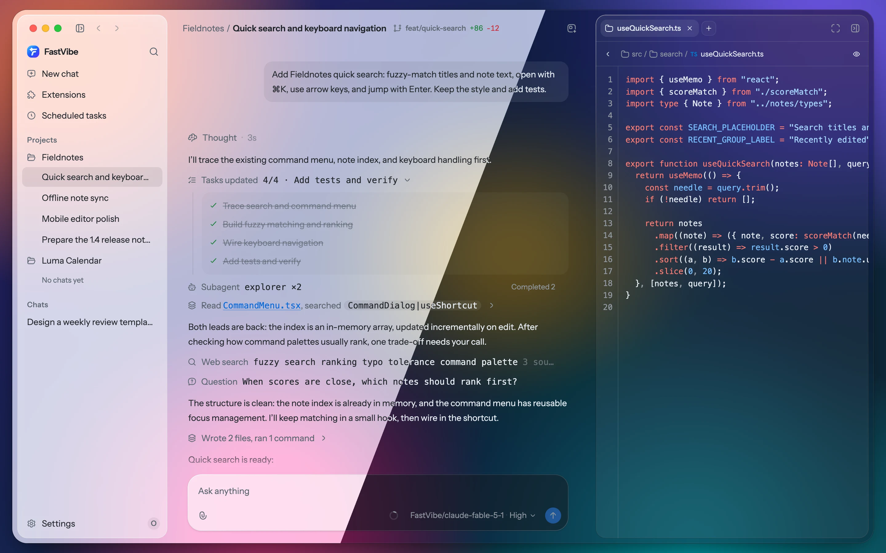

# FastVibe

[中文 README](README.zh-CN.md) · English README

[](LICENSE)
[](https://www.electronjs.org/)
[](https://github.com/badlogic/pi-mono)
[](https://github.com/tyuan511/fastvibe/releases/latest)

> A desktop AI agent workspace built on **pi coding agent**.

FastVibe embeds pi coding agent in an Electron desktop app, bringing conversations, tool calls, extensions, and project workspaces into one interface.



## Download

Download the latest installer from [GitHub Releases](https://github.com/tyuan511/fastvibe/releases/latest):

- macOS: `.dmg` or `.zip`
- Windows: `.exe`
- Linux: `.AppImage` or `.deb` (x64 and arm64)

## Features

- Native pi SDK support for conversations, tool calls, and pi extensions.
- Multi-project workspaces with archived chats, branches, attachments, and isolated scratch workspaces.
- Visual tool calls, edit diffs, terminal output, and reasoning.
- Goal mode for long-running objectives.
- FastVibe and OpenAI-compatible providers, model protocol settings, and OAuth login.
- MCP, skills, todos, subagents, Git worktrees, and usage statistics.
- Optional Jev decision engine for browser control, computer control, and batch decisions.
- Optional long-term memory, after Codex: finished conversations are distilled into local Markdown files, and the agent reads them on demand.
- File preview, terminal, browser use, computer use, and Git review side panes.
- Remote web / mobile clients and SSH connections to headless Linux Agents.
- Themes, UI scaling, customizable shortcuts, and automatic updates.

## Decision engine (Jev)

Settings → Decision engine can put **Jev (TypeSafe)** behind a set of “what happens next” judgements, applied per scenario (each with its own switch):

| Scenario | What it does |
| --- | --- |
| Browser control | The decision model drives clicking and typing in the browser (`browser_task`) |
| Computer control | The decision model drives operations in desktop windows (`computer_task`) |
| Batch decisions | The main agent gains the `batch_decide` tool |

When it is off every scenario takes its default path: the main model calls `browser_*` / `computer_*` directly. Jev serves decision scenarios only — it is not a chat model and never appears in the model list. Its API key stays on this machine and is never handed back to the renderer.

## Long-term memory

Settings → Memory is one switch, off by default. When it is on, a conversation that has been quiet for six hours is distilled by the model into a note and a recap, using Codex's own prompts; a background agent then consolidates them into a handbook (`MEMORY.md`) and a compact summary (`memory_summary.md`). Each turn the agent is shown the summary and reads the handbook and recaps on demand. Everything is Markdown on this computer, can be opened from the settings page, and is cleared with one button; turning the switch off stops reading, writing and injecting. Secrets are redacted before anything is stored. See `docs/memory.md`.

## Relationship with pi

FastVibe uses the `@earendil-works/pi-coding-agent` SDK and stores runtime data in its own userData directory. It never reads or writes the user's native `~/.pi` directory.

Common pi UI APIs are mapped to the desktop UI:

| pi API | FastVibe UI |
| --- | --- |
| `ctx.ui.confirm` | Inline yes / no panel |
| `ctx.ui.select` / `input` / `questions` | Selection, input, and question forms |
| `ctx.ui.editor` | Multiline editor dialog |
| `ctx.ui.notify` | Notification |
| `ctx.ui.setStatus` / `setWidget` | Status row and composer widgets |
| `ctx.newSession` / `switchSession` | Create / switch conversations |

Extensions are installed through the SDK package manager into FastVibe's isolated directory. Terminal-only full-screen interaction such as `ctx.ui.custom()` is not supported; extensions should use `select`, `confirm`, `input`, `editor`, or `questions` instead.

## Development

Requirements: **Node.js 24** and **pnpm 11**. macOS, Windows, and Linux are supported.

```bash
pnpm install
pnpm dev          # start electron-vite
```

Useful commands:

```bash
pnpm typecheck    # type-check the project
pnpm test         # run tests
pnpm sync:models  # update the models.dev snapshot
pnpm build        # build to out/
pnpm dist:mac     # package macOS (also dist:win / dist:linux)
```

Browser preview:

```bash
pnpm exec vite src/renderer --config vite.config.ts
# open /mock.html?theme=dark
```

## Data and privacy

Runtime data is stored in FastVibe's own userData directory:

| Platform | Directory |
| --- | --- |
| macOS | `~/Library/Application Support/FastVibe/` |
| Windows | `%APPDATA%\\FastVibe\\` |
| Linux | `~/.config/FastVibe/` |

Provider credentials stay in the isolated runtime and are injected into the SDK's in-memory authentication storage. They are not exported to the user's login shell or the in-app terminal. Browser login cookies are stored only in FastVibe's isolated browser session, and long-term memory lives as Markdown files in the local `runtime/engine/memories`. While memory is on, finished conversations are sent to your configured model to be distilled.

## Project structure

```text
src/main/       Electron main process, IPC, embedded Agent, and remote services
src/agent/      headless FastVibe Agent
src/preload/    contextBridge API
src/renderer/   React UI
src/shared/     IPC, App Protocol, and shared types
resources/      bundled extensions, skills, and model resources
```

## License

[MIT](LICENSE) © 2026 FastVibe
