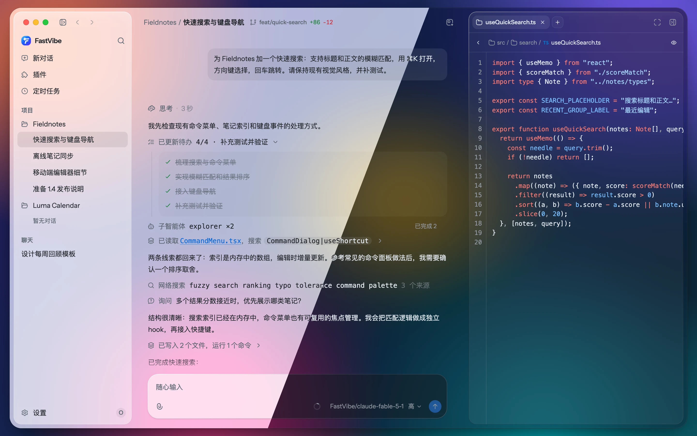

# FastVibe

[English README](README.md) · 中文 README

[](LICENSE)
[](https://www.electronjs.org/)
[](https://github.com/badlogic/pi-mono)
[](https://github.com/tyuan511/fastvibe/releases/latest)

> 基于 **pi coding agent** 的桌面智能体工作台。

FastVibe 将 pi coding agent 嵌入 Electron 主进程，把会话、工具调用、扩展和项目工作区整合到一个桌面界面中。



## 下载

前往 [GitHub Releases](https://github.com/tyuan511/fastvibe/releases/latest) 下载对应平台的安装包：

- macOS：`.dmg` 或 `.zip`
- Windows：`.exe`
- Linux：`.AppImage` 或 `.deb`（x64 与 arm64）

## 功能

- 基于原生 pi SDK，支持会话、工具调用和 pi 扩展。
- 多项目工作区，支持会话归档、分支、附件和隔离的 scratch 工作区。
- 工具调用、编辑 diff、终端输出、思考过程可视化。
- 目标模式，用于长期任务。
- 支持 FastVibe、OpenAI 兼容供应商、模型协议配置和 OAuth 登录。
- 支持 MCP、技能、待办、子 Agent、Git worktree 和用量统计。
- 可选决策引擎 Jev，用于浏览器操控、电脑操控和批量决策。
- 可选长期记忆（参考 Codex）：把已结束的对话整理成本地 Markdown 文件，智能体按需读取。
- 集成文件预览、终端、浏览器操控、电脑操控和 Git 审查侧栏。
- 支持远程网页 / 手机客户端，以及通过 SSH 连接远程 Linux Agent。
- 多主题、界面字号、自定义快捷键和自动更新。

## 决策引擎（Jev）

设置 → 决策引擎 可以选择用 **Jev（TypeSafe）** 承担一批「下一步做什么」的判断，逐步应用于以下场景（各自独立开关）：

| 场景 | 作用 |
| --- | --- |
| 浏览器控制 | 浏览器里的连续点击和输入交给决策模型（`browser_task`） |
| 电脑控制 | 桌面窗口里的操作交给决策模型（`computer_task`） |
| 批量决策 | 主 Agent 获得 `batch_decide` 工具 |

关闭时各场景都走默认路径：主模型直接调用 `browser_*` / `computer_*` 工具。Jev 只服务决策场景，不作为普通对话模型出现在模型列表里，API key 保存在本机，不会回传渲染层。

## 长期记忆

设置 → 长期记忆 只有一个开关，默认关闭。开启后，对话安静六小时后会由模型整理成一份笔记和一份回顾（提示词取自 Codex）；后台智能体再把它们汇总成手册（`MEMORY.md`）和一页摘要（`memory_summary.md`）。每轮对话开始时，智能体会看到这页摘要，需要细节时再去读手册和各对话的摘要。全部是本机上的 Markdown 文件，可以在设置页里打开文件夹，也可以一键清除；关掉开关就不再读取、写入和注入。写入之前会先抹掉其中的密钥。详见 `docs/memory.md`。

## 与 pi 的关系

FastVibe 使用 `@earendil-works/pi-coding-agent` SDK，并将运行数据保存在自己的 userData 目录中，不读写用户的 `~/.pi`。

常用的 pi UI API 已映射到桌面界面：

| pi API | FastVibe 呈现 |
| --- | --- |
| `ctx.ui.confirm` | 内联是 / 否面板 |
| `ctx.ui.select` / `input` / `questions` | 选择、输入和多问题表单 |
| `ctx.ui.editor` | 多行编辑对话框 |
| `ctx.ui.notify` | 通知 |
| `ctx.ui.setStatus` / `setWidget` | 状态行和输入框上方组件 |
| `ctx.newSession` / `switchSession` | 创建 / 切换会话 |

扩展通过 SDK 的包管理器安装到 FastVibe 的隔离目录。`ctx.ui.custom()` 等依赖终端全屏交互的能力暂不支持，建议使用 `select`、`confirm`、`input`、`editor` 或 `questions` 等语义化 API。

## 安装与开发

需要 **Node.js 24** 与 **pnpm 11**。macOS、Windows、Linux 均可开发与打包。

```bash
pnpm install
pnpm dev          # 启动 electron-vite
```

常用命令：

```bash
pnpm typecheck    # 类型检查
pnpm test         # 运行测试
pnpm sync:models  # 更新 models.dev 快照
pnpm build        # 构建到 out/
pnpm dist:mac     # 打包 macOS（另有 dist:win / dist:linux）
```

浏览器预览：

```bash
pnpm exec vite src/renderer --config vite.config.ts
# 访问 /mock.html?theme=dark
```

## 数据与隐私

运行数据保存在 FastVibe 自己的目录中：

| 平台 | 目录 |
| --- | --- |
| macOS | `~/Library/Application Support/FastVibe/` |
| Windows | `%APPDATA%\FastVibe\` |
| Linux | `~/.config/FastVibe/` |

供应商凭据保存在隔离运行时，并注入 SDK 的内存认证存储，不会导出到登录 shell 或应用内终端。浏览器登录 Cookie 只写入 FastVibe 自己的隔离浏览器会话。长期记忆以 Markdown 文件保存在本地的 `runtime/engine/memories`；开启期间，已结束的对话会发给你配置的模型做整理。

## 项目结构

```text
src/main/       Electron 主进程、IPC、内嵌 Agent 与远程服务
src/agent/      headless FastVibe Agent
src/preload/    contextBridge API
src/renderer/   React 界面
src/shared/     IPC、App Protocol 与共享类型
resources/      内置扩展、技能和模型资源
```

## 许可

[MIT](LICENSE) © 2026 FastVibe
