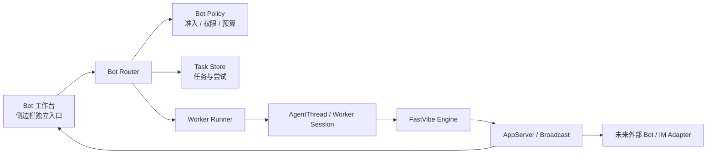
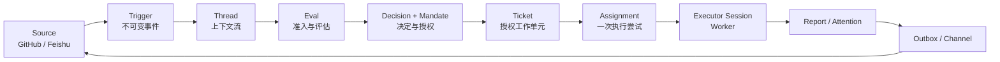
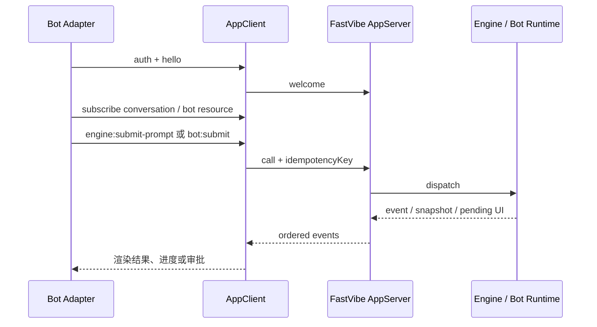
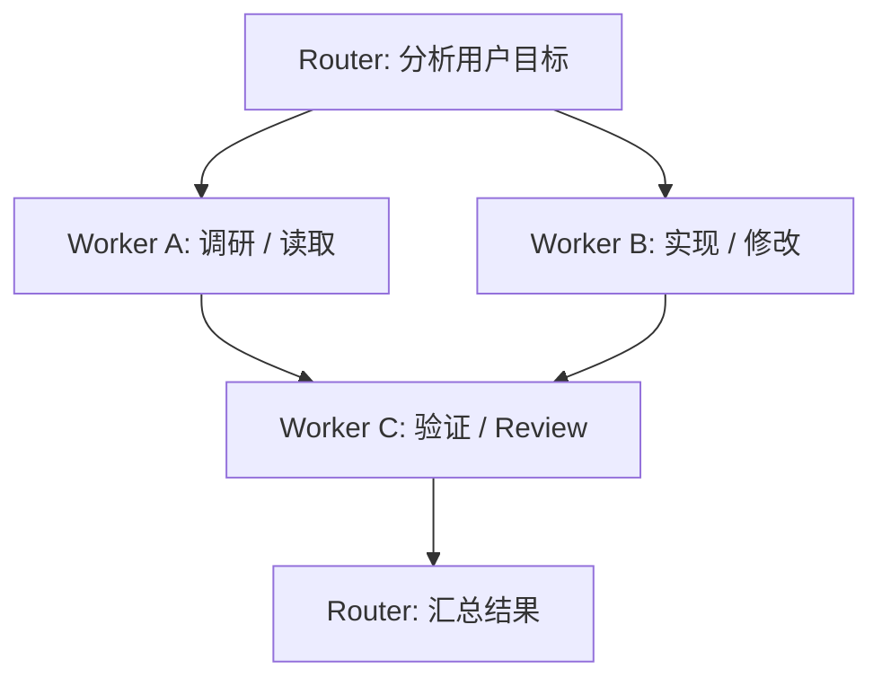
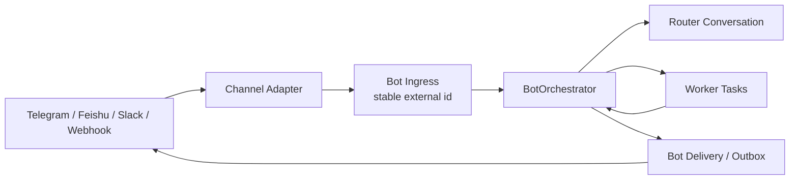

# Bot Router / Worker 架构调研

调研日期：2026-11-01  
目标仓库：[deepseek-ai/dsh-superagent-prototype](https://github.com/deepseek-ai/dsh-superagent-prototype)  
调研基线：`6337fc823ce20251c8de8085948165c81aaa701e`（`feat: add the dsh-superagent research prototype`）  
FastVibe 基线：当前工作树代码与 `AGENTS.md`

这份文档研究 dsh-superagent 的架构，并结合 FastVibe 后续要做的产品形态提出建议：Bot 作为侧边栏里的独立入口，交互接近 Muse；Bot 内部有一个主 Agent Router，根据用户请求拆分、分派和汇总多个 Worker。文档关注可复用的架构原则与 FastVibe 的落点，不建议直接复制目标仓库的业务代码。

## 1. 结论先行

建议把 Bot 设计成一个独立的产品工作台，但把它接在 FastVibe 已有的会话与 App Protocol 边界上：



核心建议如下：

1. **产品入口独立，运行时能力复用。** 侧边栏新增 Bot 工作台入口，Bot 有自己的 Router、任务列表和 Worker 详情，但不再造一套模型调用、权限请求、流式事件和会话恢复机制。
2. **Router 与 Worker 分工明确。** Router 负责理解目标、决定是否拆任务、选择 Worker、汇总结果和向用户提问；Worker 负责在明确的任务边界内读写文件、运行命令、调用工具和产出结果。
3. **每个用户请求都必须有可追踪的任务实体。** 不把任务生命周期藏在一次模型调用或 Promise 里。至少需要持久化 `BotRun`、`BotTask`、`BotTaskAttempt`、状态变更和幂等键。
4. **第一版不要直接实现完整的 Source / Trigger / Eval / Mandate 体系。** 侧边栏中的用户输入已经是显式请求，先实现内部 Bot Router；未来接入 Telegram、飞书、Webhook 等外部入口时，再把它们作为 Source/Ingress 适配器接入同一个 Bot Orchestrator。
5. **外部 Bot 使用 App Protocol，不直接调用 `PiProcessManager`。** FastVibe 已有传输中立的调用表、AppServer、事件游标、快照和权限队列，这些正是外部入口需要的基础设施。
6. **Bot 需要独立的窄权限身份。** 当前远程访问策略对持有远程凭据的客户端开放面较宽，不能直接把普通手机远程凭据当成 Bot 凭据。Bot 应有自己的 subject、能力集合、速率限制和撤销入口。

可以把目标架构理解为：

> Muse 负责 Bot 的产品形态；dsh-superagent 提供 Router / Worker / Task 生命周期的设计参考；FastVibe 的 App Protocol、会话快照、AgentThread、SQLite 和 IPC 表提供实现基础。

## 2.1 Muse 的产品形态：轻入口、长对话、后台工作

这里的 Muse 指 Meta 的个人 AI Agent。此次调研以 Meta 的设计说明 [How We Designed Muse](https://introducing.muse.ai) 和 Meta 的产品介绍 [Muse](https://ai.meta.com/muse) 为主要来源；搜索摘要和第三方文章只用于发现页面，不作为关键结论的唯一依据。

Muse 的产品重点不是把界面做成一个“任务管理后台”，而是让用户感觉自己在和一个会持续做事的个人 Agent 相处。官方设计说明里有几条和 FastVibe Bot 直接相关的原则：

- **一个主聊天承载连续关系。** Muse 选择一个长期主聊天，允许用户在上一轮还没结束时继续发送多个任务，也允许打断正在进行的工作；复杂主题再用 side chat 分开上下文。
- **后台工作与前台聊天分离。** 用户可以设定目标或任务后离开，Agent 继续在后台工作；回来时看到的是有意义的结果、需要处理的事项或简短的活动线索，而不是所有内部 token 和工具日志。
- **透明度通过活动和目标提供。** 头像/状态入口能展开完整 activity log 和已批准权限；Goals 视图专门展示长期目标、计划和进度，让用户可以直接操作，也可以回到聊天继续说。
- **关键动作使用确定性 UI。** 对购买、发邮件、数据分享等不可逆或高风险操作，Muse 使用明确的 Approval Card，而不是让用户从一段自然语言里猜哪里需要点击。
- **结果以 Artifact 呈现。** 行程、追踪器、交互式学习资料、仪表盘和文件等成果不应该全部压缩成一段文本；它们可以从聊天里产生，并在聊天之外继续使用。
- **主动消息需要有高门槛。** 当 Agent 可以在用户没有刚刚提问时主动发消息，消息必须足够有价值，值得打断用户；默认要安静，用户再决定是否调高或调低主动性。
- **头像、名字和性格是产品入口的一部分。** Muse 的设计说明明确提到，长期与 Agent 相处时，用户更容易把它当作一个有名字和风格的对象，而不是企业 Logo。

对 FastVibe 的直接启发是：Bot 页应该从一个很轻的 Router 对话开始，任务、活动、审批和产物作为必要时展开的辅助面，而不是打开就看到一棵复杂的 DAG。内部可以有 Router、Task 和 Worker，用户第一眼只需要看到“我交给 Bot 的事情、它现在做到哪里、我需要做什么”。

### 2.2 Grok Bot 的产品形态：多个有名字的专业 Bot 组成团队

这里的 Grok Bot 指 xAI 的官方产品页 [Grok Bot](https://x.ai/bot) 和发布说明 [Introducing Grok Bot](https://x.ai/news/introducing-grok-bot) 所描述的 AI teammate 产品，而不是普通 Grok 聊天入口。

Grok Bot 对产品形态的侧重点与 Muse 不同：它不是一个单一的个人 Agent，而是一个可以长期保留多个专业 Bot 的团队工作台。官方页面展示了这些特征：

- **侧边栏直接列出多个 Bot。** Bot 有名字和职位，例如 Sales Outbound、Inbox Manager、Talent Scout、Expense Manager；用户从列表进入对应 Bot 的线程。
- **Bot 像同事一样被交代工作。** 产品文案强调从手机或桌面像给同事发消息一样交办任务，Bot 自己使用已登录的工具和应用，完成后回来汇报。
- **多个 Bot 可以并行工作。** 用户可以同时维护多个专业 Bot，甚至让一个 Chief/Chief of Staff 类型的 Bot 协调其他 Bot；Bot 之间共享项目上下文、互相交接，也可以在同一个群组线程里协作。
- **Bot 是长期实体，不是一次性模型角色。** 每个 Bot 有自己的名字、工作、上下文、记忆和分享关系；用户逐渐建立信任，Bot 会学习语气、边界和何时需要提醒。
- **Routine 来自一次示范。** 用户可以让 Bot 旁观一次工作流程，Bot 把它保存成 Routine，之后按计划或再次触发时自己运行。产品因此把“教一次，重复执行”作为入口，而不是要求用户先搭一个工作流。
- **结果落在真实工具里。** Bot 的价值标准是把工作真正落到 CRM、邮箱、工单、代码或其他用户日常工具中；它只在需要判断或审批时把人拉回来。
- **长期共享工作空间。** 官方 FAQ 说明多个 Bot 可以共享一个持久云端电脑，因此文件、浏览器登录和上下文可以在 Bot 之间继续传递。这个设计不等于 FastVibe 必须共享一个真实工作目录，但说明 Bot 间协作需要明确的共享资源和权限模型。

对 FastVibe 的启发是：如果未来用户确实需要“多个 Bot”，侧边栏可以展示 Bot Profile，而不是展示内部 Worker；Worker 是 Bot 的执行细节。Bot 之间的协作可以先由 Router 编排，后续再开放 Bot-to-Bot thread 或 handoff，避免用户成为复制粘贴的中间人。

### 2.3 Muse 与 Grok Bot 的共性、差异和 FastVibe 取舍

| 维度 | Muse | Grok Bot | FastVibe 建议 |
| --- | --- | --- | --- |
| 第一入口 | 一个个人 Agent 的主聊天 | 多个有名字、有职位的 Bot 列表 | 第一版采用一个默认 Bot + 极简主聊天；数据模型预留多个 BotProfile |
| 任务表达 | 连续聊天里直接发送多个任务 | 给某个专业 Bot 交办工作 | Router 支持连续输入，必要时把请求路由到 Worker profile |
| 后台工作 | 长期目标、事件和计划驱动 | 24/7、多 Bot 并行、Routine 驱动 | `BotRun` / `BotTask` / `Attempt` 持久化，调度和事件分开 |
| 透明度 | Activity log、Goals、权限列表 | Bot 线程、状态、真实工具结果 | 默认只显示摘要；展开看活动、任务和 Worker transcript |
| 高风险操作 | Approval Card | Approval / Auto Review | 复用 pending UI，但为不可逆动作提供结构化审批卡 |
| 产物 | Artifacts，适合交互式结果 | 落在真实工具和业务系统 | 复用文件、Git、Diff 和资源面板，逐步增加结构化 Artifact |
| 协作方式 | 一个 Agent 管多任务，side chat 分上下文 | 多个专业 Bot 互相交接 | 内部先 Router → Worker；Bot-to-Bot 作为后续协议能力 |
| 用户心智 | “我有一个会主动帮我的 Agent” | “我有一支 AI 小团队” | 先做一个轻入口，底层支持扩展成 AI 小团队 |

这两个产品共同说明了一件事：用户看到的不是 Router、DAG、Effect 或 AgentThread，而是一个有身份的工作对象和一条低负担的交互路径。它们的差异则提示我们不要过早锁死产品形态：

- 如果产品重点是个人长期协作，主界面应该像 Muse，保持一个默认 Bot、一个长对话和少量可展开状态；
- 如果产品重点是可分工的专业团队，侧边栏应该像 Grok Bot，允许多个 Bot Profile 作为不同工作入口；
- 这两种 UI 可以共享同一套底层 `BotProfile`、`RouterConversation`、`BotRun`、`BotTask` 和 `BotTaskAttempt`，只是第一版隐藏或展示的层级不同；
- 因此底层应该先支持多 Bot 和多 Worker，产品首版却可以只露出一个默认 Bot，等真实任务证明需要更多入口后再开放 Bot 列表。

### 2.4 形态结论：简洁表面，丰富但可收起的运行时

结合 Muse、Grok Bot 和 dsh-superagent，建议 FastVibe 的 Bot 工作台采用三层渐进披露：

```text
第一层：Bot 主聊天
  用户交代目标、补充要求、回答问题、接收最终结果

第二层：Bot 状态入口
  头像/名称旁显示“正在做什么”“等待你处理”“最近完成”
  点击后查看 activity、审批、Goals/任务摘要

第三层：任务与 Worker 详情
  展开某个任务后查看依赖、Attempt、日志、文件、Diff、产物和完整 Worker transcript
```

初始页面不建议画出固定的三栏任务管理器，也不建议把每个 Worker 的思考和工具调用持续刷进主聊天。主聊天只接收：

- 用户请求和 Router 的简短确认；
- Router 需要用户决定的问题；
- 有意义的状态变化；
- 结构化的任务结果和 Artifact 链接。

后台活动、完整执行日志和任务图通过状态抽屉、Goals/Tasks 页面或任务详情查看。这样可以同时满足 Muse 的轻量入口和 dsh-superagent 对可恢复执行、审计、报告的要求。

### 2.5 调研边界

Muse 和 Grok Bot 的公开资料主要是产品介绍、设计文章和演示页面，不能证明其内部实现细节，也不能把宣传中的云端隔离、模型能力或后台稳定性直接当成工程事实。本文只把公开页面中可观察到的交互和产品概念用于 FastVibe 的取舍，并将持久化任务、权限、事件恢复和 Worker 生命周期单独按 FastVibe 的现有代码约束设计。

参考页面：

- [Meta Muse](https://ai.meta.com/muse)
- [How We Designed Muse](https://introducing.muse.ai)
- [Grok Bot](https://x.ai/bot)
- [Introducing Grok Bot](https://x.ai/news/introducing-grok-bot)
- [Grok Bot Marketplace](https://x.ai/bot/marketplace)

## 2. 目标仓库是什么

[dsh-superagent-prototype](https://github.com/deepseek-ai/dsh-superagent-prototype) 明确声明自己是研究原型，而不是官方产品或生产就绪实现。[README](https://github.com/deepseek-ai/dsh-superagent-prototype/blob/6337fc823ce20251c8de8085948165c81aaa701e/README.md) 描述的产品是一个面向单个 GitHub 仓库的主动式 coding agent，也可以接入 Feishu：它监听外部事件，在获得授权后创建工作项，为每个工作项启动自己的 Agent Session 和工作目录，并将确认、进度、结果发回原始对话。

它最值得借鉴的地方不是 GitHub 或 Feishu 的具体实现，而是把“收到消息”和“启动一个可恢复的执行任务”拆开了：



目标仓库的官方文档入口：

- [000 Philosophy](https://github.com/deepseek-ai/dsh-superagent-prototype/blob/6337fc823ce20251c8de8085948165c81aaa701e/docs/000-philosophy.md)
- [001 Domain model](https://github.com/deepseek-ai/dsh-superagent-prototype/blob/6337fc823ce20251c8de8085948165c81aaa701e/docs/001-domain.md)
- [002 Authorization](https://github.com/deepseek-ai/dsh-superagent-prototype/blob/6337fc823ce20251c8de8085948165c81aaa701e/docs/002-authorization.md)
- [003 Execution](https://github.com/deepseek-ai/dsh-superagent-prototype/blob/6337fc823ce20251c8de8085948165c81aaa701e/docs/003-execution.md)
- [005 Panel](https://github.com/deepseek-ai/dsh-superagent-prototype/blob/6337fc823ce20251c8de8085948165c81aaa701e/docs/005-panel.md)
- [007 Architecture](https://github.com/deepseek-ai/dsh-superagent-prototype/blob/6337fc823ce20251c8de8085948165c81aaa701e/docs/007-architecture.md)
- [008 Cookbook](https://github.com/deepseek-ai/dsh-superagent-prototype/blob/6337fc823ce20251c8de8085948165c81aaa701e/docs/008-cookbook.md)

## 3. dsh-superagent 的关键架构

### 3.1 Runtime 是组合根，不承载业务规则

`src/app/runtime.ts` 负责锁定状态目录、打开 SQLite、构造各个服务、启动与停止后台循环。它组装：

- `Store`：SQLite 持久化；
- `Engine`：领域状态的唯一写入者；
- `SourceRegistry`：Source 类型和实例；
- `MasterAssessor`：让主 Session 评估候选请求；
- `DshExecutor`：创建和运行 Worker Session；
- `Effects`：提交后的持久化副作用队列；
- `Outbox`：可靠的出站消息；
- `Sessions`：Router 与 Worker Session 生命周期；
- `Passes`：周期性推进 Eval、Effect 和恢复逻辑。

这使得启动、停止、恢复、重试等横切逻辑集中在 Runtime，而不是散落在各个 Source 或 UI 入口中。

FastVibe 可以借鉴这个组合根思路，但不建议把 Bot 逻辑继续堆进已经很大的 `PiProcessManager`。更合适的是新增一个窄的 `BotRuntime` / `BotOrchestrator`，由它持有 Bot Store、Router、Worker Runner 和效果队列，并通过 Host 接口调用已有引擎。

### 3.2 Engine 是领域状态的唯一写入者

`src/core/engine.ts` 把领域写入集中在一个入口，内部拆成：

- `Intake`：接收 Trigger，去重、挂到 Thread、扇出给已有 Ticket；
- `Evals`：对新请求做准入和评估；
- `Tickets`：管理授权工作单元及其订阅；
- `Assignments`：管理某个 Ticket 的执行尝试和 Worker 报告；
- `Replies`：生成确认、回复和结果消息。

调用者拿到的是按角色裁剪后的接口：Source、主 Session、人工操作、Settings、Executor 各自只看到自己能做的事情。这一点很适合 Router/Worker 架构：Router 不应该拿到 Worker 的全部控制权，Worker 也不应该能修改全局策略或随意创建别的工作。

### 3.3 Router 是主 Session，Worker 是 Executor Session

目标仓库里的主 Session 使用 `dsh-superagent-router` preset，职责是：

- 阅读候选请求和有限上下文；
- 评估是否应该启动工作；
- 接受、忽略、停止或把请求附加到已有 Ticket；
- 收到 Worker 报告后决定下一步；
- 向人提问或发出最终结果。

主 Session 被明确要求不要长时间等待。候选、Worker 报告、后续消息和后台作业结果会通过 relay/notice 重新送入它。

每个 Ticket 得到一个独立的 Worker Session 和执行目录。Worker 只获得完成该 Ticket 所需的工具和资源，Ticket 结束后工具会被限制。Worker 可以报告：

- `progress`：仍在工作；
- `waiting`：本轮完成，等待新输入；
- `ready`：结果已经可以交付或审查；
- `blocked` / `failed`：需要人处理或重试；
- `dropped`：没有需要继续做的工作。

这给 FastVibe 的 Bot Router 一个清晰的基本模型：

| dsh-superagent | FastVibe Bot 建议映射 |
| --- | --- |
| Main Session / Orchestrator | Bot Router Session |
| Ticket | BotTask / 用户可见任务 |
| Assignment | BotTaskAttempt / 一次 Worker 执行 |
| Executor Session | AgentThread 对应的 Worker Session |
| Report / Attention | Worker 状态、进度、问题和审批卡片 |
| Outbox | Bot 工作台事件，以及未来外部渠道发送队列 |
| Source | 侧边栏、定时任务、外部 IM/Webhook 等输入适配器 |

### 3.4 Effects 与 Outbox 把副作用移到提交之后

`src/app/effects.ts` 是 SQLite-backed 的持久副作用队列。领域命令在事务里只负责写状态和 enqueue effect；事务提交之后才执行真正的模型调用、Session relay、Worker launch 或外部发送。

它提供：

- 每种 Effect 独立的并发上限；
- 按 key 合并重复等待项；
- 指数退避；
- `Later` 表示暂时不能执行，不把它记成真正失败；
- 关闭时停止启动新任务，但保留 SQLite 中未完成的行；
- health 状态和连续失败统计。

`src/app/outbox.ts` 则负责外部回复：消息先以 receipt 落库，再由 `reply` effect 发送。相同 Ticket 到同一会话的消息保持顺序，发送失败可重试，目标永久消失时记为 dropped。

这比“模型结束后直接调用发送 API”可靠得多。对 FastVibe Bot，至少要保证：

1. 用户请求被接受、任务被创建、Worker 被启动之间可以跨进程重启恢复；
2. 用户看到的确认、进度、问题和结果不会因为窗口关闭而消失；
3. 外部渠道重试时不会重复发送同一条结果；
4. 一个 Worker 失败不会让其他任务的结果丢失。

### 3.5 Source 是可扩展入口，而不是把渠道逻辑写进核心

`src/sources/kind.ts`、`src/sources/registry.ts` 和 `docs/008-cookbook.md` 共同定义了 Source 扩展协议。一个 Source 负责：

- 配置 schema、设置字段和健康状态；
- 把原生事件翻译成稳定 ID 的 Trigger；
- 判断事件是否属于监听范围；
- 提供 Thread 上下文读取；
- 提供幂等 Channel 发送；
- 声明允许哪些人或 Bot 触发工作；
- 保存自己的 cursor；
- 以可取消、可报告健康状态的 loop 运行。

需要特别借鉴的是三个稳定性规则：

- **Trigger ID 必须稳定。** 轮询重叠、断线重试和重启不能重复创建任务；
- **Channel 地址必须包含未来发送所需的全部信息。** 不能依赖当前内存里的“活动会话”；
- **cursor 只能在所有事件成功入库之后前进。** 中途崩溃时重新读取是安全的，因为 Trigger 有稳定 ID。

但侧边栏 Bot 的用户输入已经是本地显式请求，第一版不需要强行套完整 Eval。未来外部入口出现后，再把它们接到同一个规范化入口即可。

## 4. dsh-superagent 的授权与恢复设计

### 4.1 准入和执行授权是两件事

目标仓库把“谁可以让系统开始工作”和“已经开始的工作能做什么”分开：

- Gate 判断请求是 `explicit`、`inferred` 还是不允许进入；
- Eval 让 Router/模型结合规则和上下文评估候选；
- Decision 记录接受、忽略、停止或不可用；
- Mandate 记录接受时依据的 Policy 版本、范围、发送者和匹配规则；
- Ticket 在 Mandate 约束下执行。

这避免了“模型在一段自由文本里说可以做，所以系统就做”的问题。对 FastVibe Bot，侧边栏直接输入可以默认为 explicit，但仍需要一层确定性的 Bot Policy：

- 允许使用哪些项目或工作目录；
- 允许哪些 Worker 类型；
- 单个任务的并发数、模型预算和最长运行时间；
- 哪些工具需要用户审批；
- Router 能否创建子任务、改变任务优先级或停止其他任务；
- 外部入口能否发起新任务，还是只能继续已有任务。

模型可以提出计划，不能单独授予自己权限。

### 4.2 Ticket 独立于 Session 状态

目标仓库明确拒绝“Ticket 状态跟着 Agent Session 走”。原因是：

- Worker Session 可能重启、被替换或被人工继续；
- 一个 Ticket 可能有多个 Assignment；
- Assignment 失败不必然代表 Ticket 结束；
- 人的 follow-up 可以让已结束任务恢复；
- Policy 变化需要通知任务，而不是粗暴杀掉任务。

FastVibe 现有 `AgentThread` 已经有类似基础：`queued`、`working`、`waiting`、`completed`、`failed`、`interrupted`、`closed`，并且 `AgentThreadStore.recoverAfterRestart()` 会把重启时仍在运行的线程标成 `interrupted`。

不过 `AgentThread` 目前更像“子 Agent 的可观察线程”，还不是完整的长期任务领域对象。Bot 需要在它之上增加任务层，不能仅靠 `AgentThread.status` 代表全部业务状态。

### 4.3 关注点优先于健康状态

目标仓库的 Panel 不是把所有运行指标都铺在页面上，而是优先回答：

1. 现在有什么需要人处理？
2. 系统是否健康、是否在按规则工作？
3. 某件工作从触发到执行的完整历史是什么？

这很适合 Muse 风格的 Bot 工作台。健康的 Worker 不需要长期占据视觉空间；需要用户处理的状态才应该变成明显的卡片：等待审批、失败可重试、需要补充信息、结果待验收。

## 5. FastVibe 当前可复用的基础

### 5.1 App Protocol 已经是正确的外部边界

FastVibe 的 [App Server 协议文档](app-server-protocol.md) 明确把自己定义为第三方桌面端、移动端和自动化客户端的接入协议。已有组件包括：

- [`src/main/ipc/registry.ts`](../src/main/ipc/registry.ts)：传输中立的调用表；
- [`src/main/ipc/broadcast.ts`](../src/main/ipc/broadcast.ts)：传输中立的推送总线；
- [`src/main/app-server/app-server.ts`](../src/main/app-server/app-server.ts)：握手、能力、调用、幂等、取消和分发；
- [`src/main/app-server/client-session.ts`](../src/main/app-server/client-session.ts)：订阅、事件批处理、游标和重放；
- [`src/main/app-server/event-bus.ts`](../src/main/app-server/event-bus.ts)：有界事件保留；
- [`src/shared/app-client.ts`](../src/shared/app-client.ts)：可复用的 App Protocol 客户端；
- [`src/shared/app-protocol.ts`](../src/shared/app-protocol.ts)：线协议、能力、scope、cursor 和 event envelope。

因此未来外部 Bot 的正确路径是：



外部 Bot 不应：

- 直接 import 或调用 `PiProcessManager`；
- 直接写 `MessageQueueStore`；
- 直接监听原始 `broadcast`，自己重新实现游标和恢复；
- 在 `RemoteGateway` 里增加 Bot 特殊路由；
- 复用 Electron 原生通知作为 Bot 交付机制。

### 5.2 Prompt、Snapshot 和 Pending UI 已经适合 Bot 客户端

Bot 发送消息时应始终带显式 `conversationId`，避免不同窗口或不同 Bot 任务之间使用共享的 `#activeId`。

对于聊天式输入，优先使用 `engine:submit-prompt`，因为它能保留 FastVibe 已有的直接提交、steer/follow-up、预览和持久队列语义。调用成功只表示“服务端接受了请求”，不表示 Agent 已完成；完成、错误、流式内容和需要用户回答的请求都要从事件中观察。

Bot 重新连接时应：

1. 先订阅具名的 `conversation:<id>` scope；
2. 再读取 `engine:get-snapshot`；
3. 用 snapshot 的 `messages`、`running`、`pendingUi`、`turnEvents` 和 `queue` 重建界面；
4. 用 App Protocol 的 `{ epoch, seq }` 丢弃快照之前的事件；
5. 收到 `resync` 时放弃增量状态，重新读取 snapshot。

要遵守 FastVibe 当前快照语义：`messages` 已经包含进行中的回复，不能再把 `message_update` delta 追加一次，否则会重复绘制。

### 5.3 FastVibe 已有 Worker 基础，但需要补任务层

当前可复用的基础包括：

- [`src/shared/agent-thread.ts`](../src/shared/agent-thread.ts)：Worker 线程状态和消息类型；
- [`src/main/engine/agent-thread-store.ts`](../src/main/engine/agent-thread-store.ts)：线程和消息的 SQLite 存储；
- [`src/main/pi/process-manager.ts`](../src/main/pi/process-manager.ts)：已有 `spawnAgent`、`sendAgentMessage`、`followupAgent`、`waitAgents`、`interruptAgent` 等宿主能力；
- [`src/main/pi/process-manager-subagent.ts`](../src/main/pi/process-manager-subagent.ts)：子 Agent 的 Session 创建、事件转发、模型和工具绑定；
- [`src/shared/subagent-state.ts`](../src/shared/subagent-state.ts)：子 Agent 状态归并；
- [`src/main/engine/scheduled-tasks.ts`](../src/main/engine/scheduled-tasks.ts)：持久化调度、运行记录和 claim/finish 语义；
- [`src/main/engine/message-queue.ts`](../src/main/engine/message-queue.ts)：按会话持久化的用户消息队列。

当前缺口是：这些能力主要围绕“一个主对话里的子 Agent”组织，尚未形成独立的 Bot Task / Router 领域。Bot 不应把所有状态继续塞进 `Conversation`、`AgentThread` 或内存 Map，而应增加一个拥有任务生命周期的服务。

## 6. 推荐的 FastVibe Bot 产品模型

### 6.1 侧边栏形态

第一版 Bot 入口应保持 Muse 式简洁：侧边栏只提供一个清晰的 Bot 入口，进入后首先看到一个主聊天和一个轻量状态入口。任务、Worker、活动日志和产物按需展开，不把内部编排结构直接铺在首屏。

推荐的首屏形态：

```text
FastVibe sidebar
├── 新对话
├── Bot
│   └── 我的 Bot
├── 项目
│   ├── Project A
│   └── Project B
└── 设置

Bot 工作台
┌──────────────────────────────────────┐
│ 我的 Bot                 正在处理 2 件事 │
│                                      │
│  Router 主聊天                        │
│  用户目标、补充信息、结果和问题          │
│                                      │
│  [查看活动] [查看任务] [查看产物]        │
│                                      │
│  ┌────────────────────────────────┐  │
│  │ 输入你希望 Bot 完成的事情…      │  │
│  └────────────────────────────────┘  │
└──────────────────────────────────────┘
```

点击 Bot 后进入独立工作台：

- 中间首先是 Router 主聊天，用户可以连续交代多个目标，不必等待上一项结束；
- Bot 名称/头像附近只显示一条简短的当前状态，例如“正在整理 3 个文件”或“有 1 个问题等你处理”；
- 活动、Goals/Tasks、审批和产物通过抽屉、弹层或详情页展开；
- 任务详情里再查看 Worker、Attempt、依赖、日志、文件、Diff 和完整 Worker transcript；
- 运行中的任务可以单独停止、重试或继续；
- Router 的最终回复负责把多个 Worker 的结果汇总给用户。

如果后续需要多个专业 Bot，可以把侧边栏逐步扩展为 Grok Bot 式的 Bot 列表：每个 Bot 有名字、头像、职责和独立上下文。但这不应阻塞第一版，底层先支持多个 `BotProfile`，界面先只显示一个默认 Bot。

第一版不需要在侧栏或主聊天中暴露 dsh-superagent 的内部术语。用户看到的是“正在做什么、需要我处理什么、完成了什么”；内部仍可使用 Trigger、Task、Attempt、Worker 等稳定模型。

首屏需要坚持三条规则：

1. 不把 DAG 作为默认视觉中心；
2. 不把每个 Worker 的思考和工具调用持续刷进主聊天；
3. 不把健康指标和执行细节放在用户必须阅读的位置。

只有用户点击查看活动、任务或产物时，才逐级展开更多信息。这一层次与 Muse 的主聊天、Activity、Goals、Approval Card、Artifact 组合一致，也保留了 Grok Bot 后续扩展为多个有名字工作对象的空间。

### 6.2 Bot Profile、Router Conversation 和 Bot Run

推荐把三层对象分开：

| 对象 | 作用 | 是否长期存在 |
| --- | --- | --- |
| `BotProfile` | Bot 名称、模型、系统提示词、Worker 能力、并发与预算策略 | 是 |
| `RouterConversation` | Router 与用户持续对话的 transcript；保存目标、补充信息和汇总结果 | 是 |
| `BotRun` | 一次用户目标从接收、规划到完成的工作流 | 是，直到归档 |
| `BotTask` | Router 为一个 Run 创建的可执行工作单元 | 是 |
| `BotTaskAttempt` | 一个 Task 的某次 Worker 执行、重试或恢复尝试 | 是 |
| `AgentThread` | Task 对应的 Worker 运行线程与消息视图 | 是，作为执行载体 |

`RouterConversation` 可以复用 FastVibe 的 Conversation transcript 和 snapshot 机制，但应有明确的 Bot 标识，例如新增 `botId` / `botRouter` 语义。不要把它伪装成普通项目会话后再靠标题区分，也不要复用 `side-chat` 的隐藏语义作为长期方案。

一种低风险的迁移路径是：

1. 第一版复用 Conversation 的 transcript、`engine:submit-prompt`、pending UI 和 snapshot；
2. 为其增加 `kind: "bot-router"` 或等价的 Bot 归属字段，并从普通项目会话列表中独立过滤；
3. 通过 `BotWorkspaceSnapshot` 把 Router snapshot 与任务树一次性提供给 Bot 页面；
4. 后续再决定是否把 Router transcript 从普通 Conversation 表中抽成独立 Bot Session。

### 6.3 Router 的职责与工具

Router 不应该只是一个拥有所有工具的“大模型”。建议给 Router 一个窄而稳定的工具面：

- `bot_read_context`：读取当前 Bot、Run、项目和已有任务的摘要；
- `bot_create_task`：创建一个带目标、范围、优先级和 Worker profile 的任务；
- `bot_update_task`：补充任务说明或调整等待状态；
- `bot_send_task`：向运行中的 Worker 发送明确 follow-up；
- `bot_wait_tasks`：等待任务状态发生变化，或直接结束当前 Router 回合；
- `bot_stop_task`：停止单个任务；
- `bot_ask_user`：以结构化问题向用户提问；
- `bot_publish_summary`：在 Router 具备足够结果后生成最终汇总。

Router 可以拥有少量只读 workspace 工具，但不应默认拥有全部文件写入、终端和浏览器工具。执行动作应由 Worker 承担，Router 通过任务工具表达意图。

这对应目标仓库的做法：主 Session 负责路由和决策，Executor Session 负责实际工作；角色之间通过窄接口通讯，而不是共享一个万能上下文。

### 6.4 Worker 的职责与边界

一个 Worker 任务至少包含：

- 目标和验收标准；
- 项目或工作目录；
- 允许使用的工具；
- 所属 BotRun 和父任务；
- 模型与 thinking level；
- 最大运行时间、重试次数和资源预算；
- 是否允许创建子 Worker；
- 结果需要回传给 Router 的摘要格式。

Worker 的状态建议使用：

```text
queued
  -> running
  -> waiting_input
  -> review
  -> completed
  -> failed
  -> canceled
```

`interrupted` 作为恢复时的事实状态保留，但 UI 可以映射成“已中断，可恢复”。不要让 Worker 自己决定任务是否完成；它提交结构化 Report，由 Bot Orchestrator 根据任务状态和依赖关系结算。

### 6.5 任务依赖与并发

初版只需要支持一个 Run 下的并行任务和简单依赖：



任务图可以先保持轻量：`parentTaskId`、`dependsOn[]`、`status`、`priority` 和 `position` 就足够。不要第一版就引入通用 DAG 编辑器；用户需要的是工作结果和可控的任务状态，不是编排图本身。

并发规则建议：

- Bot Profile 有 `maxWorkers`；
- 用户直接继续一个等待中的任务时，可以使用一个额外的 human wake slot；
- 新任务在没有 slot 时排队；
- 一个任务重试只影响自己；
- 停止 Run 会取消仍未开始的任务，并向运行中的 Worker 发送 abort；
- 关闭应用后，任务状态先落盘，恢复策略由 `BotTaskAttempt` 决定。

### 6.6 产品表面与底层储备分离

Muse 和 Grok Bot 的共同经验是：复杂能力应该存在，但不应该要求用户先理解复杂能力。FastVibe 可以把“产品默认值”和“底层储备”分开：

| 现在可以保持简单的表面 | 底层提前保留的能力 |
| --- | --- |
| 侧边栏只显示一个默认 Bot | `BotProfile` 支持多个 Bot、名称、头像、职责和权限 |
| 首屏只有一个主聊天 | Router conversation、side context、外部 thread 映射 |
| 活动和任务默认收起 | activity event、Task snapshot、worker transcript、audit trail |
| 不显示 DAG | `parentTaskId`、`dependsOn[]`、优先级和可恢复状态 |
| 不要求用户配置 Routine | `ScheduledTask`、事件触发、幂等 ingress 和可复用 routine schema |
| 结果先以文本、文件和 Diff 返回 | `ArtifactRef`、结构化 Artifact、版本和预览能力 |
| 只有高风险动作弹审批 | 每个工具/动作带风险等级、policy 和 approval requirement |
| 一个 Router 负责分派 | Router → Worker、未来 Bot → Bot handoff 和共享上下文 |

这样做的意义是：产品团队后续可以在“单一个人 Agent”和“多个专业 Bot 团队”之间做选择，而无需推翻持久化模型、事件协议或 Worker 执行层。实现上先把能力建成稳定的内部合同，再决定哪些合同进入 UI。

## 7. 推荐的 FastVibe 运行时分层

建议增加以下模块，而不是把逻辑继续放入 `process-manager.ts`：

```text
src/main/bot/
  bot-runtime.ts          组合根与生命周期
  bot-model.ts            BotProfile / BotRun / BotTask / Attempt
  bot-store.ts            SQLite 读写与迁移适配
  bot-orchestrator.ts     Router 与任务状态机
  bot-router.ts           Router prompt、工具和输入输出
  bot-worker-runner.ts    AgentThread / subagent 适配
  bot-effects.ts          launch / delivery / report / notify 队列
  bot-policy.ts           工具、项目、并发、预算与审批策略
  bot-snapshot.ts         Bot 工作台的一致性快照
  bot-events.ts           本地 broadcast / App Protocol 推送
  bot-recovery.ts         重启恢复、超时、重试
```

### 7.1 BotRuntime

`BotRuntime` 负责构造和关闭 Bot 子系统：

- 读取 Bot Profile；
- 打开已有 `fastvibe.db`；
- 初始化 Store、Orchestrator、Router、Worker Runner；
- 注册 Effect handler；
- 恢复 `queued` / `running` / `waiting_input` 的 Run 与 Task；
- 在退出时停止新任务、等待可安全结束的 Worker，并保留未完成状态。

它可以由 `PiProcessManager` 注入能力，但不应该让 `PiProcessManager` 反过来知道 Bot 的全部业务规则。

### 7.2 BotOrchestrator

`BotOrchestrator` 是 Bot 领域的唯一写入口。它可以提供类似以下的窄接口：

```ts
type BotOrchestrator = {
  submitRequest(input: SubmitBotRequest): Promise<BotRun>;
  createTask(input: CreateBotTask): BotTask;
  taskReport(input: BotTaskReport): BotTask;
  sendTaskMessage(input: SendBotTaskMessage): Promise<BotTask>;
  stopTask(taskId: string, reason?: string): Promise<BotTask>;
  retryTask(taskId: string): Promise<BotTask>;
  stopRun(runId: string, reason?: string): Promise<BotRun>;
  snapshot(botId: string, runId?: string): BotWorkspaceSnapshot;
};
```

所有修改应遵循：

1. 校验当前状态和 Bot Policy；
2. 在一个 SQLite transaction 中更新领域状态、幂等记录和待执行 effect；
3. transaction 提交后才触发模型、Worker 或推送；
4. 将事件发布到对应 Bot / Run scope；
5. 返回新的领域对象或一致性 snapshot。

### 7.3 BotWorkerRunner

第一版可以包装现有的：

- `spawnAgent`；
- `sendAgentMessage`；
- `waitAgents`；
- `interruptAgent`；
- `getAgentThreadMessages`。

但接口应该隐藏当前 `PiProcessManager` 内部的 Map 和 Session 细节：

```ts
type BotWorkerRunner = {
  start(task: BotTask, attempt: BotTaskAttempt): Promise<void>;
  deliver(task: BotTask, input: BotTaskInput): Promise<void>;
  stop(task: BotTask, attempt: BotTaskAttempt, reason: string): Promise<void>;
  recover(attempt: BotTaskAttempt): Promise<void>;
};
```

这样未来可以替换成独立进程 Worker、ACP 后端或远程 Agent，而 BotOrchestrator 不需要改变。

### 7.4 BotEffects

需要至少有这些 effect 类型：

| Effect | 作用 | 失败处理 |
| --- | --- | --- |
| `router-turn` | 向 Router 投递新的用户输入或 Worker 报告 | 有序、幂等、指数退避 |
| `task-launch` | 启动一个 Worker Attempt | 受并发限制，临时失败重试 |
| `task-delivery` | 向运行中的 Worker 投递 follow-up | 保持顺序，失败重试 |
| `task-recovery` | 应用重启后恢复中断任务 | 只恢复仍符合 Policy 的任务 |
| `bot-notify` | 推送 UI 或外部 Bot 状态 | 发送幂等，目标失效则 dropped |
| `approval-expiry` | 结算超时的 pending UI | 只影响所属 Run / Task |

FastVibe 已有 SQLite 和多种持久化 store。第一版可以新增 Bot 专用 effect 表；如果后续其他功能也需要同样的语义，再抽成通用 durable effect queue。不要用 `setTimeout`、未持久化 Promise 或进程内数组作为任务可靠性的唯一依据。

## 8. 数据模型建议

### 8.1 最小持久化对象

建议新增以下表或等价的 SQLite 行模型：

| 对象 | 关键字段 |
| --- | --- |
| `bot_profiles` | `id`, `name`, `model`, `systemPrompt`, `policy`, `enabled`, `createdAt`, `updatedAt` |
| `bot_runs` | `id`, `botId`, `routerConversationId`, `status`, `requestId`, `title`, `cwd/project`, `createdAt`, `updatedAt`, `endedAt` |
| `bot_tasks` | `id`, `runId`, `parentId`, `title`, `objective`, `workerProfile`, `status`, `priority`, `dependsOn`, `cwd`, `createdAt`, `updatedAt` |
| `bot_attempts` | `id`, `taskId`, `agentThreadId`, `status`, `attempt`, `startedAt`, `endedAt`, `error`, `lastReport` |
| `bot_inputs` | `id`, `runId/taskId`, `source`, `externalId`, `text`, `deliveredAt`, `readAt` |
| `bot_effects` | `kind`, `key`, `payload`, `attempts`, `dueAt`, `generation`, `lastError` |
| `bot_idempotency` | `subject`, `key`, `method`, `fingerprint`, `result` |

如果复用已有 `AgentThreadStore`，`bot_attempts.agentThreadId` 必须是明确的关联，而不是通过标题或时间猜测。

### 8.2 一致性规则

- `BotRun`、`BotTask`、`BotTaskAttempt` 的状态变化与待执行 effect 同一事务提交；
- `BotTaskAttempt` 是执行事实，`BotTask` 是业务状态，二者不能混为一个字段；
- `routerConversationId` 必须固定，不能用当前窗口活动会话；
- 外部来源的 `externalId` 和 Bot subject 组成唯一幂等键；
- 用户停止任务后，迟到的 Worker report 不能把任务重新变成 running；
- 重启时把没有确认结束的 attempt 标成 interrupted，再由 recovery 规则决定重试、等待人工或终止；
- 所有 Bot snapshot 在一个同步读取窗口里生成，不能拼接几个时间点不同的列表。

### 8.3 与现有 Conversation 的关系

推荐关系如下：

```text
BotProfile
└── RouterConversation  ── 复用 FastVibe transcript / snapshot
    └── BotRun
        ├── BotTask
        │   └── BotTaskAttempt ── AgentThread / Worker Session
        └── BotTask
```

Bot Router 的 transcript 是用户和 Router 的产品界面；Worker transcript 是任务执行详情。Worker 的所有模型细节不需要默认塞进 Router transcript，Router 只接收结构化 report、摘要和必要的链接。

## 9. 事件与快照

### 9.1 本地 UI 事件

建议新增 Bot 专用事件 channel，例如 `bot:event`，payload 至少包含：

```ts
type BotEvent =
  | { type: "run_created"; botId: string; runId: string }
  | { type: "run_status"; botId: string; runId: string; status: string }
  | { type: "task_created"; runId: string; task: BotTaskSummary }
  | { type: "task_status"; runId: string; taskId: string; status: string }
  | { type: "task_report"; runId: string; taskId: string; report: BotTaskReport }
  | { type: "approval"; runId: string; taskId?: string; request: Record<string, unknown> }
  | { type: "artifact"; runId: string; taskId: string; artifact: BotArtifactRef };
```

状态事件只携带 reducer 需要的最小信息，完整内容通过 `bot:get-snapshot`、`bot:get-task` 或现有 transcript API 读取。

### 9.2 BotWorkspaceSnapshot

独立 Bot 页面需要一个原子快照，避免先读 Router、再读任务列表、最后读 pending UI 时看到互相矛盾的状态：

```ts
type BotWorkspaceSnapshot = {
  bot: BotProfileSummary;
  router: ConversationSnapshot;
  runs: BotRunSummary[];
  tasks: BotTaskSummary[];
  pendingApprovals: BotApproval[];
  artifacts: BotArtifactRef[];
  seq: number;
};
```

未来外部 Bot 也应使用同样的读取语义：订阅 scope，然后读 snapshot；收到 `resync` 就重新读，不把旧增量硬拼回来。

### 9.3 Scope 选择

短期可以使用现有 App Protocol 的 `resource:<id>` scope：

- `resource:bot:<botId>`：Bot 工作台状态；
- `resource:bot-run:<runId>`：一个 Run 的任务和 Worker 状态；
- `conversation:<routerConversationId>`：Router transcript 和流式事件。

这样无需立即引入新的协议版本。等 Bot 成为稳定的一等能力后，再评估是否增加显式 `bot:<id>` scope。

## 10. 外部 Bot / IM 的后续接入

外部入口应作为 Bot 的 Ingress/Source，而不是另一套 Agent 运行时：



每个渠道适配器只负责：

- 认证和接收平台事件；
- 把原生消息转换为统一的 `BotIngressMessage`；
- 识别外部 account、channel、thread、message id 和 reply target；
- 以稳定 external id 做去重；
- 把 FastVibe 的确认、问题、结果和必要进度发送回原渠道。

推荐的统一输入形状：

```ts
type BotIngressMessage = {
  source: "sidebar" | "telegram" | "feishu" | "slack" | "webhook";
  externalId: string;
  subject: string;
  channelId: string;
  threadId?: string;
  sender: { id: string; kind: "human" | "bot"; displayName?: string };
  text: string;
  addressed: boolean;
  replyTarget: Record<string, unknown>;
  receivedAt: number;
};
```

对于外部适配器，推荐通过 [`src/shared/app-client.ts`](../src/shared/app-client.ts) 连接 App Server：

1. 认证并完成 `fastvibe.app` v1 handshake；
2. 创建或查找与 `{bot, channel, thread}` 对应的 Router conversation；
3. 调用 `engine:submit-prompt` 或未来的窄 `bot:submit-request`；
4. 订阅 Router conversation 和 Bot run scope；
5. 将 `conversation_activity`、`extension_ui_request`、任务状态和最终结果转换成渠道消息；
6. 断线重连时读取 cursor 和 snapshot，不盲目重复提交 prompt。

未来的 Bot Source 可以借鉴 dsh-superagent 的 Trigger/Thread/Channel，但不要把渠道字段塞进 FastVibe 的普通 Conversation。渠道映射、external cursor 和发送 receipt 应属于 Bot adapter / Bot store。

## 11. 安全边界

### 11.1 Router 和 Worker 的能力分级

建议至少有三层：

| 身份 | 可以做什么 |
| --- | --- |
| Router | 读取工作区摘要、创建/停止/等待任务、向用户提问、汇总结果 |
| Worker | 在任务声明的 cwd 和工具 allowlist 中执行工作 |
| External Bot Adapter | 接收指定渠道的消息、提交请求、读取状态、回答被允许的审批 |

Router 不应直接继承 Worker 的全部工具；External Bot 也不应因为能提交 prompt 就自动拥有模型配置、任意 workspace 写入或远程服务管理权。

### 11.2 现有 remote policy 不能直接当 Bot policy

FastVibe 的 [`src/shared/remote-policy.ts`](../src/shared/remote-policy.ts) 使用 exhaustive allow/deny coverage，能防止新增 IPC 方法默默暴露，这个原则应继续保留。

但它当前面向“已经持有远程访问权限的手机/客户端”，允许面较大。Bot 需要更细的约束：

- 独立 Bot subject 或 credential；
- 只开放 Bot 能力集合；
- 渠道级 sender allowlist；
- 每个 subject 的速率和并发限制；
- 单次请求的最大文本、附件和预算；
- 只能操作绑定的 BotProfile 和项目；
- 独立撤销，不影响普通手机设备；
- 所有外部发送有审计记录和幂等键。

可以有两条实现路线：

1. **窄 Facade。** 新增 `bot:*` 方法，在内部调用现有 engine handler，但对外只暴露 Bot 需要的输入输出；
2. **Subject-aware policy。** 保留通用方法，但在 AppServer dispatch 前根据 subject、client kind 和 capability 再做一次 Bot policy 判断。

第一版更推荐窄 Facade，因为它能避免 Bot 客户端看到普通手机的完整调用面。

## 12. 借鉴与不照搬清单

### 值得借鉴

- Router 和 Worker 的角色分离；
- Task 独立于 Session 的生命周期；
- 一个任务多个 Attempt；
- 事务内写领域状态，提交后执行副作用；
- durable effects、重试、退避和有序 Outbox；
- 稳定外部 ID、cursor 和幂等发送；
- 结构化 Report 和 Attention，而不是用自由文本猜状态；
- 主界面优先显示需要人处理的事项；
- Source / Channel 适配器隔离外部渠道差异；
- 每个角色只拿到自己的窄接口和资源。

### 不建议直接照搬

- GitHub/Feishu 特定字段和资源读取；
- 以单一仓库、PR、Issue 为中心的 Ticket 结束规则；
- 依赖 `danger-full-access` 和命令 shim 作为安全边界；
- 第一版就实现完整的 proactive Eval 和 admission table；
- 把所有 Worker 结果都注入 Router transcript；
- 把普通手机的远程 token 直接作为 Bot credential；
- 用内存 Promise、定时器或 process-local Map 代表可恢复任务；
- 为侧边栏 Bot 再造一套与 App Protocol 不一致的事件和 snapshot 协议。

## 13. 分阶段实施建议

### Phase 0：合同和最小运行闭环

目标：侧边栏 Bot 以一个极简主聊天入口创建一个 Run，Router 能创建一个 Worker，Worker 能回传结果，刷新或重启后状态仍然可解释。

交付：

- `BotProfile`、`BotRun`、`BotTask`、`BotTaskAttempt` 类型；
- SQLite store 和 schema migration；
- Bot Router conversation 的归属字段；
- `BotOrchestrator` 与 `BotWorkerRunner` 接口；
- 一个 `bot:get-snapshot` 和一组 `bot:*` 中立调用；
- UI 侧边栏 Bot 入口、Router 主聊天、轻量状态入口；
- Activity / Tasks / Approval / Artifact 的可展开占位和数据契约；
- 单 Worker、单项目、无外部渠道的纵向测试。

### Phase 1：并行 Worker 和渐进披露

交付：

- 任务依赖和 `maxWorkers`；
- Worker 状态、结构化 report、独立 stop/retry；
- Router 收到结果后的汇总；
- Worker transcript 查看，但不默认注入 Router 主聊天；
- pending UI 按 BotRun / Task 归属；
- Activity、Goals/Tasks、审批和结果卡片；
- 重启后 interrupted recovery；
- Bot snapshot 与事件游标测试。

### Phase 2：工作区和产物闭环

交付：

- Task 绑定项目、cwd 或独立 worktree；
- 产物引用、文件预览、Git diff 和测试结果；
- Router 只能汇总事实，不能伪造 Worker 完成状态；
- 结果待验收、需要用户决定、失败可重试等产品状态；
- 预算、超时、审计和 Worker 工具策略；
- 对不可逆动作提供确定性 Approval Card。

### Phase 3：多个 Bot 与外部 Bot / IM

交付：

- 多个 `BotProfile` 的名称、头像、职责和独立 Router context；
- Bot 之间的 handoff、共享上下文和明确的权限边界；
- Bot subject 和窄 capability；
- `BotIngressMessage` 与渠道映射；
- Telegram / Feishu / Webhook 中至少一个 adapter；
- AppClient 连接、cursor 恢复、snapshot 重建；
- 外部发送 Outbox、幂等和失败诊断；
- 渠道级 sender allowlist 与审批策略。

这个顺序的原因是：外部渠道和多 Bot 协作最容易放大会话、权限、事件恢复和消息幂等问题。先把 Muse 式轻入口、本地任务生命周期和渐进披露做稳定，再开放 Grok Bot 式的多个专业 Bot 和外部渠道。

## 14. 验收测试建议

### 领域与一致性

- 同一个用户请求重复提交不会创建两个 Run；
- 同一个 external message id 重放不会创建两个 Trigger/Run；
- Router 创建两个并行任务时，两个任务状态互不覆盖；
- 停止 Task A 不会停止 Task B；
- 迟到的 Worker report 不能复活已取消的 Task；
- Task 重试会生成新的 Attempt，但保留原任务和历史报告；
- 一个 Attempt 失败不会丢失其他任务的结果；
- 数据库提交失败时，不会启动已经回滚的 Worker。

### 重启与恢复

- Router 正在运行时退出，重启后 Run 状态可解释；
- Worker 正在运行时退出，Attempt 变为 interrupted，并按策略恢复或等待人工；
- effect 在发送过程中退出，下一次启动不会重复执行已完成的 effect；
- pending approval 重连后仍能显示，回答只结算一次；
- Router snapshot、任务列表、pending UI 和 event cursor 来自同一个一致性时刻。

### 权限与资源

- Router 不能直接执行 Worker 专属工具；
- Worker 不能修改 Bot Profile、全局 Provider 或其他 Run；
- Worker 的 cwd、工具和模型受 Task policy 限制；
- 外部 Bot 只能访问绑定的 BotProfile 和 scope；
- 撤销 Bot credential 后既有连接和未来调用的行为明确；
- 每次发送、审批和任务状态转换都有可追踪的 subject、request id 和 task id。

### UI 与交互

- Bot 入口与普通项目会话互不干扰；
- Router 对话和 Worker 详情切换不会改变普通会话的 activeId；
- 任务卡片在窄视口仍能显示等待人工、失败和完成状态；
- 页面刷新后不会把运行中的 Worker 画成空闲；
- 健康状态不占用过多空间，等待人工的任务可以一步进入处理现场；
- 用户可以只停止一个 Worker，也可以停止整个 Run；
- Router 汇总结果中的文件、diff 和产物都能跳到现有资源面板。

## 15. 需要后续确认的问题

这些问题不影响先做架构骨架，但会影响数据模型和 UI 细节：

1. Bot 是一个全局 Router，还是允许用户创建多个 Bot Profile？
2. 一个 Bot Profile 是一个长期 Router Conversation，还是每次 Run 一个 Router Conversation？
3. Worker 是一次性完成任务，还是需要长期等待外部事件并恢复？
4. 一个 Run 是否允许跨多个项目或远程 Agent？
5. Bot 页面是否允许用户直接编辑 Worker prompt，还是只通过 Router 追加要求？
6. 哪些 Worker 工具默认自动执行，哪些必须在 Bot 页面上审批？
7. Bot 的最终结果是否需要自动 commit、创建 PR，还是只生成可审阅的工作区变更？
8. 外部 IM 入口是第一期产品能力，还是先只为以后保留 App Protocol / Source 适配边界？
9. Bot 的任务历史是否进入全局搜索、使用统计和归档机制？
10. 用户需要的是一个“AI coworker”持续工作台，还是多个一次性“任务 Bot”集合？

在这些问题中，最影响第一版的是第 2、3、4、6 项。它们决定 Router transcript、Worker Session 和任务恢复之间的持久化关系。

## 16. 推荐的第一批实现文件

如果开始落地，建议先建立以下骨架，保持改动可审查：

```text
src/shared/bot.ts
src/shared/bot-events.ts
src/shared/ipc.ts                  # 增加 bot:* 方法
src/shared/api.ts                  # 增加 renderer facade
src/shared/remote-policy.ts        # 明确 Bot 方法的远程分类
src/main/bot/bot-runtime.ts
src/main/bot/bot-model.ts
src/main/bot/bot-store.ts
src/main/bot/bot-orchestrator.ts
src/main/bot/bot-router.ts
src/main/bot/bot-worker-runner.ts
src/main/bot/bot-snapshot.ts
src/main/bot/bot-recovery.ts
src/main/ipc/bot-handlers.ts
src/renderer/src/components/bot/
src/renderer/src/components/layout/sidebar.tsx
src/renderer/src/App.tsx
```

测试优先覆盖：

```text
test/bot-orchestrator.test.ts
test/bot-recovery.test.ts
test/bot-snapshot.test.ts
test/bot-policy.test.ts
test/bot-events.test.ts
test/bot-app-client.test.ts
```

第一步不需要接入 Telegram、Feishu 或 Slack，也不需要立即改写全部子 Agent 代码。先证明“侧边栏 Bot → Router → 两个 Worker → 汇总 → 重启恢复”这一条本地闭环，才能把后续渠道和远程入口建立在真实可恢复的任务模型上。

## 17. 参考文件索引

### dsh-superagent

- `src/app/runtime.ts`：组合根和生命周期
- `src/core/engine.ts`：领域唯一写入口与角色接口
- `src/core/model.ts`：Trigger、Thread、Ticket、Assignment 等模型
- `src/core/ports.ts`：Policy、Assessor、Executor、Outbox 等端口
- `src/app/assessment.ts`：主 Session 的候选评估
- `src/app/effects.ts`：持久副作用队列
- `src/app/outbox.ts`：可靠出站消息
- `src/app/sessions.ts`：Router / Worker Session 生命周期和工具限制
- `src/executor/dsh.ts`：Worker 执行、目录、并发和恢复
- `src/sources/kind.ts`、`src/sources/registry.ts`：Source 扩展协议
- `docs/001-domain.md`、`docs/002-authorization.md`、`docs/003-execution.md`、`docs/007-architecture.md`、`docs/008-cookbook.md`

### FastVibe

- [`docs/app-server-protocol.md`](app-server-protocol.md)：App Protocol v1、快照、事件、cursor 和重连
- [`src/main/ipc/registry.ts`](../src/main/ipc/registry.ts)：传输中立调用表
- [`src/main/ipc/broadcast.ts`](../src/main/ipc/broadcast.ts)：传输中立推送
- [`src/main/app-server/app-server.ts`](../src/main/app-server/app-server.ts)：AppServer 会话、调用、能力和幂等
- [`src/main/app-server/client-session.ts`](../src/main/app-server/client-session.ts)：订阅、事件批处理和游标
- [`src/main/app-server/event-bus.ts`](../src/main/app-server/event-bus.ts)：有界事件历史
- [`src/shared/app-client.ts`](../src/shared/app-client.ts)：可复用外部客户端
- [`src/main/pi/process-manager.ts`](../src/main/pi/process-manager.ts)：当前 Agent Session、子 Agent 和调度宿主
- [`src/main/engine/agent-thread-store.ts`](../src/main/engine/agent-thread-store.ts)：持久 Worker 线程元数据和消息
- [`src/shared/agent-thread.ts`](../src/shared/agent-thread.ts)：AgentThread 状态模型
- [`src/main/engine/message-queue.ts`](../src/main/engine/message-queue.ts)：持久化消息队列
- [`src/main/engine/scheduled-tasks.ts`](../src/main/engine/scheduled-tasks.ts)：持久化任务调度
- [`src/shared/remote-policy.ts`](../src/shared/remote-policy.ts)：远程调用的 exhaustive policy
- [`src/renderer/src/components/layout/sidebar.tsx`](../src/renderer/src/components/layout/sidebar.tsx)：现有侧边栏入口和布局
- [`src/shared/types.ts`](../src/shared/types.ts)：Conversation、ConversationSnapshot 和 WorkspaceSnapshot

这次调研只读取了目标仓库和 FastVibe 相关代码，没有安装目标仓库依赖，没有执行目标仓库脚本，也没有修改业务代码。
