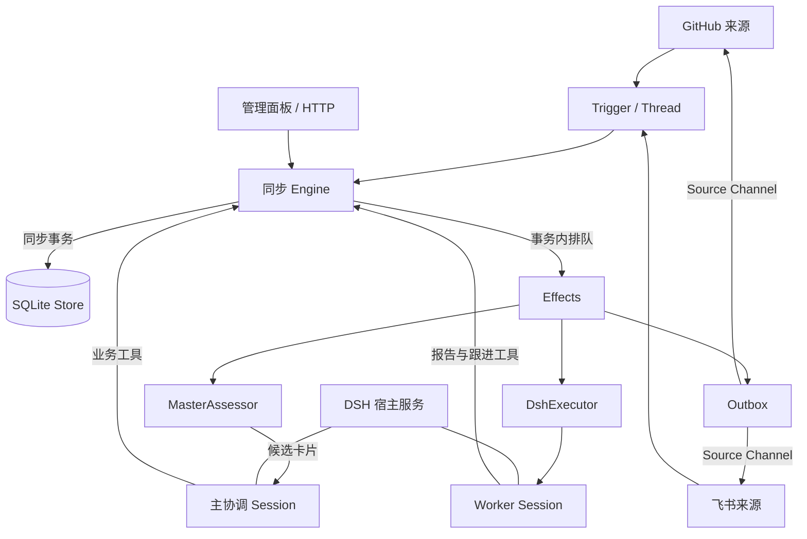

# dsh-superagent-prototype 源码架构与实现报告

> 分析基线：[`deepseek-ai/dsh-superagent-prototype@8c32a9dc5d72c033816c6a8110b37f40cf94fba4`](https://github.com/deepseek-ai/dsh-superagent-prototype/tree/8c32a9dc5d72c033816c6a8110b37f40cf94fba4)。本次从远端获取并固定提交，提交时间为 2026-10-31 20:06:31 +0800，包版本为 `0.1.0`。
>
> 方法：阅读官方说明和设计文档，追踪核心源码、运行时装配、执行器、持久化、GitHub/飞书适配器、管理 API、前端及相关测试，并交叉核对领域、执行和可靠性路径。本报告没有运行真实 DSH、模型、GitHub 或飞书，也没有安装目标项目依赖或运行其测试。下文的“实现”指代码已存在，不表示已经过真实环境验收。

本文保存固定提交的上游研究，不随 FastVibe 实现变化改写其源码结论。FastVibe 当前落点见 [Vivi 架构与实现](vivi-bot-implementation.md)，其他项目文档见 [文档索引](README.md)。

## 1. 核心结论

这个项目最有价值的部分，是把一次性 coding agent 组织成能够长期接收事件、维护工作关系、持续跟进 PR 的系统。

其主体可以概括为：

**外部事件适配器 + 确定性的领域引擎 + 一个持久协调会话 + 每项工作的持久执行会话 + SQLite 副作用队列 + 原渠道回复。**

它的“自主性”受到明确限制：谁可以要求它干活、什么事件可以触发主动工作、主动工作必须匹配什么规则，都需要团队配置。默认主动模式是 `observe`：评估并记录“本来会接什么”，但不真正创建主动工作。它不是持续自行寻找任意目标的无限循环。

三个关键判断：

1. **协调与执行分开，但不只有 Router/Worker 两个概念。** `Ticket` 保存工作与授权，`Assignment` 保存一次执行绑定，DSH `Session` 保存模型上下文。重试会换 Assignment，通常不换 Ticket、Session、目录或 PR。
2. **业务完成与模型运行结束分开。** 会话 idle 可以表示等新消息、等后台工作、等用户或等 review；`ready` 可以只是 PR 可审查，之后还要持续接收 review、CI 和合并关闭事件。
3. **可恢复依赖持久事实与幂等投递，不依赖模型记得上一次发生过什么。** Trigger、输入、决策、报告、待执行副作用和出站回执有宿主记录；但工具造成的外部副作用仍需恢复时核对，不能宣称全局 exactly-once。

README 明确将其定位为研究参考原型、非官方 DeepSeek 产品，公开实现也不等于团队内部版本或文章中的全部设想。本报告只评价这个提交的代码。[S01]

## 2. 系统边界、技术栈与代码布局

### 2.1 它依赖 DSH 承担什么

它以 DeepSeek Harness 的 bundle/plugin 形式运行，并非一个完整自带模型循环的独立 agent 引擎。

| 层次 | 本仓库的职责 | 委托给 DSH 或外部组件的职责 |
|---|---|---|
| 编排 | 接单、授权、订阅、输入分发、执行绑定、报告与回复用途 | — |
| 模型 | 为协调/执行角色选默认模型、拼提示词、调用 Agent 接口 | 模型调用循环、provider、原生重试、上下文压缩 |
| 会话 | 稳定 Session ID、角色装饰、投递判重、生命周期协调 | Session 创建恢复、事件持久化、inbox、原生 Web 会话 UI |
| 工具 | 业务工具、角色工具限制、结束后守卫 | 文件/shell/jobs/web search/子代理等实际工具 |
| 外部平台 | GitHub/飞书协议转成领域事件、出站适配 | `gh`、`lark-cli`、平台 API、平台账户凭据 |
| 管理界面 | React 管理面板、查询与设置 API | DSH Webserver、插件槽位、会话导航 |

技术栈为 TypeScript/ESM、Cordis 服务和事件机制、Zod schema、Node `node:sqlite`、React 18、tsdown、Vitest。目标 DSH 是 `0.2.1-alpha.2` 系列；`engines.dsh` 声明 `^0.2.1-alpha.2`，不能据此保证任意后续 SDK 都兼容。Node 声明为 `^22.19.0 || >=24.0.0`。[S02]

### 2.2 代码分层

本次按目录文件逐行计数，包含注释和空行；`src/app` 包含其子目录。

| 目录 | 文件数 | 行数 | 作用 |
|---|---:|---:|---|
| `src/core` | 15 | 2,088 | 领域模型、同步命令、授权后生命周期、端口 |
| `src/app` | 38 | 5,292 | 装配、SQLite、队列、会话桥接、管理 API、视图、工具 |
| `src/executor` | 2 | 838 | Worker 调度、目录准备、后台任务、恢复 |
| `src/sources` | 16 | 2,059 | 来源插件协议、GitHub 和飞书适配 |
| `src/infra` | 5 | 347 | CLI、环境、路径、健康状态等 |
| `src/client` | 27 | 4,419 | 管理 UI |
| `prompts` | 15 | 438 | 角色、准入、交付与沟通规则 |
| `tests` | 65 | 14,960 | 测试及辅助文件，其中 48 个 `*.spec.ts` |

工程重点明显落在应用编排和异常语义，而不是新造一个模型推理循环。测试目录体量大于单个实现层，但体量不能替代覆盖率或真实运行证明。

## 3. 总体架构与依赖方向



### 3.1 Runtime 是装配根

`src/index.ts` 声明所需宿主服务并创建 `Runtime`。`Runtime` 负责状态目录锁、数据库、Setup、Settings、Sources、Sessions、Assessor、Executor、Outbox、Engine 和 Passes 的生命周期。[S03][S04]

启动大致依次执行：

1. 创建状态目录并获得 `proper-lockfile` 排他锁。
2. 打开 Store，构造依赖对象，建立回调关系。
3. 注册管理 HTTP 路由，让配置尚未完成时仍有修复入口。
4. Setup 验证仓库与账号、构造 CLI shims 和 Git 环境。
5. 安装 Session/Executor hooks，确保主协调 Session 存在。
6. 同步必要的来源策略数据。
7. 恢复中断 Assignment，启动 Passes 与 Effects。

停止过程会停止调度、取消会话、等待在途效果、清理 Worker 后台工作、flush Session 持久化、恢复环境、关闭数据库，最后释放目录锁。

**含义：它采用同一状态目录单活进程的运行模型。** Effects 自身不是分布式队列，不能把多个进程直接指向同一数据库来横向扩容。

### 3.2 Engine 是同步的业务裁判

`Engine` 不执行网络请求或等待模型返回。每条命令在同步 `repo.atomic()` 中更新状态，需要外部工作时调用端口入队。这样数据库事务不会跨越几秒到几分钟的网络或模型等待。[S05]

内部拆成五部分：

| 部分 | 负责什么 |
|---|---|
| Intake | 收 Trigger、去重、记录 Thread、向订阅 Ticket 扇出、排 Eval |
| Evals | 线程内候选批次、准入、超时、Decision、策略变化重评 |
| Tickets | 接单、Mandate、订阅、Inputs、恢复、重试、停止与结束 |
| Assignments | Executor 的启动、输入送达/读取、轮次结束、报告和恢复事实 |
| Replies | 对外消息用途校验，生成幂等身份，送入 Outbox |

Sources、主会话、执行器、设置和人工操作分别拿 `Engine` 的 `Pick` 接口。这个设计收窄调用面，但 TypeScript 类型不是面对恶意插件的运行时安全沙箱。

## 4. 领域模型：为什么需要这些实体

| 实体 | 解决的问题 | 与其他实体的区别 |
|---|---|---|
| Source | 事件来自哪里、如何读取与回复 | 一个来源种类可描述配置、准入行、上下文和环境变量 |
| Trigger | 发生了哪一条具体外部事件 | 带稳定 ID；`text/meta` 是不可信输入 |
| Thread | 哪些消息属于同一个讨论及订阅范围 | 可为 Issue、PR、飞书话题；不是模型 Session |
| Channel | 消息应该写回哪个具体地址 | 写入地址，不承担业务生命周期 |
| Evaluation | 当前批次是否值得产生新工作 | 存在 Thread 内，同 Thread 同时最多一个活动 Eval |
| Decision | 当时做了什么判断、依据是什么 | 可审计的判断记录，不是执行上下文 |
| Mandate | 这项工作被授予了什么权限与范围 | 记录 strength、actor、basis、policyVersion、scope |
| Ticket | 跨多个轮次、review、重启仍然是同一项工作 | 工作与授权聚合，不等于一次模型运行 |
| Assignment | 当前是哪一次执行绑定 | pending/running/ended；重试和恢复可更换 |
| TicketInput | 什么新信息需要让该 Worker 读到 | 有 undelivered、deliveredTo、readAt 等事实 |
| Report / Attention | 结果到了哪一步、是否需要人回答 | `ready`、`waiting`、`failed` 等不能压成 running/idle |
| DSH Session | 模型读过什么、工具做过什么、上下文如何继续 | 由宿主持久化，位于 core 外部 |

关键关系为：

```text
一个 Thread ── 订阅关系 ── 多个 Ticket
一个 Ticket ── 生命周期内 ── 多个 Assignment
一个 Ticket ── 稳定身份 ── 一个 Worker Session（通常复用）
一个 Ticket ── follow 关系 ── 多个 PR/外部 Thread
一个 Trigger ── fanout ── 多个 TicketInput
```

### 4.1 Subscription、Follow 和 Correlation 各有用途

- **Subscription**：后续消息送给谁。
- **Follow**：外部对象的生命周期何时让 Ticket 结束；`own` 表示 Ticket 自己创建的 PR 等对象。
- **Correlation**：同一个 Trigger 涉及的线程之间有上下文关系；它不会自动带来订阅或授权。
- **Context-only Subscription**：可读消息，但不拥有其中的人类请求，不因此恢复已经结束的工作。

这几个关系的分离，避免“看到一个相关 Issue”就被当成“有权替它接单”。[S06][S07]

### 4.2 状态不是一个总枚举

Ticket 没有单独的 `state` 字段，`!ticket.ended` 即开放。Assignment 有 `pending | running | ended`，最新报告另有：

| Report | 意义 |
|---|---|
| progress | 仍在推进 |
| waiting | 当前轮次安静，等新的事件 |
| ready | 已有可交付结果，可能仍等待 review/PR 完成 |
| blocked | 需要外部条件或人类决定 |
| failed | 本次执行失败，需要恢复 |
| dropped | 没有值得继续的工作或该工作已无必要 |

UI 的 `TicketStage` 再按以下优先级派生：`ended → delivery failure → attention → ready/review → blocked/failed → queued → idle → working`。[S08]

这比保存多套可独立写入的 UI 状态更容易避免矛盾，但也使状态分类依赖时间与报告/输入关系，需要足够细的测试。

## 5. 一次请求的端到端执行

以“团队成员在 GitHub Issue 中 @ 机器人要求修复问题”为例：

1. **来源标准化**：GitHub 适配器读取平台事件，生成 Trigger、ActorRef、ThreadRef 和 ChannelRef。
2. **事务接收**：`Engine.receive → Intake.receive` 按 Trigger ID 去重，记录来源过滤结果、线程索引和分发事实。
3. **先看既有工作**：如消息在已订阅 Thread 上，会成为现有 Ticket 的 Input。人类 follow-up 已有 owner 时，通常由原 Worker 判断，主会话不再创建竞争处理。
4. **必要时进入 Eval**：无 owner 的请求进入 primary Thread.pending。`evaluateDue()` 启动批次，选取最强准入事件作为 primary；同强度时优先较新的事件。
5. **候选送达主会话**：Assessor 排入 `assessment` effect，送卡片到主 Session。此处只确认收到，不是模型已经消费该卡片。
6. **主会话决定**：明确请求走 `orchestrator_route`；推断的主动候选走 `orchestrator_eval → read → decide`。
7. **原子接单**：一次事务创建 Decision、Mandate、Ticket、首个 pending Assignment、订阅、ack 回执与 launch effect。
8. **执行器启动**：拿 Worker 槽位，必要时运行 prepare，确保 `worker-<ticketId>` Session 存在，投递任务说明。
9. **Worker 自主实施**：读仓库、调查方案、编辑和验证、开 PR；主会话不逐步替 Worker 规划技术实现。
10. **内部结构化报告**：Worker 调用 `orchestrator_report`；宿主记录最新报告，必要时更新 Attention、关联 PR、向主会话 relay。
11. **对外回复**：主会话按用途调用 `orchestrator_reply`，经过域规则后进入 Outbox，再回到最初的 GitHub 或飞书讨论。
12. **继续生命周期**：review、CI、人类补充成为新 Trigger，通常继续原 Ticket/Worker；PR 完成后再结束 Ticket。

跨层调用的代表链路：

```text
SourceContext.receive
  → Passes.receive
  → Engine.receive [transaction]
  → Intake / Evals / Tickets
  → effect(assessment / launch / delivery)
  → MasterAssessor / DshExecutor
  → Sessions.prompt
  → AgentDelivery.send
  → DSH Agent inbox/history
  → worker tools / native events
  → Engine.report / inputsRead / turnEnded
  → relay → main Session
  → Engine.reply → Outbox → SourceChannel.send
```

## 6. 授权与主动性的具体实现

### 6.1 接收范围、准入与执行授权分层

来源配置决定“收不收这个群/仓库范围的事件”；Policy 决定“能否成为候选以及强度”；模型决定具体意图是否匹配；Mandate 保存接受时的工作范围。

不能把它们合成一句“模型自己判断权限”。准入和很多结构校验由代码完成，语义意图和工作范围是否被实际遵守则仍依赖模型及提示词。

### 6.2 明确请求与推断候选不同

允许名单中的人明确 @ 或私聊机器人，可以成为 `explicit`。其他消息按接收范围的 admission table 处理：

| 人是否在名单 / 是否指向机器人 | 可配置选择 | 默认 |
|---|---|---|
| 在名单，未指向机器人 | inferred / ignore | inferred |
| 不在名单，指向机器人 | explicit / inferred / ignore | ignore |
| 不在名单，未指向机器人 | inferred / ignore | ignore |

“在名单且明确指向”固定为 explicit；未指向的消息不能配置成 explicit。未指向消息还需要来源配置为接收对应范围的全部消息。[S09]

bot 使用单独名单：最多成为 inferred，不能借 bot 身份发起 explicit 或停止工单。使用普通人类账号的自动程序，在来源字段上仍可能被视作 human，需要团队提示词说明其身份。

### 6.3 主动模式的三种语义

- `off`：不准入 inferred 候选。
- `observe`：照常评估；符合接单条件则记录 `ignore + would_accept`，不创建 Ticket。
- `auto`：允许符合规则的 inferred 候选真正接单。

明确请求不受 `observe/auto` 的主动接单开关限制。默认规则主要是文案纠错和目标明确的局部视觉修复，不是“发现任何问题都自动重构”。[S09]

### 6.4 评估结果不只是一句自然语言

主动 Assessment 需要结构化字段：每条启用规则恰好一项 assessment、是否匹配、实现是否被要求、目标是否确定、是否需要设计决策、证据和 scope。

`assessmentOutcome()` 在代码中检查：

1. enabled rules 被恰好覆盖一次。
2. 接单方向为 implementation requested。
3. 目标不是 undetermined，且无需设计决定。
4. 至少一条规则匹配。
5. 有 intent evidence。
6. inferred 真接单必须处于 auto。

**边界：这是主动 assessment 路径的检查。explicit route 不经过同一套方向/证据判断。** 而证据内容是否真实、范围是否真的足够小，代码没有语义验证器。[S09][S10]

### 6.5 策略版本和 Mandate 延续

Policy version 是规则、主动模式、各 Source 策略内容的稳定 hash；模型、并发和暂停等执行配置不进入该版本。

策略变更让在途 Eval 重评；对受影响 live Ticket 发送 PolicyEffect，解释规则变化、主动权限变化或 requester 不再被允许。它**不会立即硬停所有受影响 Worker**。

已结束 Ticket 被人类消息恢复前再校验 Mandate：来源仍监听、原准入强度仍成立、必要的名单/规则/auto 条件仍有效。校验失败时不把等待消息吞在原 Ticket 中，会释放给重新评估。人工停止的 Ticket 不自动复活。[S07][S09]

## 7. 主会话和 Worker 如何协作

### 7.1 主会话是持久的协调器

主 Session ID 存在 KV 中，缺省根据 stateDir 派生 `orchestrator-<stable key>`。它接收候选、工作报告、follow-up 提示和策略/提示词变化。

主会话的职责主要是：判断、路由、附加既有 Ticket、停止、转发事实、判断回复时机。它的提示词明确要求：实现调查和技术决策交给 Worker，不额外提供实施计划。[S04][S11]

### 7.2 Worker 的会话身份与重试解耦

```text
Ticket T
  ├─ Assignment A1 → 失败/中断
  ├─ Assignment A2 → 人工重试
  └─ Assignment A3 → 重启恢复
               ↓
       同一 worker-T Session
       同一 directory / branch / PR
```

`Sessions.ensure()` 优先 resolve 已有 Agent，不存在才创建 workspace 和 Session。launch 会检查初始任务消息是否已经存在，后续执行绑定只补新信息。[S12]

这保留的不只是摘要，还包括由 DSH 保存的原执行历史。外部删除 Session 后会重新创建，此时不能保证完整旧上下文仍存在；当前 `ensure()` 也未核对已存在 Session 的 cwd 是否仍等于预期目录。

### 7.3 工具表面

| 主协调会话工具组 | 典型工具 |
|---|---|
| 路由 | `orchestrator_route`（accept/attach/stop/ignore，可批处理） |
| 主动评估 | `orchestrator_eval`、`orchestrator_eval_read`、`orchestrator_eval_decide` |
| 既有工作 | `orchestrator_ticket_retry`、`orchestrator_ticket_request_status`、`orchestrator_ticket_note` |
| 消息和订阅 | `orchestrator_reply`、`orchestrator_trigger_requeue`、`orchestrator_thread_unsubscribe` |
| 配置 | settings save、policy sync、prompts save |
| 资源读取 | `orchestrator_read` |

Worker 获得 ack、thread follow/unrelated、trigger handback、report 和自身资源读取等业务工具，再配文件、shell、搜索、jobs、todo、web search 与子代理能力。[S10][S13]

`orchestrator_route` 的批次不是全批原子：每个条目独立处理，一个条目被拒不会阻断其他条目。

### 7.4 不靠等待占住协调会话

新候选和报告通过 inbox 自动送达。协调会话被要求“没有其他工作就结束本轮”，不要 sleep 等 Worker。宿主还拦截部分 bash sleep、过长 shell timeout 和 job wait。

这避免单协调会话被等待卡住，但这些检查只是对部分工具参数和脚本文本的守卫，不构成“所有程序都不能等待”的证明。[S11]

## 8. Follow-up ownership：长期工作的关键机制

收到一条人类补充时，系统首先判断哪一个 Ticket 有权处理它，而不是全部交给 Router 重新分派。

具体规则：

- 自身 Thread 上的请求直接给已有 Worker。
- 一个 Trigger 可以到达多个 Ticket；存在多个 owner 时，全部放弃后才回到 Eval。
- owner 尚在处理时，主会话不能再 accept、attach 或 ignore 该消息；请求停止是例外，仍需通过 stop 规则。
- Worker 判定超出原 scope 时调用 handback，留下理由，避免既有工作无限扩张。
- 仅为 context 订阅的 Thread 不获得 ownership，也不唤醒已经结束的 Ticket。
- Ticket 结束时释放未读且未承接的请求，避免“最后报告到达时顺手丢掉了用户刚发的新要求”。

**设计收益：** 原执行者掌握具体技术现场，能更准确地判断补充是不是同一项工作；主会话只处理真正需要重新路由的内容。

**代价：** owner、ack、read、handback、订阅和结束时刻相互关联，领域复杂度明显高于简单的 Router → Worker → result 系统。[S06][S07]

## 9. 输入一致性与持久化投递

### 9.1 它记录了哪些不同的事实

```text
外部 Trigger 已保存
    ↓
TicketInput 已创建 / undelivered
    ↓
已到 Worker inbox（inputsDelivered）
    ↓
已进入 Session history（user/message → inputsRead）
    ↓
后续 Report 或 turn end 表明已有处理机会
    ↓
ack / answer / handback 等进一步承接事实
```

“模型已读”是宿主以历史事件及后续边界推导出的处理事实，不是对模型内部理解能力的测量。[S14]

### 9.2 AgentDelivery 的实现

每个投递 requestId 映射为固定的 DSH message ID。判重同时检查：

- 持久 Session 事件中的 `user/message`。
- 当前 nextTurn inbox。
- 当前 nextStep inbox。
- 实时到达的 Session 历史事件缓存。

发送前重新检查目标 Agent 是否仍存活，并执行 `authorize()`，再调用 `followup`、`steer` 或 `inject`。发送方法返回前等待 persistence flush。[S15]

注意时序：可选 `accepted()` 回调在最后一次 flush **之前**执行，不能把它本身当成持久成功确认。跨重启投递保证还依赖 DSH inbox 和持久化的真实行为，本次未深入运行验证该 SDK。

### 9.3 重试时未读输入如何保住

旧 Assignment 已投递但 `readAt === null` 的 Trigger Input 重新进入队列。新 launch 先移除 inbox 中可能还残留的旧副本，然后再投递，避免两份内容一起进入下一步。[S07][S12]

这是“把消息放进队列”之后经常被忽略的一层：取消或崩溃可能发生在 inbox claim 与历史持久化之间，队列层的 sent 并不足以代表模型真的拿到内容。

## 10. SQLite、Effects 和 Outbox

### 10.1 Store 的结构

主要表包括 `trigger`、`disposition`、`thread`、`ticket`、`decision`、`outbox`、`trigger_thread`、`effect`、`kv`。[S16]

实体大多保存为 JSON `value`，再增加必要索引和派生列：例如活跃 Ticket、等待 Eval 的 Thread、订阅 Thread、待发送回执和 effect due。这样领域对象结构灵活，调度不必每轮扫描解析全部历史。

数据库启用 WAL 和 `synchronous=FULL`；目录创建指定 `0700`，数据库打开后设 `0600`。`atomic()` 使用 SAVEPOINT 支持嵌套事务。

- `afterCommit` 用于提交后的内存动作，比如取消当前 Worker。
- `Effects` 用于必须跨崩溃保存的外部动作，比如启动、投递、转发和回复。

不要混淆：afterCommit 回调没有持久化，进程在提交后、执行前崩溃，回调本身不会重放。关键恢复由持久状态和 Effects 承担。

当前 schema 为 11，支持从 schema 10 迁移。比支持范围更旧或更新的库拒绝打开，并非可任意跨版本自动升级。[S16][S17]

### 10.2 Effects 的六类任务

| kind | 含义 | 队列 key |
|---|---|---|
| assessment | 候选卡片送主会话 | Eval ID |
| launch | 启动 Assignment | Assignment ID |
| delivery | 投递 Ticket 等待输入 | Ticket ID |
| relay | 报告/跟进送主会话 | request ID |
| notice | 不唤醒主会话的背景通知 | 通知名称 |
| reply | 原渠道对外回复 | message ID |

每行保存 kind/key/payload/seq/generation/attempts/error/due/since。`(kind,key)` 唯一；同 key 再入队会更新 payload、增加 generation、重置失败次数，但保留排队顺序。[S18]

generation 的作用很具体：旧 handler 运行时又来了新 payload，旧 handler 成功后只能删掉自己那一代，不能把新工作一起清掉。

默认失败按 2 秒起步、指数增长到 60 秒后继续重试；`Later` 表示暂停、槽位满等暂时不可执行，不增加失败次数。连续失败 3 次才把对应健康状态标为 error。relay/notice 各自按队列顺序执行，前一项失败会挡住后续同类项。

Passes 默认每 2 秒触发，并支持按需触发与合并重入；Effects 本身也在入队和执行完成后 kick。[S18][S19]

### 10.3 Outbox 与真正的外部幂等

Outbox 在同一事务中保存 receipt 和 reply effect；状态为 pending/sent/dropped。来源被关闭时等待，来源不再监听目标或目标永久不可达时 dropped。[S20]

回复 effect 全局并发为 1，失败退避从 5 秒增长到 300 秒。同 Ticket、同 conversation 的后续消息等待之前的消息，以保证 ack 尽量先于结果；前序失败累计 3 次后允许后序越过，因此并非永不放行的严格 FIFO。

| 平台 | 去重实现 | 保证的边界 |
|---|---|---|
| GitHub | 评论携带 `<!-- dsh-superagent:<messageId> -->`；重试前扫描本账号已有评论 | 查重与 POST 是两个请求，不是平台原子幂等；marker 被删改等情况仍可能重复 |
| 飞书 | CLI 传 `--idempotency-key message.id` | 依赖平台/CLI 对幂等键的实现与有效期；本仓库没有证明永久去重 |

因此应把它描述为“至少一次调度 + 多层去重，使重复可控”，不能描述为“任意外部操作严格只执行一次”。Worker 自己发起的 push、创建 PR、执行命令也不自动被 Outbox 去重。[S21][S22]

## 11. Worker 并发、后台工作与工作目录

### 11.1 槽位是什么

默认 `maxWorkers = 3`，配置范围 1–16。槽位覆盖 launch/prepare、唤醒中的 Worker、活跃模型轮次，以及轮次结束后仍在执行的后台工作。

`WorkerSlots.reserve()` 在 await 之前同步预留，避免并发启动都看见同一个空位。人类 follow-up 或状态请求可使用额外一个槽位，达到 `maxWorkers + 1`，让人类追加不被新工作长期堵住。普通 CI/bot 输入等正常名额。[S12]

**这个限制不是 CPU、进程或所有子 Agent 的全局上限。** 子代理数量、交接给人的服务进程、用户在 DSH Worker 页面直接手动启动的轮次，不完全受相同入口限流。

### 11.2 shell 转后台的意义

Worker 和 Router 预设的 shell 超过 5 秒转后台，job wait 也限 5 秒。长命令因此不会把一个模型步骤长时间锁住，新消息可以在下一步进入。Worker 子代理使用 DSH standard preset，其 shell 前台默认上限更长，公开配置说明为 60 秒。[S23]

### 11.3 前台 idle 不立刻释放名额

Worker 轮次结束后，如果还有 jobs 或子代理，会进入 settling，继续占槽并等待结果事件。普通后台观察最多 30 分钟；到期可杀 shell jobs，记录 waiting，子代理允许继续。

交接给人时另有语义：ready、提问、blocked/failed 等会释放槽位并停止子代理；供人 review 的 shell jobs 可继续运行，其结束只注入记录，不自动唤醒 Worker。

**资源边界：** 30 分钟不是整个 Ticket 的运行时限，也不是所有子代理的硬超时。某些仍运行的后台对象不再持有父 Worker 槽位。shutdown 中的限时等待也不等于所有底层操作已经终止。[S12][S24]

### 11.4 目录不是必然的 Git worktree

Ticket 目录名由校验后的英文短名加 Ticket ID 前 12 位生成，根目录默认 `<stateDir>/work`。prepare 是团队配置的一段 `sh -c`，上限 10 分钟。可以用它 `git worktree add`，但没有配置时只是一个普通空目录。[S12]

已有目录被视为已准备，跳过 prepare。prepare 失败后只尝试删除空目录，非空残留保留；后续人工 retry 可能复用这个现场。这对保住部分成果有价值，但也意味着目录存在不是“初始化已完整成功”的强校验。

## 12. 故障、停止与重启恢复

### 12.1 三类不同重试

| 类型 | 策略 | 不能混为一谈的地方 |
|---|---|---|
| Eval 超时 | 未送达不超时；送达后两次重排，第三次 unavailable | 送达是 inbox 接收，未必已被模型处理 |
| Effects 失败 | 持久任务持续指数退避；没有统一最大次数/死信终态 | relay 队首失败可能阻塞同类后续项 |
| Worker/launch 瞬时失败 | 额外最多重试 3 次；Worker 续跑延迟 15/30/60 秒 | 是向原 Session 追加继续消息，不是恢复同一个 HTTP 请求 |
| DSH 原生模型重试 | 由宿主引擎承担 | 应用主要观察预算等待状态，不在这里实现完整 provider 重试 |

prepare 失败不走自动瞬时重试，以免把残留目录误认成完整准备好的现场。瞬时重试次数/定时器在进程内，重启后并不是一个持久累计预算。[S12][S18]

### 12.2 失败与阻塞不是结束

blocked/failed 报告让自动输入暂停，CI 和 bot 消息可被记录而不继续唤醒 Worker。人类消息、显式 retry 或新的非失败报告可以解除。

错误分类由结构化 status 和网络错误文本匹配共同完成。文本匹配有误分类可能，不能当作精确的错误本体系统。

### 12.3 重启如何决定要不要继续

恢复按 Ticket 接受时间排序处理：

- pending Assignment 重新排 launch。
- 对忙碌中断的 Assignment，结束旧绑定，创建新绑定并追加 recovery note。
- waiting/ready/blocked/failed 且该报告之后没有新输入送达的，可保留原绑定，不一律重新执行。
- 未进入历史的 Input 回收重投；已有会话尽量保留 inbox。

recovery note 明确要求先核对 worktree、Git history 和 GitHub state，再继续，避免重复已经完成的外部动作。[S14]

### 12.4 pause、stop、restart 不同

- **pause** 主要阻止新评估、launch、自动输入投递与对外发送；不是统一 kill 当前所有工作。
- **stop Ticket** 结束工作并撤回其延续授权，不允许后续评论自动唤醒它。
- **plugin shutdown/restart** 取消受管会话并收尾后台工作、保留可恢复输入。
- 上述动作都不自动回滚已写文件、已 push 或已发送的平台消息。

## 13. PR 生命周期与“完成”的定义

代码通过 `ticket.follows` 关联 PR 等外部 Thread，并保存 own/closed 信息。

- 无 Follow 的 Ticket 报告 ready，可结束为 completed。
- 有自己创建的 PR，需等所有 own Follow 不再开放。
- 没有 own Follow，则需所有 Follow 都关闭。
- 按最后一次相关关闭事实得到 merged 或 closed。
- 如果关闭时仍有恢复后的未完成工作，或刚承接的人类补充尚未处理，不能立刻终止 Worker。

PR 的 ready 是人类可以审查的边界，merged/closed 是另一种外部事实。这使同一个 Worker 能继续处理 review、CI 和后续补充。[S07][S14][S25]

**自动合并没有独立的宿主 merge 状态机。** 默认交付提示词要求另一账号的 merge CLI，并描述小于 200 行、审批覆盖 head commit、变更时撤销 auto-merge 等条件；未配置 merge CLI 时人工合并。这些主要是提示词规则，真正的审批约束仍应靠 GitHub 分支保护。甚至 reviewer credit、重写提交信息、force-with-lease 等具体流程也写在默认交付提示词中，显示其行为很受原团队流程影响。[S26]

## 14. Source 适配器与增量读取

### 14.1 SourceKind 是扩展协议

来源种类可提供 schema、UI fields、scope、channel、threadContext、find、repliesTo、policy、labels、environment；通过 `SourceContext` 使用受管服务。[S27]

这是比“每加一个平台就在 Engine 里加 if”更好的扩展位置。核心主要依赖 Trigger、Thread、Actor、Channel 等通用类型。

但来源扩展尚非完全无感：Setup 账号探测、技能注册、图片资源、PR 工具和部分通知等仍直接知道 GitHub/飞书。不能把它视为已经完全独立的任意平台 SDK。

### 14.2 GitHub

采用 CLI 轮询，而不是本仓库自建 webhook server。默认最少 60 秒，并尊重 GitHub 返回的更长间隔。

读取通知、已订阅讨论、Ticket PR、review 和 CI；可选读取仓库级新 Issue/PR/评论/默认分支 CI。仓库观察流开启时从当前基线开始，不把全部历史突然作为新请求。

可靠性措施包括：

- 游标回退 5 秒，靠 Trigger ID 去重覆盖边界。
- ETag / 304 降低无变化读取开销。
- 默认轮询追溯范围 14 天；live Ticket 的订阅持续读取。
- 单个线程读取失败保留错误和位置，不因一个坏对象吞掉其他对象。
- 404 可能是私有仓库失去访问，因此继续重试；410 明确删除可结束重试。
- 通知读失败连续 24 小时后可放弃该通知重试，并保留线程诊断。

这些机制降低漏收风险，但不是“无限离线后完整恢复所有消息”的保证。仓库流单轮读取一页 `per_page=100`，高流量或边界数据仍需真实压力验证。[S28]

### 14.3 飞书

实时 CLI 消费与历史补收、已订阅话题轮询结合；标准化会话、root、parent、消息作者与图片引用。

上下文读取校验消息/父消息所属 chat、thread；图片读取要求 key 已在指定消息出现，并限制路径、大小和模型图像能力。

实时单条消费失败会报告错误并继续，并没有为所有坏事件单独建立持久失败队列。补收能否覆盖该事件，取决于配置群、已知私聊、订阅及游标范围。[S29]

## 15. 提示词、上下文与记忆

### 15.1 提示词被当作可版本化配置

默认提示词包含共享规则、角色规则、订阅/回复/dispatch/work 指南、准入与 handoff。团队还可修改 communication、scope、delivery 三段，或覆盖内置片段。[S30]

配置保存带 base revision，过期提交报冲突；保留历史以及内置文本 base hash，升级后能提示“你的覆盖基于旧默认文本”。模型请求时读取当前版本，并记录每个 Session 曾使用的 revision。

主会话 Policy 部分由当前设置生成，并放在组合末尾。Worker 还会继承宿主提示及仓库 AGENTS.md，Mandate 的额外约束由应用补入。[S11][S30]

### 15.2 上下文按需读，不整库塞进提示词

Assessor 初始卡片含 bounded thread window：Trigger 文本最多 4,000 字符，附近消息/窗口消息有不同缩略长度，其他内容给 stub 和可读引用。Worker 的 Trigger 默认只带 600 字符，任务说明默认最多 1,500 字符，超过通过 resource path 补读。[S10][S12]

读取缓存按 Eval 生命周期释放，游标和图片引用校验锚定当前候选，过期 Eval 不再继续接受旧读取/决定。这既控制上下文成本，也减少模型在无界历史中迷失。

### 15.3 它没有在本仓库实现长期记忆系统

公开实现中的跨轮次连续性主要来自：DSH Session 历史、Ticket/Inputs/Reports、Thread 订阅、设置/提示词版本。没有在本项目层看到独立的向量检索、跨任务记忆提炼或遗忘曲线。

`src/core/memory.ts` 是测试用的内存 repositories，不能因为名字含 memory 就认作 Agent 长期记忆。上下文压缩和工具结果裁剪则由 DSH preset 插件提供。[S23]

## 16. 管理面板与 API

React 面板嵌入 DSH 的主面板、侧栏和插件配置槽位，点击工作会打开真实 Worker Session。它关注来源、Trigger/Eval、工作执行、Thread/Ticket、策略、提示词和部署配置，而非实现第二份完整聊天渲染器。[S31]

数据由 `/orchestrator/api/*` 提供。默认 5 秒轮询，隐藏页面周期乘 6；重启期间切到 1 秒。请求串行化，避免手工 refresh 与旧轮询结果互相覆盖；内容相同不更新状态，卸载或依赖变化后丢弃迟到结果。[S32]

API 包含状态/健康、overview、来源、Thread/Decision/Ticket、retry/stop、pause、设置/策略、提示词预览与版本历史等。统一错误区分 Zod 校验、领域 UserError、缺失、配置冲突和内部错误。

管理服务器必须绑定 `127.0.0.1`；请求校验 Host 为带实际端口的 loopback 地址，需要 `x-orchestrator-request: 1`，并检查 Origin 缺失或同源。响应使用 no-store/nosniff，普通 JSON body 默认限制 128 KiB。[S33]

**该接口是本机管理面，不是完整的公网多用户服务。** 这里的同源检查不能替代远程账号认证、租户隔离和权限模型。

## 17. 安全与工程边界

### 17.1 代码明确实现的护栏

- 来源监听与 allowed/bot 名单、准入强度、主动规则检查。
- 旧 Eval/旧 Policy 决策拒绝或重评。
- reply 的用途校验：不能在非 ready 结果上随意报告已交付；attention 要匹配当前问题。
- Worker 资源读取限制到其 Ticket、已到达 Trigger、相关 Thread 和可读提示词版本。
- Ticket 结束后工具 guard 拒绝新工作；Worker 后代也尽量继承工作工具限制。
- 账号 CLI 默认路径、清除环境 GitHub token、隔离 Git 全局配置、禁止交互凭据提示。
- 管理 API 回环与同源限制。

### 17.2 不能误认为已经保证的性质

| 常见误读 | 源码支持的实际结论 |
|---|---|
| 每个 Worker 在安全沙箱里 | Session 使用 `danger-full-access`，以操作者 OS 用户运行；目录不是访问控制边界 |
| Router 不能写代码 | 没给直接 write/edit，但仍保留 bash；可经 shell 写文件 |
| Mandate 会强制阻止任何越界修改 | 授权准入由代码检查，语义 scope 主要靠 Worker 判断和提示词 |
| blockedCommands 可以阻止所有危险程序 | shims 只约束默认命令名，绝对路径可绕过 |
| 自动合并由宿主独立验证 | 默认 merge 条件主要在提示词；平台保护另行承担 |
| 消息与工具严格 exactly-once | effect 至少一次调度，消息多层判重，工具动作未获得通用原子幂等 |
| maxWorkers 是系统资源上限 | 只约束部分 Worker 槽位，不覆盖全部进程和子代理 |
| pause 就是全部停止 | 主要阻止新调度与投递，活跃工作未被统一杀停 |
| 报告 ready 等于成果已验证 | 是执行者结构化声明，主会话检查仍靠模型，非独立确定性验收 |

环境修改作用于整个 DSH 进程，项目文档要求单独 profile，并建议专用 OS 账号。不存在“在个人全权限 profile 装上它就自动隔离”的前提。[S11][S34][S35]

### 17.3 从实现推导的主要生产风险

以下是工程推论，不是本次已复现漏洞：

1. **外部副作用不确定窗口。** GitHub 操作成功后、本地确认前崩溃，重试必须核对实际平台状态。
2. **有序队列的队首阻塞。** 一个长期失败的 relay 可以影响后续同类主会话消息，没有统一死信策略。
3. **完整权限下的提示词注入。** 不可信讨论和仓库文本进入拥有 shell 的会话；授权域规则并不覆盖每一种 shell 行为。
4. **prepare 完成事实过弱。** 目录存在不一定代表 checkout、分支、依赖初始化均正确。
5. **资源回收边界复杂。** 后台超时保留子代理、交接保留 jobs、有界 shutdown 只限制等待，不能当成资源强回收证明。
6. **单协调会话瓶颈。** 一个主协调上下文承担多个来源和工作汇总；卡片变多时可能有评估排队和上下文竞争。
7. **审计保留成本。** 输入、历史、回执、版本长期增长；本次未确认覆盖所有数据族的统一压缩/保留策略。
8. **外部 alpha API 耦合。** 多种 SDK 服务、事件名与 preset 行为紧密相连，升级应保留真实运行回归。

## 18. 测试能说明什么

本次定位到 48 个 `*.spec.ts`，包括领域、策略、消息投递、follow-up、Effects、Outbox、后台工作、运行时并发、迁移、环境、来源、API、提示词和 UI 草稿等。

| 测试文件 | 代表性语义 |
|---|---|
| `core-engine.spec.ts` / `stage.spec.ts` | 接单、状态派生、停止、恢复、超时 |
| `policy.spec.ts` | 准入表、主动模式、规则、bots、授权延续 |
| `followups.spec.ts` | ownership、handoff、未读释放、context-only |
| `delivery.spec.ts` | 固定消息 ID、inbox/history 判重、持久化 |
| `effects.spec.ts` | 事务、generation、退避、取消、关停恢复 |
| `outbox.spec.ts` | 回执、出站排序、失败与 dropped |
| `background.spec.ts` / `runtime-concurrency.spec.ts` | jobs/子代理收尾、并发与唤醒 |
| `store.spec.ts` / `migration.spec.ts` | 嵌套事务、afterCommit、权限、schema 迁移 |
| `sources.spec.ts` / `commands.spec.ts` | 平台转换、游标、CLI 与错误 |
| `http.spec.ts` / `prompts.spec.ts` | 管理边界、配置冲突、提示词版本 |

这些用例反映作者认真处理了真实长期运行中的竞态，但仍不能据文件存在证明当前版本全部通过。尤其 DSH 内部取消、inbox 落盘、实际平台幂等期限、真实分支保护、CLI 凭据和高流量恢复，需要在目标部署上另外验证。

## 19. 对 FastVibe/Vivi 这类本地助手的借鉴

本节保留针对不同产品目标的通用建议，不是当前 FastVibe 实现审计。**Vivi 已明确选择整体采用 DSH 架构并由 GitHub Issue/PR 外部事件驱动**，具体目标以 [完整重构设计](vivi-dsh-architecture.md) 为准；下文“单用户本机可用薄编排层”的条件性建议不作为 Vivi 此次实施方向。

### 19.1 优先吸收的机制

1. **持久 Worker 会话。** 用户说“接着改一下”应回到同一个工作上下文；执行尝试变更不必丢掉 Session。
2. **明确保存输入处理事实。** 已接收、已排队、已进入模型历史、已产出报告分开，重启和取消才有可解释恢复。
3. **状态与待办副作用原子保存。** 新结果和需要通知协调器的任务一起落盘，避免 Worker 已结束但主界面永远没结果。
4. **协调器不阻塞等待。** 有事处理，无事结束，结果通过持久投递重新触发。
5. **结构化结果/待答问题。** 不从最后一句“好了”猜 ready，不从 idle 猜完成。
6. **旧执行失效检查。** 用 Assignment ID、epoch 或 revision 验证迟到消息，避免 Stop 后旧结果覆盖新工作。
7. **派生界面状态。** 从权威事实计算“等你/工作中/失败”，减少多份可各自写入的状态。
8. **按需上下文。** 发摘要与可读引用，完整执行历史留给真实 Worker 会话。

### 19.2 不宜直接搬来的复杂度

Source admission、多人跨渠道 authorization、Thread 多 owner、PR merge/close completion、follow-up handback，主要解决团队机器人和外部代码审查的生命周期。

个人桌面助手未必都需要。可以保留会话身份、输入回执、结果、待答问题、出站投递和取消代际，而不把 Ticket/Assignment/Thread 全部暴露为产品概念。

但省掉可见“任务卡”不代表可以省掉持久工作事实。没有这一层，重复投递、停止、恢复、结果遗漏仍然会以难以解释的 UI bug 出现。

### 19.3 技术取舍建议

若目标是单用户、本机、持久聊天，应先实现薄编排层；未来真的接入团队 GitHub/飞书，才增加按来源授权、Thread 订阅与外部对象生命周期。

若目标直接是团队级主动 coding bot，这个仓库可作为可靠性和生命周期语义的参考，但生产化优先补运行隔离、凭据范围、平台强制审批、资源预算、恢复演练和可观测性，而非先加更多 Agent 角色。

## 20. 总体评价与阅读路线

**架构判断：这是一个以事件和持久工作事实为中心的 Agent 编排应用。** 它让模型做判断和执行，让确定性代码守住授权入口、状态关系、投递与生命周期；其长期运行能力主要来自这些宿主机制。

优点是职责分层明确、业务状态细致、恢复链路可追踪、原渠道沟通克制。局限是语义行为仍大量受提示词支配，运行权限宽，单进程和外部 alpha SDK 依赖强，并发限制不覆盖所有真实资源。

推荐阅读顺序：

1. `README.md`、`docs/000-philosophy.md`：目标与边界。
2. `src/core/model.ts`、`stage.ts`：实体和状态。
3. `src/core/engine.ts`、`ports.ts`：同步命令与外部边界。
4. `intake.ts → evals.ts → tickets.ts → assignments.ts → replies.ts`：业务完整路径。
5. `app/runtime.ts`、`store.ts`、`effects.ts`、`delivery.ts`、`outbox.ts`：运行与一致性。
6. `executor/dsh.ts`、`background.ts`、`app/sessions.ts`：DSH 执行桥接。
7. `policy.ts`、`app/assessment.ts`、`app/tools/*`、`prompts/*`：谁决定什么。
8. `sources/*`、`app/http.ts`、`client/*` 和对应 tests：平台与产品表面。

## 附录：固定提交源码索引

以下链接全部固定到本次分析提交，避免 main 后续变化让报告失去依据。行号为阅读锚点，不表示整份结论只来自该一行。

- [S01 README：原型定位与能力范围](https://github.com/deepseek-ai/dsh-superagent-prototype/blob/8c32a9dc5d72c033816c6a8110b37f40cf94fba4/README.md#L1-L15)
- [S02 package.json：版本、技术栈与 DSH 依赖](https://github.com/deepseek-ai/dsh-superagent-prototype/blob/8c32a9dc5d72c033816c6a8110b37f40cf94fba4/package.json)
- [S03 index.ts：插件入口](https://github.com/deepseek-ai/dsh-superagent-prototype/blob/8c32a9dc5d72c033816c6a8110b37f40cf94fba4/src/index.ts#L1-L27)
- [S04 runtime.ts：装配、锁、启动与退出](https://github.com/deepseek-ai/dsh-superagent-prototype/blob/8c32a9dc5d72c033816c6a8110b37f40cf94fba4/src/app/runtime.ts#L86-L254)
- [S05 engine.ts：事务命令与接口](https://github.com/deepseek-ai/dsh-superagent-prototype/blob/8c32a9dc5d72c033816c6a8110b37f40cf94fba4/src/core/engine.ts#L19-L120)
- [S06 model.ts：实体、ownership 与状态事实](https://github.com/deepseek-ai/dsh-superagent-prototype/blob/8c32a9dc5d72c033816c6a8110b37f40cf94fba4/src/core/model.ts#L22-L353)
- [S07 tickets.ts：跟进、重试、恢复与结束](https://github.com/deepseek-ai/dsh-superagent-prototype/blob/8c32a9dc5d72c033816c6a8110b37f40cf94fba4/src/core/tickets.ts#L37-L423)
- [S08 stage.ts：状态派生](https://github.com/deepseek-ai/dsh-superagent-prototype/blob/8c32a9dc5d72c033816c6a8110b37f40cf94fba4/src/core/stage.ts#L9-L26)
- [S09 policy.ts：准入、规则、版本与 revalidate](https://github.com/deepseek-ai/dsh-superagent-prototype/blob/8c32a9dc5d72c033816c6a8110b37f40cf94fba4/src/policy.ts#L26-L240)
- [S10 assessment.ts：主动评估 schema 和上下文窗口](https://github.com/deepseek-ai/dsh-superagent-prototype/blob/8c32a9dc5d72c033816c6a8110b37f40cf94fba4/src/app/assessment.ts#L19-L279)
- [S11 sessions.ts：提示词装配与工具守卫](https://github.com/deepseek-ai/dsh-superagent-prototype/blob/8c32a9dc5d72c033816c6a8110b37f40cf94fba4/src/app/sessions.ts#L61-L340)
- [S12 dsh.ts：Worker、槽位、目录、投递与恢复](https://github.com/deepseek-ai/dsh-superagent-prototype/blob/8c32a9dc5d72c033816c6a8110b37f40cf94fba4/src/executor/dsh.ts#L23-L673)
- [S13 executor tools：报告和跟进工具](https://github.com/deepseek-ai/dsh-superagent-prototype/blob/8c32a9dc5d72c033816c6a8110b37f40cf94fba4/src/app/tools/executor.ts#L25-L105)
- [S14 assignments.ts：输入事实、报告、restart](https://github.com/deepseek-ai/dsh-superagent-prototype/blob/8c32a9dc5d72c033816c6a8110b37f40cf94fba4/src/core/assignments.ts#L21-L138)
- [S15 delivery.ts：Session 消息幂等](https://github.com/deepseek-ai/dsh-superagent-prototype/blob/8c32a9dc5d72c033816c6a8110b37f40cf94fba4/src/app/delivery.ts#L16-L86)
- [S16 store.ts：表结构、事务与回执](https://github.com/deepseek-ai/dsh-superagent-prototype/blob/8c32a9dc5d72c033816c6a8110b37f40cf94fba4/src/app/store.ts#L30-L288)
- [S17 migration.ts：schema 10 到 11](https://github.com/deepseek-ai/dsh-superagent-prototype/blob/8c32a9dc5d72c033816c6a8110b37f40cf94fba4/src/app/migration.ts)
- [S18 effects.ts：持久副作用队列](https://github.com/deepseek-ai/dsh-superagent-prototype/blob/8c32a9dc5d72c033816c6a8110b37f40cf94fba4/src/app/effects.ts#L11-L161)
- [S19 passes.ts：周期与按需推进](https://github.com/deepseek-ai/dsh-superagent-prototype/blob/8c32a9dc5d72c033816c6a8110b37f40cf94fba4/src/app/passes.ts#L22-L69)
- [S20 outbox.ts：出站回执与重试](https://github.com/deepseek-ai/dsh-superagent-prototype/blob/8c32a9dc5d72c033816c6a8110b37f40cf94fba4/src/app/outbox.ts#L21-L52)
- [S21 github-channel.ts：评论 marker 去重](https://github.com/deepseek-ai/dsh-superagent-prototype/blob/8c32a9dc5d72c033816c6a8110b37f40cf94fba4/src/sources/github-channel.ts#L18-L47)
- [S22 feishu-channel.ts：平台幂等键](https://github.com/deepseek-ai/dsh-superagent-prototype/blob/8c32a9dc5d72c033816c6a8110b37f40cf94fba4/src/sources/feishu-channel.ts#L19-L33)
- [S23 cordis.patch.yml：角色 preset 与压缩/工具配置](https://github.com/deepseek-ai/dsh-superagent-prototype/blob/8c32a9dc5d72c033816c6a8110b37f40cf94fba4/cordis.patch.yml)
- [S24 background.ts：jobs/子代理收尾](https://github.com/deepseek-ai/dsh-superagent-prototype/blob/8c32a9dc5d72c033816c6a8110b37f40cf94fba4/src/executor/background.ts)
- [S25 github-pull.ts：PR 归属与关闭事实](https://github.com/deepseek-ai/dsh-superagent-prototype/blob/8c32a9dc5d72c033816c6a8110b37f40cf94fba4/src/sources/github-pull.ts)
- [S26 team/delivery.md：默认交付和合并指令](https://github.com/deepseek-ai/dsh-superagent-prototype/blob/8c32a9dc5d72c033816c6a8110b37f40cf94fba4/prompts/team/delivery.md)
- [S27 kind.ts：Source 插件契约](https://github.com/deepseek-ai/dsh-superagent-prototype/blob/8c32a9dc5d72c033816c6a8110b37f40cf94fba4/src/sources/kind.ts#L29-L115)
- [S28 github.ts：轮询与失败恢复](https://github.com/deepseek-ai/dsh-superagent-prototype/blob/8c32a9dc5d72c033816c6a8110b37f40cf94fba4/src/sources/github.ts#L153-L459)
- [S29 feishu-loops.ts：实时与历史补收](https://github.com/deepseek-ai/dsh-superagent-prototype/blob/8c32a9dc5d72c033816c6a8110b37f40cf94fba4/src/sources/feishu-loops.ts)
- [S30 prompts.ts：版本、覆盖与动态组合](https://github.com/deepseek-ai/dsh-superagent-prototype/blob/8c32a9dc5d72c033816c6a8110b37f40cf94fba4/src/app/prompts.ts#L14-L247)
- [S31 client/index.tsx：面板与会话导航](https://github.com/deepseek-ai/dsh-superagent-prototype/blob/8c32a9dc5d72c033816c6a8110b37f40cf94fba4/src/client/index.tsx)
- [S32 client/api.ts：请求、轮询与迟到响应](https://github.com/deepseek-ai/dsh-superagent-prototype/blob/8c32a9dc5d72c033816c6a8110b37f40cf94fba4/src/client/api.ts#L41-L122)
- [S33 http.ts：管理接口边界](https://github.com/deepseek-ai/dsh-superagent-prototype/blob/8c32a9dc5d72c033816c6a8110b37f40cf94fba4/src/app/http.ts)
- [S34 environment.ts：账号与命令环境](https://github.com/deepseek-ai/dsh-superagent-prototype/blob/8c32a9dc5d72c033816c6a8110b37f40cf94fba4/src/infra/environment.ts)
- [S35 docs/006-deployment.md：隔离与部署要求](https://github.com/deepseek-ai/dsh-superagent-prototype/blob/8c32a9dc5d72c033816c6a8110b37f40cf94fba4/docs/006-deployment.md#L5-L27)
- [补充：main tools](https://github.com/deepseek-ai/dsh-superagent-prototype/blob/8c32a9dc5d72c033816c6a8110b37f40cf94fba4/src/app/tools/main.ts)
- [补充：Replies 用途校验](https://github.com/deepseek-ai/dsh-superagent-prototype/blob/8c32a9dc5d72c033816c6a8110b37f40cf94fba4/src/core/replies.ts)
- [补充：固定提交的完整测试目录](https://github.com/deepseek-ai/dsh-superagent-prototype/tree/8c32a9dc5d72c033816c6a8110b37f40cf94fba4/tests)

[S01]: https://github.com/deepseek-ai/dsh-superagent-prototype/blob/8c32a9dc5d72c033816c6a8110b37f40cf94fba4/README.md#L1-L15
[S02]: https://github.com/deepseek-ai/dsh-superagent-prototype/blob/8c32a9dc5d72c033816c6a8110b37f40cf94fba4/package.json
[S03]: https://github.com/deepseek-ai/dsh-superagent-prototype/blob/8c32a9dc5d72c033816c6a8110b37f40cf94fba4/src/index.ts#L1-L27
[S04]: https://github.com/deepseek-ai/dsh-superagent-prototype/blob/8c32a9dc5d72c033816c6a8110b37f40cf94fba4/src/app/runtime.ts#L86-L254
[S05]: https://github.com/deepseek-ai/dsh-superagent-prototype/blob/8c32a9dc5d72c033816c6a8110b37f40cf94fba4/src/core/engine.ts#L19-L120
[S06]: https://github.com/deepseek-ai/dsh-superagent-prototype/blob/8c32a9dc5d72c033816c6a8110b37f40cf94fba4/src/core/model.ts#L22-L353
[S07]: https://github.com/deepseek-ai/dsh-superagent-prototype/blob/8c32a9dc5d72c033816c6a8110b37f40cf94fba4/src/core/tickets.ts#L37-L423
[S08]: https://github.com/deepseek-ai/dsh-superagent-prototype/blob/8c32a9dc5d72c033816c6a8110b37f40cf94fba4/src/core/stage.ts#L9-L26
[S09]: https://github.com/deepseek-ai/dsh-superagent-prototype/blob/8c32a9dc5d72c033816c6a8110b37f40cf94fba4/src/policy.ts#L26-L240
[S10]: https://github.com/deepseek-ai/dsh-superagent-prototype/blob/8c32a9dc5d72c033816c6a8110b37f40cf94fba4/src/app/assessment.ts#L19-L279
[S11]: https://github.com/deepseek-ai/dsh-superagent-prototype/blob/8c32a9dc5d72c033816c6a8110b37f40cf94fba4/src/app/sessions.ts#L61-L340
[S12]: https://github.com/deepseek-ai/dsh-superagent-prototype/blob/8c32a9dc5d72c033816c6a8110b37f40cf94fba4/src/executor/dsh.ts#L23-L673
[S13]: https://github.com/deepseek-ai/dsh-superagent-prototype/blob/8c32a9dc5d72c033816c6a8110b37f40cf94fba4/src/app/tools/executor.ts#L25-L105
[S14]: https://github.com/deepseek-ai/dsh-superagent-prototype/blob/8c32a9dc5d72c033816c6a8110b37f40cf94fba4/src/core/assignments.ts#L21-L138
[S15]: https://github.com/deepseek-ai/dsh-superagent-prototype/blob/8c32a9dc5d72c033816c6a8110b37f40cf94fba4/src/app/delivery.ts#L16-L86
[S16]: https://github.com/deepseek-ai/dsh-superagent-prototype/blob/8c32a9dc5d72c033816c6a8110b37f40cf94fba4/src/app/store.ts#L30-L288
[S17]: https://github.com/deepseek-ai/dsh-superagent-prototype/blob/8c32a9dc5d72c033816c6a8110b37f40cf94fba4/src/app/migration.ts
[S18]: https://github.com/deepseek-ai/dsh-superagent-prototype/blob/8c32a9dc5d72c033816c6a8110b37f40cf94fba4/src/app/effects.ts#L11-L161
[S19]: https://github.com/deepseek-ai/dsh-superagent-prototype/blob/8c32a9dc5d72c033816c6a8110b37f40cf94fba4/src/app/passes.ts#L22-L69
[S20]: https://github.com/deepseek-ai/dsh-superagent-prototype/blob/8c32a9dc5d72c033816c6a8110b37f40cf94fba4/src/app/outbox.ts#L21-L52
[S21]: https://github.com/deepseek-ai/dsh-superagent-prototype/blob/8c32a9dc5d72c033816c6a8110b37f40cf94fba4/src/sources/github-channel.ts#L18-L47
[S22]: https://github.com/deepseek-ai/dsh-superagent-prototype/blob/8c32a9dc5d72c033816c6a8110b37f40cf94fba4/src/sources/feishu-channel.ts#L19-L33
[S23]: https://github.com/deepseek-ai/dsh-superagent-prototype/blob/8c32a9dc5d72c033816c6a8110b37f40cf94fba4/cordis.patch.yml
[S24]: https://github.com/deepseek-ai/dsh-superagent-prototype/blob/8c32a9dc5d72c033816c6a8110b37f40cf94fba4/src/executor/background.ts
[S25]: https://github.com/deepseek-ai/dsh-superagent-prototype/blob/8c32a9dc5d72c033816c6a8110b37f40cf94fba4/src/sources/github-pull.ts
[S26]: https://github.com/deepseek-ai/dsh-superagent-prototype/blob/8c32a9dc5d72c033816c6a8110b37f40cf94fba4/prompts/team/delivery.md
[S27]: https://github.com/deepseek-ai/dsh-superagent-prototype/blob/8c32a9dc5d72c033816c6a8110b37f40cf94fba4/src/sources/kind.ts#L29-L115
[S28]: https://github.com/deepseek-ai/dsh-superagent-prototype/blob/8c32a9dc5d72c033816c6a8110b37f40cf94fba4/src/sources/github.ts#L153-L459
[S29]: https://github.com/deepseek-ai/dsh-superagent-prototype/blob/8c32a9dc5d72c033816c6a8110b37f40cf94fba4/src/sources/feishu-loops.ts
[S30]: https://github.com/deepseek-ai/dsh-superagent-prototype/blob/8c32a9dc5d72c033816c6a8110b37f40cf94fba4/src/app/prompts.ts#L14-L247
[S31]: https://github.com/deepseek-ai/dsh-superagent-prototype/blob/8c32a9dc5d72c033816c6a8110b37f40cf94fba4/src/client/index.tsx
[S32]: https://github.com/deepseek-ai/dsh-superagent-prototype/blob/8c32a9dc5d72c033816c6a8110b37f40cf94fba4/src/client/api.ts#L41-L122
[S33]: https://github.com/deepseek-ai/dsh-superagent-prototype/blob/8c32a9dc5d72c033816c6a8110b37f40cf94fba4/src/app/http.ts
[S34]: https://github.com/deepseek-ai/dsh-superagent-prototype/blob/8c32a9dc5d72c033816c6a8110b37f40cf94fba4/src/infra/environment.ts
[S35]: https://github.com/deepseek-ai/dsh-superagent-prototype/blob/8c32a9dc5d72c033816c6a8110b37f40cf94fba4/docs/006-deployment.md#L5-L27
