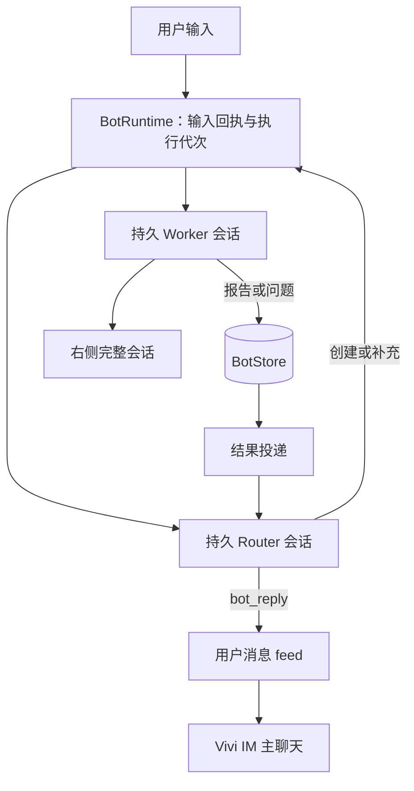

# Vivi：架构与实现

Vivi 使用一个长期 Router 会话协调多个持久 Worker 会话。本文是当前实现的维护入口；接口以 [`src/shared/bot.ts`](../src/shared/bot.ts) 为准，独立记忆的细节见 [Vivi Markdown 记忆](vivi-memory-design.md)。

上游机制研究见 [DSH Superagent 源码报告](dsh-superagent-architecture.md)，产品参考与尚未实现的外部渠道约束见 [Vivi 产品参考](vivi-product-references.md)。

**目标架构已改为整体采用 DSH。** 新的领域、运行机制与迁移方案见 [Vivi DSH 架构重构](vivi-dsh-architecture.md)；GitHub Issue/PR 作为外部事件驱动完整闭环。本篇继续描述重构前当前代码，以下“不直接采用”等取舍是现状说明，不再作为未来架构约束；新设计尚未实现。

## 架构取舍

- **真实会话是执行主题的身份。** 一个工作主题使用稳定的 `conversationId`。补充、回答、继续和恢复留在原会话；新主题才创建新 Worker。内部保存输入、epoch、问题、结果和投递，不再维护 Run / Task / Attempt 三层业务对象。
- **不直接复用 Agent Team 作为持久 Worker。** 当前子 Agent runner 使用内存 Session，mailbox 交付不会自动唤醒空闲父会话；Vivi 需要真实 catalog 会话、磁盘历史和自己的结果投递。
- **运行收尾与目标完成分开。** SDK 正常结束不代表 ready；无报告的 Worker 收尾记录 `idle`，中断记录 `uncertain`，不能自动宣布成功。
- **协调上下文与用户聊天分开。** Router 的 SDK transcript 用于协调与恢复；主聊天只读取独立的 `bot_chat_messages` feed。Worker 工具、思考和完整日志留在右侧真实会话。
- **不照搬团队机器人的授权与 PR 生命周期。** DeepSeek 的 Source / Thread / Eval / Mandate / Ticket 处理多用户 GitHub/飞书场景，本机直接交办目前没有整套接入。

## 代码入口与数据归属

| 位置 | 职责 |
| --- | --- |
| [`src/shared/bot.ts`](../src/shared/bot.ts) | `BotHost`、`BotApi`、输入/问题/结果/事件和 `WorkSnapshot` 类型 |
| [`src/main/bot/bot-runtime.ts`](../src/main/bot/bot-runtime.ts) | 输入、调度、停止、继续、恢复、报告与投递 |
| [`src/main/bot/bot-store.ts`](../src/main/bot/bot-store.ts) | SQLite 编排事实和聊天 feed |
| [`src/main/bot/bot-engine-host.ts`](../src/main/bot/bot-engine-host.ts) | SDK prompt、收尾等待、取消及超时 |
| [`src/main/pi/process-manager.ts`](../src/main/pi/process-manager.ts) | 创建和加载真实 catalog 会话，接入 Host |
| [`src/main/bot/bot-session-extension.ts`](../src/main/bot/bot-session-extension.ts) | Router/Worker 工具、每次请求上下文及执行身份 |
| [`src/main/bot/vivi-voice.ts`](../src/main/bot/vivi-voice.ts) | Vivi 口吻与简短汇报规则 |
| [`src/main/engine/db-schema.ts`](../src/main/engine/db-schema.ts) | 持久表及兼容迁移 |

schema v12 新建 `bot_conversations`、`bot_v2_inputs`、`bot_attention`、`bot_results`、`bot_outbox`；schema v13 新建 `bot_chat_messages`，`bot_meta` 保存 revision、Router ID 和聊天显示代次。

catalog 负责标题、cwd、项目和 sessionFile；SDK 转写负责完整模型/工具历史；BotStore 负责输入、epoch、问题、结果、投递及用户 feed。`getWorkSnapshot()` 不复制完整执行转写，Worker 正文和状态按 `conversationId` 从引擎读取。

schema v11 的旧 Run/Task/Attempt 表保留以维持数据库升级兼容，不进入新调度器。当前 v12 建表与 BotStore **没有实现旧 Task/Attempt 记录自动导入新会话模型**，不能因保留旧表就声称迁移已完成。未来需要迁移时，不拼接不同 Attempt 的 JSONL，不删除旧转写或复用已使用的 schema 编号。

## 输入、工作区与一致性

- Router 创建 key 为 `router:vivi`；Worker 创建 key 为 `work:<requestId>`。创建身份与后续执行 epoch 分开，补充不换会话。
- `requestId` 重复时校验原 payload；用户提交比较文字、图片、目标会话与记忆引用，创建工作还比较工作区选择。相同身份不能提交不同内容。
- 纯图片输入有效。文件/长粘贴元数据还原为 feed 附件，模型输入保持原内容；图片随 `BotInput` 保存并经 Host 交给 SDK。
- Router 每次请求只使用当前执行输入的 requestId/epoch，以及最新本地项目列表。后续排队输入不能提前改变当前工作上下文。
- 项目由 Router 根据语义通过 `bot_create_work.project` 选择，必须是精确本地主目录；catalog 同时绑定 project 和实际 cwd。未知、远程或不可访问的项目拒绝，不回退。
- 无项目 Worker 使用稳定私有目录 `vivi/workspaces/<hash>`；只有显式 `workspace: "vivi"` 才共享 Router 的 `vivi/outputs`，且与 project 互斥。已有 Worker 不迁移工作区。
- 结构化结果、关联 feed 行与 outbox 在一次 BotStore 事务中登记，随后驱动结果投递。会话创建先经 Host 幂等创建 catalog/session，再写 BotStore 元数据；catalog、SQLite 和 SDK JSONL 不是一个跨存储事务。当前 requestId 没有与 SDK JSONL entry 建立严格的输入回执协议，不能承诺跨存储或任意外部副作用 exactly-once。

同一会话的输入串行执行，不同会话可并行。当前 Runtime 没有统一的 Worker 数量上限、同仓库写入互斥或共享桌面资源锁；不同 cwd 和工具白名单也不是文件系统沙箱。需要这些能力时必须单独实现，不能沿用旧设计稿的未实现承诺。

## 工具与结果投递

Router 可以读取上下文、创建工作、向原 Worker 发送补充、停止/继续指定会话，以及调用 `bot_reply` 发送用户可见消息。Worker 可以 `bot_report`、`bot_ask_user`；两者都能 `bot_progress` 上报真实阶段。Vivi 会话不开放递归 Agent Team、DAG、定时任务、worktree 创建和全局配置修改等编排路径。

工具调用绑定当前输入和 epoch，停止后的迟到进度、回复和报告不能更新新一轮。`bot_progress` 不结束回合；回复、报告和问题通过扩展控制本轮收尾。Router 普通文字收尾仍有兼容兜底，正常指令应使用 `bot_reply`。

Worker 非 idle 结果先持久化，再生成 `pending` delivery；Runtime 将 delivery 作为 Router 输入，记录 `injected`。Router 成功收尾后改为 `delivered`，失败则保留 `failed`，供后续恢复。`delivered` 表示 Router 执行完成，不是客户端已读回执。结果在 Router 串行输入通路排队，不做运行中工具边界注入，也不把全量 Worker 日志塞进主会话。

报告 `ready` 是执行者声明，证据和产物是结构化引用，不代表宿主已独立验证。没有报告的正常收尾保持 `idle`，不自动失败、不无限重试。

## 停止、重试与重启

### 停止范围

`stopConversation` 先持久化 `paused` 和新 epoch，清除重启恢复责任，撤回待答问题，使 queued 输入取消、running 输入变成 uncertain，再中止 SDK。旧代次不能恢复新状态。

**Vivi 主聊天输入框的停止当前调用 `stopAll()`，会停止 Router 和所有 Worker。** 单个工作会话或 Router 工具的定向停止只作用于目标会话。关闭侧栏、离开 Vivi 或隐藏宠物不停止工作。

停止全部后，新 requestId 的用户输入可以重新开放 Router；重复旧请求不会解除暂停，也不会恢复 Worker。Worker 继续需要显式操作或仍有效的启动恢复检查。

### 继续与错误重试

`continueConversation` 保持 conversationId，递增 epoch，追加恢复输入。带 `inputId` 的错误重试只针对当前仍可重试的失败回执；运行中、有更新请求、待答或暂停时，不允许旧按钮再次启动工作。重复点击在 epoch 变化后无效。

Router 汇报失败的重试只消费本次失败关联的 delivery，不重新运行已经 ready 的 Worker。继续输入要求先检查历史、实际文件和外部效果，再完成剩余内容；不会自动回滚已执行的命令或远程操作。

### 启动恢复

BotStore 将退出中 running/accepted 输入标为 uncertain，并保存 `restartRecovery`。Runtime 为有效中断记录排队持久 Router 检查，读取已有会话和结果，沿原 Worker 继续；先核对已发生效果，保留原要求、图片、记忆引用与后续队列。

ready 只恢复汇报；blocked/failed、待答问题和用户主动停止不自动执行。检查自身再次中断可重新检查，稳定身份避免重复排队。检查期间 Stop 会清除恢复责任，旧检查、迟到继续工具和收尾补偿不得解除暂停。

## 待答问题

两类问题不能混同：

| 类型 | 状态与应答 |
| --- | --- |
| `BotAttention` | 持久问题。提出后让出执行；回答进入同一会话的新 epoch，并保留已有后续队列 |
| 插件阻塞请求 | Main 中等待的 Promise。通过原 request ID 调用 `engine.respondPermission`；窗口重连可补齐，进程退出后的旧 Promise 不恢复 |

主聊天 composer 上方的 `ViviRequestsPanel` 合并展示所属 Router/Worker 的这两类问题，不混入普通聊天请求。已访问表单保留草稿，只有当前表单启用键盘；confirm/select/input/questions 复用 `PermissionPanel`，editor 在 Vivi 内联预填。

插件列表经 `engine.getPendingUi` 轻量补齐：先订阅并缓冲 request/dismiss，再读存量、重放事件、一次安装队列，避免迟到快照复活已撤回请求。成功应答或 dismiss 后按 ID 移除；失败保留请求和草稿，不误删下一条。

## 主聊天、错误与清空历史

Vivi 主聊天使用独立的 `ViviMessageList` / `ViviMessageRow`：用户气泡靠右，Vivi 靠左；按五分钟间隔或跨日插入时间分隔。没有普通 Agent 的轮次目录、提问吸顶、两行提示折叠或执行耗时。右侧 Worker 仍使用标准 `MessageList` 与完整 `Composer`，按 ID 读取自己的模型、队列、附件和转写，不改变普通聊天 activeId。

主聊天默认一两句话，执行细节留在工作会话。阶段成果限频去重，同一用户请求最多三条；内部 `kind: result` 行保留在存储，Worker 结果不在主聊天重复展示，Router 自身失败仍映射为错误行。完成由 Router 简短汇报。进度问句也交 Router 回答，等待期间只有一行「正在处理…」，不能绕过模型用固定状态回复。

Worker 详情保留文本草稿，附件目前在组件内存中；普通引擎 queue 虽交给 Composer，编辑、重排、立即发送和恢复回调未完整接入。Bot 输入实际保存在 `bot_v2_inputs`，不是直接复用普通会话队列；请求类型的 `behavior` 也未接成运行中 steer。侧栏按命名事件重读 snapshot/state，尚非独立的 seq 缓冲重放 controller。

执行失败跟随对应对话显示，复用 `AssistantErrorNotice`。`WorkSnapshot.executionErrors` 从持久失败回执派生重试目标，按钮执行继续，不是刷新；全局 `error` 仅描述存储/广播等基础设施错误。

`/clear` 递增 `chatGeneration`，仅隐藏当前主聊天 feed。它不停止工作、不删除 SDK 历史、记忆来源或去重/恢复记录；更新旧 result 也不会把旧行搬进新的显示代次。

## 宠物与完成通知

Router 的一条显式回复可能只是「已安排」，不能当作工作完成。唯一完成信号 `BotChanged.completion` 要求：Worker 有 ready 结果，该结果经 Router 汇报，且 Router 回合本身成功收尾。

completion 的稳定 ID 基于结果 ID；文字采用 Router 最后一条反馈，`conversationId` 指向 **Worker**。宠物和系统通知消费此信号，承接回复、问题、进度、内部 delivery、blocked/failed/uncertain 不冒充成功。

点击通知经 `conversation-navigation.ts` 分流到 Vivi 并定位对应工作会话；普通会话通知仍打开普通聊天。宠物继续遵守独立通知窗口、后台展示、移动时隐藏、五秒寿命及悬停保留等规则，不拥有工作状态或结果存储。

## 独立 Markdown 记忆

Vivi 记忆常开、无配置入口，不跟随普通长期记忆总开关。Router 可读/搜/显式更新，Worker 只读；最多三项 `memoryRefs` 在真正执行时重新读取，明确保存必须先发布成功才能回复已记住。

普通记忆与 Vivi 共用遗忘曲线、强化间隔、到期阈值和 256 来源容量；明确保存没有永久豁免。到期清理必须与正文和索引一起成功发布。发布、输入来源、并发更新和遗忘的详细约束仅在 [记忆设计](vivi-memory-design.md) 维护，不在本文复制另一套算法说明。

## 回归入口与验证边界

只验证文档时不需要运行整套测试。修改运行机制后按涉及范围选择现有回归：

| 范围 | 测试 |
| --- | --- |
| 身份、输入、投递、epoch、图片 | `test/bot-runtime.test.ts`、`test/bot-store.test.ts`、`test/bot-engine.test.ts` |
| 启动恢复、旧执行失效、原 SDK 历史 | `test/bot-restart.test.ts`、`test/bot-restart-sdk.test.ts` |
| 失败回执与真实重试 | `test/bot-error-retry.test.ts` |
| 进度、feed、附件与 IM 排版 | `test/bot-conversation-progress.test.ts`、`test/vivi-chat.test.ts`、`test/vivi-message-layout.test.ts` |
| 插件存量请求与 Promise | `test/vivi-requests.test.ts`、`test/vivi-plugin-requests.test.ts` |
| 完成通知与导航 | `test/bot-notifications.test.ts`、`test/bot-pet.test.ts` |
| Markdown 记忆 | `test/vivi-memory-*.test.ts`、`test/memory-retention-parity.test.ts` |

使用 `node --test <对应文件>` 跑窄范围回归；代码变更需通过 `pnpm typecheck`。完整回归需要项目的 iroh 二进制，按仓库测试环境运行。历史某次通过的测试数量不能当成当前版本的验收结果。

预览以 `src/renderer` 为 Vite root：`mock.html?vivi=chat&theme=light|dark&lang=zh|en`；待答表单用 `vivi=requests`，行内错误用 `vivi=execution-error`。fixture 和脚本模型用于验证合同与呈现，不代表真实供应商/外部平台端到端完成。

## 尚未接入

Vivi 专属定时交办、外部 IM、SSH 项目执行、多 Bot、独立历史全文搜索、结果未读计数、全局 Worker 限流和同仓库写互斥尚未接入。普通会话、Agent Team、DAG 和定时任务各有现有实现，不因 Vivi 支持这些名称的相关能力就自动打通。
