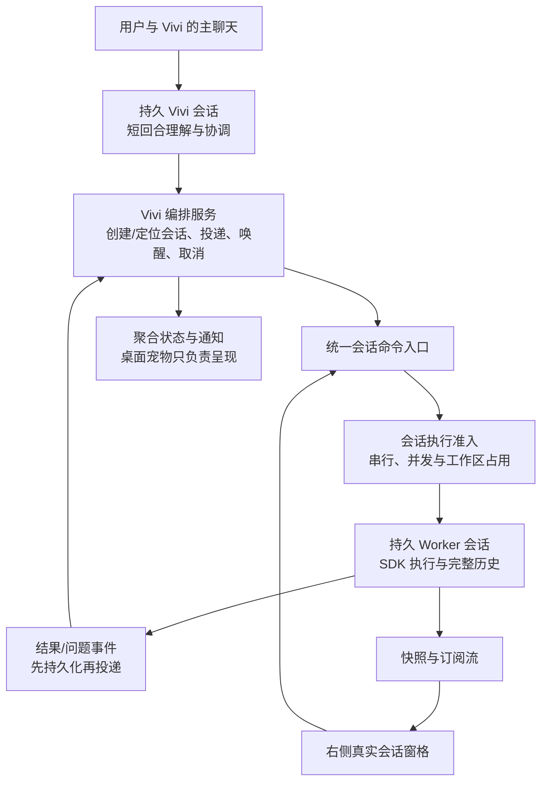

# Vivi 架构决策：真实会话与持久编排

状态：研究后的架构决策，尚未按本文重构。本文取代 `vivi-bot-plan.md` 中 Run → Task → Attempt → 新 Worker 会话的目标设计；旧计划与实现说明保留为原型记录。

## 1. 决策

**Vivi 是一个长期主会话，负责协调多个持续的工作会话。界面直接操作真实会话；宿主保存最小的编排事实，不再建立独立的 Run / Task / Attempt 业务层级。**

- 一个工作主题对应一个稳定的 Worker conversationId。补充、回答、停止后继续、失败后恢复，均留在原会话；只有新主题、显式分叉或重新开始才创建会话。
- Worker 是会话的执行角色，不是另一个进程，也不是长期复用给所有工作的“某专业员工”。不相关工作隔离上下文，同一主题保留历史。
- 会话是否正在运行由引擎决定；是否还有待回答问题、是否有可交付结果、是否已经回报给 Vivi，是另外几项持久事实。
- 保留内部执行代次、输入回执、结构化结果和唤醒队列；不把这些内部记录变成用户需要管理的工单。
- 不将现有 Agent Team 原样作为宿主，也不把全项目子 agent 持久化重构列为 Vivi 的前置条件。复用 catalog / AgentSession / 转写 / 会话队列 / 快照。

此前“直接取消 Task，状态都复用会话”的表述不够准确。真正要删除的是重复的业务对象与状态机，不能删除交付、取消、问题和恢复的事实。这不是简单把 Task 改名：新模型没有独立的任务标题/正文/转写/输入队列、依赖图、业务重试会话和多层完成状态；执行主题的唯一稳定身份是 conversationId。

## 2. 外部研究的证据与边界

核对 DeepSeek 官方组织仓库 [dsh-superagent-prototype](https://github.com/deepseek-ai/dsh-superagent-prototype)，固定提交 `6337fc823ce20251c8de8085948165c81aaa701e`。阅读官方文档和关键源码，未运行其代码，也未验证 DeepSeek 内部部署。

[README](https://github.com/deepseek-ai/dsh-superagent-prototype/blob/6337fc823ce20251c8de8085948165c81aaa701e/README.md) 明确说明：这是研究原型，不是正式产品；公开代码不等同内部版本或《Exploring Super-agent Design》文章，部分设想尚未实现。本决策的机制结论以源码为准，不用二手文章推断未知实现。Muse 仅作为用户期望的交互方向，本文不对其内部架构下结论。

| DeepSeek 已实现的机制 | 源码证据 | Vivi 取舍 |
| --- | --- | --- |
| Ticket 是授权工作的独立主体，Assignment 是一次执行绑定，Session 是执行器 | [领域模型](https://github.com/deepseek-ai/dsh-superagent-prototype/blob/6337fc823ce20251c8de8085948165c81aaa701e/docs/001-domain.md) | 不照搬其多用户/跨渠道业务对象；保留执行和交付不能由 idle 推断的原则 |
| Worker 会话按 Ticket 固定命名，重试仍恢复原会话 | [dsh.ts L24](https://github.com/deepseek-ai/dsh-superagent-prototype/blob/6337fc823ce20251c8de8085948165c81aaa701e/src/executor/dsh.ts#L24)、[L440–470](https://github.com/deepseek-ai/dsh-superagent-prototype/blob/6337fc823ce20251c8de8085948165c81aaa701e/src/executor/dsh.ts#L440) | 采用：运行代次变化不更换 conversationId |
| 补充消息以稳定 Input ID steer 原会话；允许人在 Worker UI 直接输入 | [dsh.ts L290–343](https://github.com/deepseek-ai/dsh-superagent-prototype/blob/6337fc823ce20251c8de8085948165c81aaa701e/src/executor/dsh.ts#L290)、[L487](https://github.com/deepseek-ai/dsh-superagent-prototype/blob/6337fc823ce20251c8de8085948165c81aaa701e/src/executor/dsh.ts#L487) | 采用同一会话发送通路，直接输入与路由输入统一协调 |
| 到达 inbox、进入历史、被一次完成的执行处理，是不同事实 | [delivery.ts L25–85](https://github.com/deepseek-ai/dsh-superagent-prototype/blob/6337fc823ce20251c8de8085948165c81aaa701e/src/app/delivery.ts#L25)、[assignments.ts L39–66](https://github.com/deepseek-ai/dsh-superagent-prototype/blob/6337fc823ce20251c8de8085948165c81aaa701e/src/core/assignments.ts#L39) | 采用稳定消息身份和持久回执，不用方法返回或文字相同代替对账 |
| 报告区分 progress/waiting/ready/blocked/failed/dropped；ready 可仍在等待 PR 审核 | [执行文档](https://github.com/deepseek-ai/dsh-superagent-prototype/blob/6337fc823ce20251c8de8085948165c81aaa701e/docs/003-execution.md) | 采用运行与交付分离；不搬 PR 结束规则，不把所有正常收尾都硬判完成 |
| 普通进度留在内部；问题和有用结果通过可靠 relay 唤醒主会话 | [notices.ts L109–135](https://github.com/deepseek-ai/dsh-superagent-prototype/blob/6337fc823ce20251c8de8085948165c81aaa701e/src/app/notices.ts#L109)、[sessions.ts L100](https://github.com/deepseek-ai/dsh-superagent-prototype/blob/6337fc823ce20251c8de8085948165c81aaa701e/src/app/sessions.ts#L100) | 采用；不轮询模型，不让每条工具结果触发汇报 |
| 事务内登记 effect，提交后执行；出站消息有 receipt | [effects.ts](https://github.com/deepseek-ai/dsh-superagent-prototype/blob/6337fc823ce20251c8de8085948165c81aaa701e/src/app/effects.ts)、[outbox.ts L23](https://github.com/deepseek-ai/dsh-superagent-prototype/blob/6337fc823ce20251c8de8085948165c81aaa701e/src/app/outbox.ts#L23) | 采用小型、封闭操作集的持久投递，不引入通用工作流平台 |
| 主动恢复中断 Assignment，要求先检查实际外部效果 | [执行文档的 Restart](https://github.com/deepseek-ai/dsh-superagent-prototype/blob/6337fc823ce20251c8de8085948165c81aaa701e/docs/003-execution.md#restart) | 保存历史与待投递；不自动重跑不确定的工具执行，继续由人明确触发 |

DeepSeek 管理面板确实展示 Ticket，外部聊天才用自然语言隐藏术语。“界面轻”不能推导“内部无状态”。其 Ticket 解决的是单仓库、多用户、GitHub/飞书事件订阅、授权和 PR 生命周期；FastVibe 首版是本机用户直接交办，职责不同。

值得采用的产品原则是 [少占用人的注意力](https://github.com/deepseek-ai/dsh-superagent-prototype/blob/6337fc823ce20251c8de8085948165c81aaa701e/docs/000-philosophy.md)：收到后简短回应，需要判断或有可用结果时再说话，健康状态不占一整块管理界面。

## 3. 为什么选会话底座

以下为当前 worktree 的事实，非已完成的新架构能力：

| 底座 | 证据与不足 | 决策 |
| --- | --- | --- |
| 真实 catalog 会话 | `process-manager.ts:#createBotConversation/#ensureSession` 已支持不激活普通聊天而创建、落盘、重新加载；`#executeBotConversation` 复用 SDK loop | 保留，并将稳定创建 key 从 attempt 改为工作会话身份 |
| Agent Team | `process-manager-subagent.ts` 使用 `SessionManager.inMemory`；`followupAgent` 拼最近 20 条邮箱重新启动；完整执行上下文并非同一持久会话 | 不原样承载 Vivi Worker；暂不全局改造 |
| Agent Team mailbox | `agent-team-context.ts` 持久注入后确认、noticeId 去重；明确不唤醒 idle/stopped 父会话 | 复用投递原则，Vivi 明确增加自己的可控唤醒策略 |
| 会话队列 | `message-queue.ts` 有持久 pending/claimed、暂停与重启对账；旧的 crash 对账按文本和时间匹配 | 复用队列实体；新增编排输入必须有稳定 ID 的转写回执，不能宣称已有严格跨重启幂等 |
| 会话快照 | `getSnapshot` 已含消息、运行、queue、pendingUi、seq；模型和上下文用量由对应 `getState(id)` 提供 | 读取真实会话；不再用 `bot.getTask` 搬完整转写 |
| 挂起问题 | `#pendingUi` 是内存 Map，重连可恢复，进程重启不能恢复 Promise | 保留持久 attention 记录，复用问题呈现组件，不能直接删掉这项能力 |
| 原侧边聊天 | `side-pane-chat.tsx` 读取全局 session 的模型/上下文、`queued=[]`、运行时不接受发送；临时 side-chat 还有启动清理规则 | 提取按 conversationId 隔离的完整会话容器；不能只是换组件名 |

## 4. 目标结构与职责

### Vivi 主会话

- 纯聊天直接回答。需要工具执行、独立工作目录或较长上下文的工作，创建或复用 Worker 会话。
- 不是“每条用户消息建一个 Run”。消息进入主会话，Router 决定回答、委派、跟进、停止或澄清。
- 通过有限工具查看活动会话摘要、读取指定会话的必要历史、派发/补充/停止。只增加确实需要的有界只读检索能力，不开放长时间等待和随意 shell 执行。
- 一个主会话同一时刻一个模型回合；新用户消息可靠排队，报告以带来源的宿主消息送达完整工具交换边界，不与用户文字混为一类。
- 不把全量 Worker 日志塞回主会话。只投递短摘要、结果/问题 ID、conversationId 和 entryId；需要时再读取全文。
- 模型选已有或新会话；明确点选的会话优先，歧义时澄清，不因“是新的一句话”就重建工作。

### Worker 会话

- 首次输入包含目标、相关上下文、项目与完成标准；之后仅发送新增要求、回答或恢复说明。完整历史由 SDK 自己管理和压缩。
- 用户在右侧和 Vivi 从工具发送，均进入同一个会话命令路径。附件、文件引用、模型选择与命令能力按真实会话支持，不再人为做一个 text-only 复制品。
- 默认延续已有队列交互：运行中追加为 follow-up；用户明确选择即时引导时使用 steer。二者不创建新会话；继续/原地恢复与“重试上一轮并回退历史/文件”保持原功能各自语义。
- 初版不新增 Worker 递归编排和 DAG。复杂工作可在一个 Worker 中顺序完成；确实可独立的部分由 Vivi 创建几个会话，收到结果后给下一会话输入。持久待办消息承担衔接，不再保留一份 Bot 依赖图。
- Router 的派发与普通工具执行必须经过确定性宿主校验：所属 Vivi、conversationId、来源指令、执行代次。工具限制不是文件系统沙箱。

### 会话容器

提取可绑定 `conversationId` 的会话 controller/view，复用 MessageList、Composer、PermissionPanel、队列和文件行为。Vivi 主聊天与右侧 Worker 先使用它；普通主聊天随后复用同一容器，避免一次大范围重写 App。

每个实例拥有自己的 messages/state/queue/pendingUi/seq、草稿与附件；模型和上下文不读取普通活动会话的全局单槽。挂载时先建立事件缓冲，再取 snapshot，按 seq 丢弃旧事件并应用后续事件；离开仅取消订阅，不停止会话。主机上后台流的订阅需要覆盖桌面 IPC 与 App Protocol，不沿用“把所有 Bot token 广播给所有窗口”的特例。

侧边 tab 的业务目标就是 conversationId，不调用 `conversations.open` 去改全局 activeId。资源、文件与 Git 操作仍使用该会话 cwd，手机也可读同一快照。

## 5. 必须保留的内部事实

具体表名可在实现时收敛，以下是语义边界；不能把这张表原样做成用户管理页面。

| 事实 | 最小数据与唯一来源 |
| --- | --- |
| 会话归属 | conversationId、owner Vivi、role、origin message 引用。名称/工作目录/模型/正文来自 catalog 与转写，不重复存一套 Task |
| 调度控制 | 每个工作会话的 execution epoch、自动执行暂停标记、当前执行凭据。用户 Stop 使旧代次失效；真正 running/compacting 仍由引擎持有 |
| 待送消息 | 稳定 requestId、来源、目标 conversationId、payload 引用、交付阶段。最终输入只有会话队列一份权威副本；编排表只保存创建/投递意图和回执 |
| 问题 | attentionId、conversationId、所属输入/代次、问题与答复、pending/resolved/withdrawn。提问会结束当前自动回合并释放名额，答复作为同一会话的新输入 |
| 结果 | resultId、conversationId、branch/entry 锚点、覆盖的输入序号、ready/blocked/failed/idle 等结论、短摘要及产物/证据引用 |
| 待汇报 | resultId → Vivi 会话/目标渠道、是否进入主会话、是否已有可见汇报及其 entryId。UI 已读与模型已接收分开 |

“工作已完成”不再是一个独立 Task 行的永久终态。工作会话可以完成一轮交付后继续聊；新输入使此前结果只代表此前范围，不代表最新要求已满足。

仍保留结构化报告协议，因为“模型收尾”不是完成证据。但报告不强制每轮都宣告成功；普通收尾而没有报告时记录“已结束，交付未确认”，可把原文交给 Vivi 判断，不能自动记为失败、触发重试循环或伪造完成。报告只约束本次执行，不能封死这个会话以后的工具能力。

### 输入与结果的持久化边界

1. 用户/Router 命令先持久化 requestId 与 fingerprint。创建会话使用稳定 creation key，可在崩溃后找回同一个 catalog 行。
2. 事务内写编排状态与待执行意图；事务提交后才调用 SDK/创建文件/发送通知。catalog、SQLite 与 JSONL 不是一个跨存储原子事务，必须通过 stable ID 对账。
3. 投递分为已接受、已入会话队列、已进入持久转写、已有结果覆盖。工具返回成功不直接代表模型处理完毕。
4. 新输入的 requestId 必须能从实际转写可靠对账；仅在旁边先写“已发送”标记会产生丢失窗口。用真实 SDK 验证消息标记持久化与关联，不在设计中假定 SDK 自动保存任意字段。
5. Worker 的 ready 只覆盖它实际消费的输入。执行中又来了新要求，旧结果可供查看，但不能清掉新消息或宣布最新要求已完成。
6. 结果先写存储/转写锚点，再持久入 Vivi inbox。Vivi 忙时安全注入或排队；空闲且未暂停时启动短汇报回合。若已持久注入但还没有最终汇报，恢复时继续处理该事件，不重复注入。
7. 这保证可恢复和逻辑去重，不承诺模型只调用一次或任意外部操作 exactly-once。UI/宠物用稳定 deliveryId 去重；未来外部渠道按该渠道回执能力处理崩溃窗口。

## 6. 并发、停止、恢复与问题

### 同一调度入口

所有针对 Vivi Worker 的开始/继续/排队 drain 都必须经过同一执行准入，右侧直接输入不能绕过。每会话一个执行所有者；默认两个 Worker 可并行，Router 有自己的短回合通路，不被 Worker 长操作占满。

同一规范化工作区或已声明的重叠写范围保守串行；新提交只是入队，不在拿到名额前开始副作用。优先让人的直接补充继续已有工作，同时用公平队列避免其他工作饿死，不照搬 DeepSeek 的额外超额槽位。不能宣称该范围覆盖用户手工终端或普通聊天的并发写；共享工具/全局桌面资源也不因不同 cwd 就隔离。需要共享桌面操控时按宿主实际互斥能力串行，首版不承诺两个 Worker 同时操控同一界面。

一个工具卡显示后台启动成功，不代表受管后台执行已结束；只有引擎可跟踪的后台控制句柄才计入执行所有权。初版不新增无人管理的后台作业/递归子 agent 路径。

### 停止范围

- 主聊天的停止：停止 Vivi 当前回合，并暂停由这次明确停止产生的自动汇报续跑；不暗中停止全部 Worker。结果仍保存，用户后续输入可恢复主会话。
- 右侧停止：停止该会话及其受管子执行，暂停其自动排队，提升 epoch。迟到报告可以保留历史，不能解除暂停。
- “停止所有正在进行的工作”：显式操作，暂停派发并逐个停止 owned 会话；等待真正退出后释放锁和名额。
- 关闭右侧标签、离开 Vivi、隐藏宠物均不停止工作。

### 重启

恢复同一批 conversationId 与转写。确定尚未执行的持久投递可对账后继续；已执行但未确认结束的会话标为中断，不能仅因某个队列非空就自动重跑。用户继续时在原会话附恢复说明，先核对已有文件与外部效果。已完成但未汇报的结果可恢复汇报，尊重主会话暂停状态；不会重新执行 Worker 来获得同一结果。

### 持久问题

复用 question 的字段与界面，但后台长时等待不能依赖旧 Promise。Worker 提出结构化问题后持久化并正常让出执行；回答以稳定 attentionId 去重并进入同一会话。主聊天中的问题卡与右侧卡指向同一记录，任一端回答后另一端随快照撤下。重启后展示的是可回答的持久问题，而非恢复一个不存在的工具调用。普通聊天现有的阻塞式插件 UI 不在此次重构中整体改语义。

## 7. 用户看到什么

主入口仍是一个 Vivi 聊天，提供简短的“正在处理 2 件事 / 有问题等你回答”。按需打开最近工作会话列表，列表只有会话名称、状态和打开入口；没有独立任务详情页、Attempt 下拉、验收元数据管理表单。

右侧打开完整真实会话，用户可以读过程、改要求、加附件、停止和继续。必要的结果证据在回复中，产物沿用现有预览；执行失败沿用现有错误行。主聊天的“查看过程”指向该 conversationId 与相关消息锚点。

问题、失败和有用结果才触发主聊天汇报与通知。普通进度只更新状态；用户正在右侧读结果时仍保留主会话可追踪结果，但避免重复系统打扰。宠物读取聚合事实和独立通知目标，不拥有执行或结果存储。

## 8. 范围与不采用的方案

- 不采用“只靠聊天文字推断一切”：停止、投递、结果、问题必须结构化且可恢复。
- 不继续 Run/Task/Attempt 每层维护 completed/running 的原型：事实重复，且每次补充换会话割裂上下文。
- 不直接套 Agent Team：当前完整 SDK 历史不持久，idle parent 不会自动汇报。
- 不先重构整个 Agent Team：它现有的临时协作、fork、Stop 与 mailbox 语义是另一个产品范围；以后可以共用执行宿主，但本次不迁移普通子 agent。
- 不复制 DeepSeek 的 Source/Thread/Subscription/Eval/Mandate/PR 结束规则。接外部多用户入口时再增加明确的身份、授权与来源适配，不能把任意外部文本当本机用户指令。
- 不新造 DAG、计划调度或循环 Watchdog。定时任务未来仍由现有 ScheduledTaskManager 触发会话命令；新增长期目标、跨执行器交接或外部审核生命周期时，再判断是否需要独立工作实体。
- 不自动建 worktree，不自动开启长期记忆，不引入通用审批模式；模型与权限沿用已有配置和用户指令。

## 9. 从当前原型迁移

按以下依赖顺序实施，不先继续润色 Task UI：

1. **固定会话身份。** 新工作一开始就生成稳定 Worker conversationId；补充/回答/恢复用同一会话。执行代次从会话创建 key 解耦，保留旧接口适配以方便逐步切换。
2. **统一输入与执行准入。** 将原 bot_inputs 的用户内容送入现有会话队列；补充来源 ID、跨重启回执、Vivi 自动唤醒策略和全入口调度钩子。保留已有取消代次及持久问题的有效语义。
3. **建立按 ID 的会话容器。** 直接采用 snapshot/state/queue/pendingUi 和命名流订阅；替换 bot.getTask 转写读取与 textOnly composer。保留主聊天与右侧草稿，验证普通 activeId 不变。
4. **收敛结果与通知。** 结构化结果关联输入范围，outbox 回报 Vivi；移除“没有 bot_report 一律失败”，不将 agent_settled 等同目标完成。
5. **移除冗余模型与 UI。** 删除新路径的 BotRun/Task/Attempt 业务驱动、任务详情和重复队列。旧记录以兼容读取保存历史，不简单改名继续维护原状态机。

已有原型数据不能直接丢：一个旧 Task 的不同 Attempt 已经是多份真实转写，不应拼 JSONL 或伪造 parent 链。选择最近有效会话作为今后的工作会话，附一次明确的迁移上下文与旧会话引用；旧会话只读保留，必要时按 ID 查阅。待投递、已回答问题与已汇报结果都按旧 ID 映射并去重。

schema 11 即使尚未发布也可能已被本地使用；不复用/倒退已用 schema 编号，不在未确认无数据时删除旧表。新增迁移以事务导入关系/回执，保留原表供回溯。文档中的实现完成状态以原型为准，新架构须另验收。

## 10. 验收重点

无需先堆一批样式断言，应以真实 SDK + 临时数据目录验证以下语义：

1. 首次委派、运行中追加、回答、完成后修改、重启后继续，conversationId 不变，模型能读取原工具历史。
2. 右侧和 Vivi 同时补充，同一条消息只入队一次；附图/文件/长粘贴不丢失，草稿与失败恢复正确。
3. 同目录两个 Worker，以及右侧直接“继续”，均不能绕过并发约束；普通会话 activeId 不变。
4. 新要求到达与旧 ready 同时发生，旧报告不会清空新队列或误报最新目标完成。
5. 分别在会话创建、队列接受、写入转写、写报告、报告注入 Vivi、可见汇报前后中断，重启后没有重复会话、丢消息或重复通知。
6. 主会话 idle 时结果能唤醒；用户显式停止后迟到结果不能复活它；只关窗格不影响后台。
7. 持久问题跨重启/窗口/主侧聊天回答一致，不依赖旧 Promise；回答后沿原会话继续。
8. 无报告的正常收尾不伪造成功、不无限重试；真实失败与用户停止仍分别显示。
9. 普通聊天、Agent Team、DAG、定时任务和原有临时 side-chat 的运行/停止语义不被改写。

本次只进行了文档/源码核对与架构取舍，没有运行 DeepSeek 原型或新的运行时测试，没有修改应用实现。
