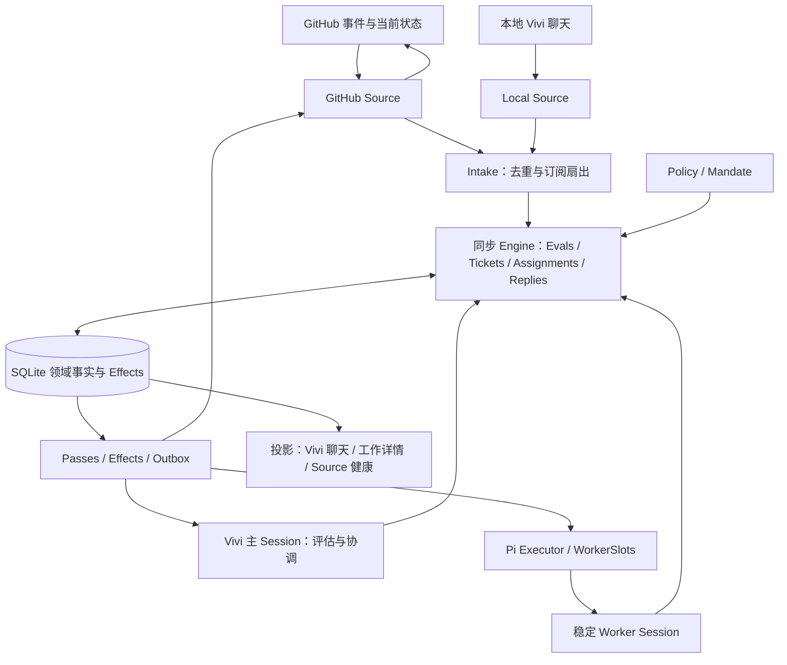

# Vivi 整体重构：采用 DSH 完整架构

状态：**目标架构已确定；M0–M10 的隔离领域、Shadow Store、同步端口、真实 Pi SDK Session、执行资源层、Source/Policy 控制面、Local Source 回放、兼容投影、迁移 dry-run、GitHub 只读 Shadow Source 与 Source Operation dry-run 已落地，生产 Runtime 尚未切换。** 实际开发进度、验收命令与未完成范围见 [开发进度记录](vivi-dsh-development.md)。M11 的本地 HTTP、宿主授权、Issue continuation 及[原生 GitHub REST 读写/对账](vivi-dsh-github-rest.md)已实现；真实专用 GitHub 仓库闭环尚未验收。

目标是把 Vivi 整体改造成 DSH Superagent 的领域与运行架构。GitHub Issue → PR → Review → 修复 → CI → Merge 是第一条验收链路；“先完成 GitHub”限定外部平台，不允许据此省略授权评估、长期工作、消息归属、持久副作用和恢复机制。

本设计不继承旧审核技能、CLI、账号配置或人工审核脚本。它也不在现有 Router/Worker Runtime 外叠加一个 GitHub 专用 Workflow。当前行为仍见 [Vivi 架构与实现](vivi-bot-implementation.md)；上游依据固定为 `deepseek-ai/dsh-superagent-prototype@8c32a9dc5d72c033816c6a8110b37f40cf94fba4`，详见 [源码报告](dsh-superagent-architecture.md)。

## 1. 架构决定与上游边界

采用 DSH 的 Source、Trigger、Thread、Channel、Policy、Evaluation、Decision、Mandate、Ticket、Assignment、TicketInput、Report、Attention，以及 Subscription / Follow / Correlation 关系；采用同步 Engine、短事务、持久 Effects、Outbox、Passes、稳定 Session 和 WorkerSlots。Vivi 是长期主协调 Session 的产品身份。

“完全按 DSH”指上述职责、状态转移、投递和恢复语义完整迁移；FastVibe 继续使用自己的 pi SDK、SQLite 封装、真实会话、IM 聊天和 Markdown 记忆，不能把 DSH SDK 的 inbox/flush 能力当成 pi 已有能力。

| 内容 | DSH 上游事实 | Vivi 的落实 |
| --- | --- | --- |
| GitHub 接入 | CLI/API 轮询通知、仓库流、订阅、PR 和 CI | 首先实现同等的持久游标轮询；无需公网回调也能由外部事件启动 Vivi。未来 webhook 走同一 Intake |
| 协调入口 | 外部事件先入域，候选与报告持久投递主 Session | Issue/PR 事件直接触发处理，不依赖用户把 URL 贴进聊天 |
| 工作身份 | Ticket 跨 Assignment，Worker Session 通常固定 | 真实 conversationId 是宿主映射，不能代替 Ticket |
| PR 结束 | Source 调用 `threadClosed`，不是生成普通 merge Trigger | 生命周期事实走来源端口，Engine 决定是否结束 Ticket |
| Review / Merge | 能接收 review/CI；交付提示词约定另一个账号执行 merge，没有独立宿主 merge 状态机 | 新增 GitHub 执行端口、审核产物与合并校验，仍服从同一 Engine / Assignment / Effects，不新增第二个调度器 |
| 运行与呈现 | DSH 宿主和面板 | pi Session adapter、Vivi IM、右侧详情、通知与独立记忆 |

Vivi 新增的多来源实例 key、完整分页、Pi 投递回执、自动审核、外部写入对账须单独验收，不能冒称上游已经保证。

## 2. 总体结构



本地交办和 GitHub 交办使用同一套领域核心。本地聊天也实现为 Source，保留本机用户的明确授权路径；不能保留一个旧 BotRuntime 负责本地工作、另一个新 Runtime 负责 GitHub 工作。

## 3. 完整领域模型

| 对象 | 责任与不可混淆的边界 |
| --- | --- |
| Source | 来源配置、监听范围、平台认证、读取/回复/上下文接口和健康；平台字段只在 adapter 内解释 |
| Trigger | 一条不可变事件，稳定 ID、Actor、human/addressed、时间、Thread 列表、Channel、正文及 metadata |
| Thread | 外部讨论身份和 Evaluation 一致性边界；持有 pending、活动 Eval、订阅和 correlation；不是 Session |
| Channel | 具体写回地址；平台评论或行内讨论地址，不能当作生命周期 |
| Evaluation | 同一 Thread 的候选批次、primary Trigger、准入强度和评估期限；每 Thread 最多一个活动项 |
| Decision | `ignore / accept / reopen / stop / unavailable`、原因、版本及审计证据；接受前并没有执行授权；`reopen` 是历史兼容值，当前人类恢复走 wake → resumed Input → 新 Assignment，不额外制造 Eval/Decision |
| Mandate | 接单时不可变的 actor、strength、basis、policyVersion、scope；后续输入不自动扩大授权 |
| Ticket | 长期授权工作聚合，包含 origin、inputs、assignments、channels、follows、attention、execution 和 ended |
| Assignment | Ticket 与某次执行实例的绑定，`pending / running / ended`，保存报告及送达/读取/空闲事实 |
| TicketInput | Trigger、policy change、resume、note 等待处理信息，分别记录未送达、已投递、已进入历史、承接与 handback |
| Report | `progress / waiting / ready / blocked / failed / dropped`；不是 GitHub 回复或外部完成证明 |
| Attention | 当前需要人决定的问题，关联提问 Trigger、回复 Channel 和 Ticket；不是一段悬在进程内的 Promise |
| Session | 域外的模型上下文与转写，主 Session 负责协调，稳定 Worker Session 负责执行 |

Ticket 不保存一个可任意修改的通用总状态。开放由 `ended` 是否存在决定；结束记录 `completed / merged / closed / dropped / stopped`、时间、发起方和原因。UI stage 从领域事实派生，沿上游优先级 `ended → delivery failure → attention → ready/review → blocked/failed → queued → idle → working`；Session idle 和 Passes idle 都不是工作结束。

### 三种关系

- **Subscription**：Thread 上的新事件扇出给哪些 Ticket；一个 Thread 可以订阅多个 Ticket。
- **Follow**：外部对象的关闭事实如何结束工作；`own=true` 表示 Ticket 自己创建的 PR，`own=false` 仍是生命周期绑定。
- **Correlation**：线程间的上下文关联；不自动订阅、不扇出、不授权。

context-only subscription 只供阅读，不取得人类消息 ownership，不能确认承接该消息，也不因此恢复已结束 Ticket。它与 `Follow.own=false` 完全不同。

GitHub 的行内评论、review 和 PR CI 归到相应 PR Thread，附文件/行号/SHA 元数据，不为每条 review 再创建一个独立 Thread。Issue 与 PR 各有 Thread；通过显式来源证据建立关联，不能看到正文引用就认定 own 或接单。DSH 当前 GitHub Trigger 是单 Thread，自动 Issue↔PR correlation 是 Vivi 扩展。

## 4. Policy、Evaluation 与 Mandate

来源监听、事件准入、模型判断和授权分别处理：

1. Source 声明事件是否在监听范围，是否是人类、是否 @ Vivi；正文不是可信控制指令。
2. Policy 根据 actor 名单、来源接收表和 `explicit / inferred` 判定是否成为候选。
3. 人类 follow-up 已有 owner 时优先交原 Worker，否则 Thread 收集 pending，启动单个 Eval。
4. 主 Session 对 explicit 请求走 route；inferred 候选先读取上下文、逐条规则结构化评估，再 decide。
5. accept 在事务中建立 Decision、不可变 Mandate、Ticket、首 Assignment、订阅、ack 和 launch Effect。

必须保留 `off / observe / auto`：off 不接 inferred，observe 评估并记录 would-accept 但不执行，auto 才允许符合规则的 inferred 接单。explicit 不被 observe 阻断。机器人白名单最多获得 inferred，不能伪装成人类 explicit 或 stop。

接收表保留“名单内未指向 / 名单外指向 / 名单外未指向”三种可配单元；名单内明确指向走 explicit。inferred assessment 逐条覆盖启用规则，包含实现方向、目标确定性、是否需要设计决定、intent evidence 和 scope；不能把这套检查错误套成 explicit 的上游规则。

Policy 版本取决于授权内容，不包含模型、并发和暂停参数。策略变化重评在途 Eval，向受影响 Ticket 添加 policy-change Input；上游不会因此立即硬停所有 Worker。Vivi 的实际工具/写入端口仍需在执行前校验当前有效授权。结束 Ticket 被人类消息恢复前再次 revalidate，人工 stop 不可被评论自动解除。

Eval 超时从候选实际送达主 Session 后计算，暂停期间调整期限；按上游重排与 unavailable 语义处理，不把 Source 网络故障算成模型拒绝。Decision 对每个批次和 Trigger 去向可追踪，不能只保存一段 Router 回复。

accept 去重覆盖整个批次的 `triggerIds`，不能只标 primary。已经被任何 accept 消费的 Trigger 重放不能再创建 Ticket；旧 evalId 不能决定新批次，旧 policyVersion 的结果也不能直接落 accept。这些领域不变量独立于 Source 事件去重，必须在决定提交的事务内再次核对。

## 5. 同步 Engine、Store 与端口

Engine 不 await 模型或网络。命令通过 `repo.atomic()` 在短事务内更新领域对象并入队 Effects。按 DSH 拆分 Intake、Evals、Tickets、Assignments、Replies；Sources、主 Session、Executor、设置和人工操作仅拿各自需要的窄端口。

| 原子操作 | 同事务提交的事实 |
| --- | --- |
| receive | Trigger、Disposition、Thread、订阅扇出 Input、pending Eval |
| accept/route | Decision、Mandate、Ticket、Assignment、订阅、ack Outbox、launch Effect |
| deliver/read/report | Assignment 对账、TicketInput、Report/Attention、relay 和必要的结束处理 |
| reply | 用途校验、稳定消息 ID、Outbox 与 reply Effect |
| threadClosed/stop/retry | Follow/ended/新 Assignment、待处理输入回收、持久取消与恢复意图 |

Thread、Ticket 等可以沿用上游 JSON 聚合存储，必要时增加索引与派生列；不能为“看起来分层”强行拆成几十张同步困难的表。最低持久集合覆盖 Trigger/Disposition、Thread/Eval、Decision、Ticket/Mandate/Input/Assignment、Effect、Outbox、KV/Source 游标与会话回执。所有改变领域状态的路径收口到 Engine。

FastVibe 的 Db 事务目前不支持嵌套。移植上游 SAVEPOINT 风格时，应明确实现嵌套语义或让 Engine 持有唯一事务、内部命令复用上下文，不能直接嵌套现有 `Db.transaction`。写入失败回滚后，内存镜像也不能先行发布。现有数据库权限、WAL、schema 升级规则继续遵守；不复用历史迁移编号，不为仿照上游而改坏普通会话存储。

`afterCommit` 仅用于可丢失唤醒，不用于唯一的外部执行记录。网络、SDK 会话创建、workspace prepare、通知都在事务外执行；崩溃后靠持久意图恢复。不同数据根各自存自己的库，不并行启动两套同域调度器。

## 6. Effects、Outbox 与 Passes

首先完整实现上游六类 Effect：

| kind | key / 职责 |
| --- | --- |
| assessment | Eval ID：候选送到主 Session |
| launch | Assignment ID：准备现场与启动执行 |
| delivery | Ticket ID：投递等待输入 |
| relay | request ID：报告/跟进送主 Session |
| notice | notice name：不唤醒模型的通知 |
| reply | message ID：原 Channel 回复 |

每项保存 kind/key、payload、seq、generation、attempts、error、due、since。同 key 更新增加 generation，旧 handler 只完成自己那代。`Later` 表示暂停、槽位满等可等待条件，不累计失败；真实失败退避并更新健康。保留顺序与故障诊断，不通过丢事件缓解积压。

上游通用 Effect 从 2 秒退避到 60 秒，launch 和 reply 分别覆盖为 5 秒到 300 秒；失败三次影响健康，**没有统一的三次失败即死信规则**。delivery 采用 quiet 错误路径，由对应 Ticket 呈现失败。Vivi 首先保持此语义，若将来增加人工隔离或上限需单独配置。relay/notice 顺序和 reply 越过长期失败前序的规则要由测试固定，不能统称严格 FIFO。

Outbox 保存 `pending / sent / dropped` 与来源、Channel、Ticket 和稳定消息 ID。Source 关闭时暂停发送，不再监听或永久不可达时按规则 dropped。Replies 的用途采用上游 `acknowledgement / answer / result / attention`，由 Engine 校验：ack/answer 回请求消息 Channel，result 回 origin，attention 回当前问题来源，无明确 asker 时回 origin。purpose 与消息 `kind` 不同，后者沿上游 `acknowledgement / reply / notice` 三类。

result 仅允许开放且报告 ready 的 Ticket，或 ended outcome 为 completed/merged/dropped；closed/stopped 不可冒充 result。answer 必须指向有人类作者的可回复 Trigger；关联 Ticket 时还需对应 Worker `answers` 承接事实或已排队的同一回复，无 Ticket 的一般问答按上游规则处理。attention 必须匹配当前 Attention 的问题文本；问题被替换/撤回时撤销未发送旧消息。ack 不允许 context-only 线程确认承接，且已有自动 ack 不能被后来调用改写。报告成功不等于外部发送成功。

GitHub 评论带稳定 HTML marker，发送前查询同身份已有评论；超时先对账。查重与 POST 不是原子操作，只能声明“至少一次调度与可控去重”。Review、PR 创建、push 和 merge 在上游并不自动受评论 Outbox 保护。Vivi 的 GitHub 写入属于扩展，调度合同如下：

| 项目 | Vivi 新增合同 |
| --- | --- |
| Effect kind | 通用来源扩展 `source-operation` 与 `source-reconcile`；payload 保存 sourceId/operationId，平台动作在 adapter 内分派。这是六类上游 Effect 之外的新增，不冒称原实现 |
| 操作记录 | 稳定 operationId、action、对象与参数哈希、Ticket/Assignment、授权版本、预期 head/base、generation、receipt、失败原因 |
| 幂等 key | PR 创建绑定 Ticket+分支；Review 绑定 PR+head/base+审核产物；Merge 绑定 PR+预期 head；Issue close 绑定 origin Issue+merge commit。相同 key 不接受不同参数 |
| 执行所有权 | handler 领取当前 generation/有效所有者，开始前再次核对来源、授权与版本。过期 Assignment 和人工 stop 不得启动新写入 |
| 操作状态 | `pending → applying → succeeded`；明确前置失败进入 refused/canceled，重试性失败保留 due；请求可能成功但结果未知进入 uncertain，只能先由 source-reconcile 查询 |
| 结果未知 | 对账确认成功后写 receipt；证实未执行且条件仍有效才重试；无法确认时保持 uncertain/Attention，不盲目创建、批准或合并 |
| 取消 | 停用来源暂停未发送动作；撤权/stop 取消未开始的普通操作。已发出请求即使取消也可能成功，继续只读对账，不能删除外部事实 |
| 结束清算 | merged 后的 Issue 收束采用独立 continuation，见第 10 节；不依赖还活着的 Worker，也不让普通写操作普遍绕过 ended guard |

所有操作变更和 Effect 入队同事务提交，generation 同样防止旧完成删除新动作。外部调用与对账在事务外；普通 shell 不可先裸写 GitHub 再补记 receipt。

Passes 同时响应定时器与新事件 kick，合并重入；推进 Evals、Effects、来源恢复和执行器。pass idle 只说明当前无可立即推进工作，不代表 Tickets 完成。Source health、delivery error、执行失败和模型问题分别展示，不共用一个覆盖所有会话的 error 字段。

## 7. Pi Session adapter 与读取回执

保留一个长期 Vivi 主 Session。每个 Ticket 使用稳定 Worker key `worker-<ticketId>`，映射到真实 conversationId、目录和转写；Assignment 换代不换工作身份。Session 丢失须明确重建与上下文缺失，不能声称完整历史仍然存在。

投递协议必须区分：

```text
Trigger 已持久保存
→ TicketInput 已创建并待投递
→ 当前 Assignment 的 inbox 已接收
→ 对应 user/message 已进入 Session history
→ Report / turn boundary 证明已经有处理机会
→ acknowledgement / answer / handback 记录承接事实
```

上游同时检查历史、nextTurn、nextStep inbox 与实时历史缓存，并在投递返回前等待持久 flush。当前 pi 宿主没有等价的这一整套协议：现有 prompt accepted 不能当作消息已进入 JSONL；但普通队列已有 message→entry→flush 确认路径，应核对后复用。必须补齐稳定 request/message ID、accepted/persisted/read 分离、pending inbox、历史映射和重启对账，验证拒收、消费输入 hook、流中 steer 与 idle follow-up。不能靠相同文本匹配去重，也不能把 `BotInput.accepted` 直接改名当成补齐。

替换 Assignment 时回收已投递但未进入历史的 Input，清理 inbox 残留后再投；不重新执行已确认副作用。每次 provider 请求更新 Ticket、Mandate、当前 Assignment 和必要上下文，覆盖 Continue、reload、compaction，不只在 before-agent-start 注入。

主 Session 接收 assessment/relay 后自行安排工作，没事就结束本轮；不 sleep 等 Worker。长运行命令、后台 job 和子代理通过 executor 的受管事件返回，不能用主 Session 永远占着工具等待来模拟调度。

主协调工具完整覆盖 route 的 accept/attach/stop/ignore、主动 eval/read/decide、ticket retry/request-status/note、trigger requeue、thread unsubscribe、领域资源读取与配置变化。Worker 工具覆盖 ack、follow/unrelated、handback、report、域内读取和受管执行；逐项校验当前 Ticket/Assignment。主会话不能拿 Worker 写代码的全部能力代替协调端口，Worker 也不能自行修改策略。

保留角色模型配置和版本化 prompts：协调、执行及受管 reviewer 可以选择模型/推理档位，修改后只在正确的空闲或新请求边界生效。提示词版本和 Policy 版本分别处理，变化通过持久事实和上下文刷新到活跃 Session。当前 Router 120 秒、Worker 3600 秒的整轮固定超时属于旧宿主行为，重构时改为明确的执行预算/重试/取消合同，不把预算超时误判成 Ticket 完成或吞掉上游错误。

## 8. Ownership、WorkerSlots 与故障恢复

### 人类 follow-up 的处理权

依据 TriggerDisposition 的实际 fanout、context、handbacks、requeued、活动 Eval 是否持有此消息，以及 live Ticket 或 ended Ticket 中待恢复的未投递输入计算 owner。`acked` 参与承接/unfinished/释放判断，不能拿来解除 ownership。多个 Ticket 可能同时拥有同一条人类补充；全部释放后才回到 Eval。移除订阅不抹掉已经收到的处理责任。

已有 owner 时，主 Session 不能为同一人类消息再 accept/attach/ignore；stop 按专门规则处理。Worker 若认定越过 scope，handback 并保存理由。context-only 不取得 ownership。bot/CI 没有人类 follow-up ownership，可以扇出并进入 Eval，不能写成“只要有 Ticket 所有事件都不评估”。

Ticket 结束时释放未读且未承接输入，ack/answer/read 不能混为一项；关闭 PR 与新补充同时到达也不能丢请求。

### WorkerSlots 与后台工作

采用上游语义：同步预留 slot 后再 await；普通工作受 maxWorkers 约束，人类跟进/状态请求可用保留名额；prepare、唤醒、模型轮次和 settling 计入约定的生命周期。提供配置与饱和状态，不以“每仓库只串行一个”代替调度器。

Worker Session idle 后仍需检查 jobs/子代理。有受管后台工作则 settling；ready、提问、blocked/failed 等交接时分别停止子代理或保留供人检查的服务。上游 30 分钟后台观察不是 Ticket 总时限，也不是所有进程硬超时。宿主必须拥有后台 job 的取消、结果和收尾句柄；这也是 pi executor 要补的能力。

Ticket 工作目录使用稳定名字和可配置的 `prepare`。每个 Ticket 都有自己的 Executor Session 和执行目录，目录默认位于配置的 execution root 下；Assignment 重试和重启恢复复用同一个 Session、目录、分支和 PR。上游 DSH 不强制目录必须是 git worktree，典型 GitHub prepare 命令可以用 `git worktree` 创建 checkout；没有 prepare 命令时，Worker 在空目录中开始。

首次 Assignment 启动前，prepare 在执行根目录运行一次，接收 Ticket 和 Source 的执行环境变量，完成后由宿主验证目录。prepare 有明确超时；失败使 Ticket failed 并记录输出，不把失败目录当成成功准备。瞬时 launch/provider 错误可以按 Effect 退避，prepare 失败不自动重试；显式 retry 或后续人类输入可重新推动 Ticket，但已有非空目录不能被无条件当作干净的新 workspace。工作区冲突检测、目录归属和是否使用 worktree 属于 Executor/部署配置，不声称 DSH 提供 OS 沙箱或仓库写锁。

### 重试、重启与停止

- Eval 超时、Effect 退避、Worker 瞬时失败重试、provider 原生重试是四层不同策略，分别记录。
- pending Assignment 重排 launch；忙碌中断结束旧绑定、创建恢复 Assignment、复用 Worker Session。
- waiting/ready/blocked/failed 且报告后无新送达输入时可保留绑定，不一律续跑。
- blocked/failed 不等于 Ticket 结束；抑制自动输入，人类消息、retry 或新非失败报告按规则恢复。
- recovery note 要求先核对文件、Git 和 GitHub，再继续；不自动回滚文件、push、评论或 merge。
- pause 阻止新评估、launch、自动投递及外发，不代表强杀全部执行；stop Ticket 撤回延续授权；shutdown 取消受管执行并保留恢复事实。
- Stop 与异步回调并发时校验 Ticket/Assignment/generation，旧回调不得复活已停止工作。

## 9. GitHub Source：外部事件实际驱动 Vivi

首个 Source 实现 DSH 同等轮询：账号通知、可配置仓库观察流、活跃 Ticket 的 PR/CI、已订阅 Thread 的评论。最少轮询间隔、ETag、时间重叠窗口、回溯期限、启动基线和源健康均显式配置/持久化；尊重平台限流，完整处理分页。

| 观察对象 | 域输入 | 去向 |
| --- | --- | --- |
| 新 Issue、新 PR | 带内容和来源身份的 Trigger | Intake → Gate/Eval 或已有订阅 |
| 普通评论、行内评论、review | conversation/inline/review Trigger；含位置、状态和 commit | 原 Thread 扇出；人类补充优先原 owner |
| PR 当前 head 的 checks/statuses | 指纹变化产生无人的 CI Trigger | 已有 Ticket 输入及允许的 inferred Eval |
| 默认分支 CI | 初次基线后记录失败/恢复变化，无回复 Channel | 按来源策略评估 |
| PR merged / closed | Source 生命周期端口 `threadClosed` | 更新 Follow，尝试收束 Ticket |
| PR reopened | 来源观察对仍开放、分支唯一匹配的 agent-authored Ticket 重新绑定 | 不因 PR reopen 自动恢复 ended Ticket，也不保证所有 origin PR 自动重绑；不得绕过人工 stop |

标准化 Trigger ID 包含来源实例、平台对象 ID 与事件版本：评论编辑不覆盖旧 Trigger，重复轮询同一版本不重复消费。来源自身评论跳过，CI 快照先建基线，不能把自身回复循环当新请求。普通 User 账号可能实际由程序驱动，human 字段不是完整信任证明。

DSH 的仓库观察从开启时建立基线，默认不是全历史重放；Issue 正文后改的 mention 不自动成为新事件。Vivi 如支持 edited 事件或历史回放，须显式版本与去重策略。离线超出回溯窗口时报告覆盖缺口，不宣称无限离线无损。404 可能是撤权，不能按删除直接结束 Ticket；410 按明确删除处理。

DSH 的单仓库 `github:<number>` 不能原样用于多个 Source 实例。Vivi 给 Source 实例稳定身份，以仓库 ID/对象 ID 形成无碰撞 Thread key；metadata 中的用户名、名称改变不改变身份。仓库到本地项目由 Source 配置绑定，不让 Issue 内容任意选择本机路径。

以后 webhook 只增加同一个 Source 的接收方式：校验签名、持久接收后确认、与轮询共用事件身份并保留补收。不能以 HTTP endpoint → `bot.submit(text)` 替代 Source/Intake。

## 10. Follow 收束与 Issue 完成

完整沿用 DSH 的 PR ownership 校验：origin PR 可以绑定；自建 PR 必须同时满足执行账号、配置仓库和 Ticket 分支身份；同一开放 PR 不属于两个开放 Ticket。`own` 与消息 ownership 不混淆。

Follow 完成规则：有 own Follow 只计算 own 对象，否则计算全部 Follow；所计算对象全部关闭后，取最后一次关闭的 merged/closed。若仍有刚承接人类补充或关闭后的恢复工作未完成，则延后，后续 ready/dropped 才结束。

**ready 不等于 merged，merged 也不要求必须再等一次 ready。** 没有 Follow 时 ready 可 completed；有未完成 Follow 时 ready 保持开放；有效 `threadClosed` 在没有 unfinished 工作时可以直接结束为 merged/closed。不能在核心增加“所有 Ticket 必须等 Review/CI/ready 四项齐全才结束”的不同状态机。

Issue 自动关闭不是上游 Follow 的既有保证。Vivi 为验收增加 GitHub 交付行为：PR 与 origin Issue 明确关联；合并后回读 Issue，按仓库的自动关闭机制或已授权的幂等 close 操作收束。

在确认 Follow 导致 `ended.outcome=merged` 的同一事务，创建绑定 origin Issue、merge commit 与接单授权的“收束 continuation”及 source-operation。它由宿主执行，不依赖已结束的 Assignment/Worker；执行资格仅限这项已登记的 merge 后清算，不能让 ended Ticket 发起任意新操作。stopped/closed/dropped 不生成该 continuation；之后撤权或人工取消可撤销尚未发出的清算。每次执行仍检查来源权限、外部 Issue 当前版本和后续人工 reopen，不能强行盖掉用户新的决定。

收束有独立 receipt/重试与健康状态；失败不能冒充 Issue 已关闭，也不能撤销已经真实发生的 merged 事实。产品区分“PR 已合并，Issue 收束待处理”和闭环完全交付，不为等待清算改变上游 Ticket 结束规则或重新启动 Worker。PR 未合并就关闭，结果为 closed，不汇报成功合并。

## 11. Review → 修复 → Merge 的 GitHub 交付实现

这是 DSH 通用架构之上的交付 profile，不能把旧审核技能或旧 App 身份搬回来。Review/CI/merge 是外部事实，核心仍只认识 Trigger、Input、Report、Follow 和受控副作用。

### 自动审核与身份

Worker 可通过 Executor 发起只读 reviewer 子会话，独立上下文读取 Issue 要求、当前 head/base、完整 diff、仓库规则并验证。reviewer 是受管执行子单元，不成为第二套调度器，也不抢原 Ticket 的人类 follow-up ownership。DSH 已有子代理机制；当前 Vivi 禁止相关工具的边界需改成专门受管、只读、定版本的 reviewer 端口，不能直接给所有 Worker 递归编排权限。

审查产物绑定 head/base SHA，包含 findings、验证和限制；没运行验证不报告通过。宿主重新读取 PR，对齐版本后才发布正式 Review。PR 作者与能够 Approve 的身份不同；同一个账号不能给自己批准。Source 配置执行身份和独立审查/合并身份，采用新凭据管理与权限声明，不硬编码旧账号、App ID 或用户私钥位置。必要身份缺失时明确 blocked。

审查反馈在 GitHub 发布后由 Source 读回原 Thread，作为正常外部 Trigger 继续原 Ticket；发布的回执和 reviewer 产物可作为执行证据，不能直接冒充外部已存在的 Review。新的 push 使旧版本结论失效。审核发现问题、提交修复、重新审查的循环属于同一 Ticket。

### 写入与合并

GitHub Source 负责读取和普通 Channel 回复。执行端口负责 branch/push、PR 创建更新、正式 Review、Merge、Issue close 这些带明确对象和前置条件的操作；写入意图/版本/receipt 经持久 Effects，凭据在宿主端使用。Worker 的普通 shell 不能同时持有可绕过这些端口的同一套 GitHub 写凭据。

Merge executor 校验：目标仓库/base 与 Mandate、PR open/非草稿、当前 head/base、独立有效 review、配置的必需本地验证、GitHub required checks/statuses、阻塞讨论和 mergeability，以及仓库合并规则。没有检查不能冒充通过；没有独立批准不能写“已审核”。审核口吻和最终合并决定不能只靠提示词。

合并使用预期 head SHA；任何版本漂移重新验证，不能 force push 或绕过保护。网络超时先查询是否已经 merged，再决定重试。Merge receipt 不是领域结束的快捷入口：Source 观察外部状态后经 `threadClosed` 收束，保证人工合并与自动合并同一路径。

纠错循环有明确轮次/停滞预算，到限报告 blocked 并保留现场；这是 Vivi GitHub profile 的预算，不改变上游 Effects 的持续重试规则。

## 12. 当前 Vivi 如何整体替换

建议新结构（下面是待建路径，不是现有实现）：

```text
src/main/bot/
  core/        model / intake / evals / tickets / assignments / replies / engine / ports / stage
  app/         runtime / store / effects / passes / outbox / assessment / delivery / prompts
  sources/     registry / local / github
  executor/    pi / worker-slots / workspace / background / reviewer
  memory/      沿用现有 Markdown 记忆，通过上下文端口接入
```

| 当前能力 | 重构归属 |
| --- | --- |
| BotRuntime 的 submit/pump/execute/报告/投递混合逻辑 | 拆到 Source、Engine、Passes、Executor；完成迁移后移除旧 pump，不保留双调度 |
| BotStore 的会话、input、result、内部 outbox | 迁移为领域聚合、Effect、Session receipt；旧内部 outbox 不能直接当外部 Outbox |
| Router/Worker conversation | main/worker Session 的真实宿主映射，catalog 不成为领域状态源 |
| BotInput requestId/epoch | 继续用于宿主取消与投递身份，不能替代 Assignment/Input/generation 各自语义 |
| BotAttention / 插件 pending UI | 前者映射域 Attention；后者仍是进程内 Promise，不能伪造重启恢复 |
| bot_reply/report/progress 等工具 | 重新定义为主协调和执行端口，名称可保留但语义与作用域必须统一替换 |
| WorkSnapshot / 消息 feed | 领域状态的兼容投影；外部事件不伪装成“用户刚在本地发的消息” |
| 工作详情 | 实际 Session 转写 + Ticket/Assignment/Review/CI/Effect 证据 |
| IM 语气、Markdown 记忆、通知和宠物 | 保留产品形式；完成通知改从领域结果派生，不再把 Worker ready 当最终 merge 成功 |

本地用户交办也经过 Local Source、Thread、Policy 与域状态；可以接收和回应已授权的明确请求，不要求所有本地工作都有 GitHub Follow。当前停止键语义需要映射到明确的全局停止操作，不能悄悄改成只 pause 新任务。单 Ticket stop、全局 pause、shutdown 分别提供 UI 与接口。

Vivi 主聊天继续一两句汇报，内部 Ticket 不强迫用户管理。右侧详情与来源设置提供 Source 健康、接收表、主动模式、规则、模型、并发、Thread/Eval/Decision、Ticket/Assignment、Effects/Outbox、重试、暂停和诊断。保留 `notice` 不唤醒模型的路径；无用心跳不占聊天。

## 13. 权限、记忆与审计边界

DSH Mandate 是业务授权，工具名单和 cwd 不是 OS 沙箱。完整迁移时必须分别限制外部来源可触达的仓库、工作目录、工具、写入对象、回复 Channel 和凭据。外部 Ticket 无权调用远程访问、账号、Provider 和宿主桌面控制面；本机用户的本地会话能力不能默默传给 GitHub 工作。

长期记忆沿用 Markdown，不改为新向量库或复制一个开关。注入与反馈附 Ticket/Source/Mandate 身份；本地私人信息与外部仓库可见知识分范围读取，不能把个人聊天摘要不加过滤地发到 GitHub 回复或 reviewer。明确记住的事务与发布、遗忘规则仍使用现有记忆合同。

来源配置和凭据由宿主保管，渲染层和模型只拿安全状态。每个 Decision、策略变化、Effect 尝试、Review 和 Merge 留下可追踪的 actor、对象、版本、结果与外部引用。日志/审计不保存 token；改策略与撤权需要影响新调用及恢复校验。

## 14. 实施顺序与数据切换

这一节采用“并行建设、最后切换”的方式。**M0–M11 完成前，当前 Vivi 的旧 `BotRuntime` 是唯一生产执行路径；新 DSH 实现不能接管本地输入、GitHub 输入、现有 Bot API、现有通知或现有 Session。** 只有 M12 通过全部验收后，才允许切换所有权。

### 14.1 所有阶段共同遵守的隔离合同

1. **旧路径唯一写入。** M0–M11 不修改旧 `bot_v2_*` 事实，不让新 Engine 调用旧 `BotRuntime`，不让旧 Runtime 读取新 DSH 表。
2. **新数据独立。** 领域和 Effect 使用 `vivi_dsh_*` 命名空间或临时/复制数据库；真实用户库只在 M12 迁移演练和最终切换时操作。迁移演练始终复制 userData 到临时目录。
3. **运行时默认关闭。** 新 Source、Pass、Effect handler、IPC 控制面和 UI 入口默认不注册或保持 disabled；不能因为安装了新模块就启动轮询、模型调用或外部写入。
4. **外部副作用后置。** M0–M8 只允许纯函数、fixture、fake port、Pi scratch session、Local Source replay、兼容投影和旧数据 dry-run；M9 增加固定原生 HTTP 响应的只读 Shadow 回放，仍不访问网络、真实凭据或生产 Source；M10 只生成 dry-run operation plan；M11 才能对专用测试仓库执行真实写入。
5. **可回滚。** 每个阶段失败时删除测试数据或关闭 feature flag 即可回到旧路径。阶段验收不能要求用户迁移数据、修改现有配置或改变现有 UI 行为。
6. **共同回归门槛。** 每阶段都要运行新增的窄测试、`pnpm typecheck` 和 `git diff --check`；涉及旧 Bot 的阶段还要运行现有 `bot-runtime`、`bot-store`、`bot-restart`、通知和 Vivi UI 回归。历史测试数量不能代替当前结果。

每个阶段必须同时交付三类证据：实现/测试产物、独立验收命令或脚本、当前功能隔离证明。没有这三项就不能进入下一阶段。

### 14.2 可独立验收的开发阶段

#### M0：边界、来源和安全基线

**交付：** 固定 DSH commit、许可证和移植方式；确定 Source 运行位置；确定 GitHub 认证、执行、Review、Merge 身份；定义新旧 Runtime ownership、feature flag、shadow 数据库和回滚协议；准备 fake Source、fake Executor、GitHub 分页/超时/乱序/重启 fixture。

**独立验收：** 能在不启动 Electron 业务 Runtime 的情况下运行所有领域 fixture；能证明新模块不会注册旧 IPC、旧 Source、旧 Pass 或外部写入；现有回归基线通过。

**当前影响：** 只增加测试和设计边界，不改变生产代码路径、数据库和配置。

#### M1：纯 DSH 领域内核

**交付：** 实现不依赖 Electron、SQLite、Pi 和网络的 Source、Trigger、Thread、Channel、Evaluation、Decision、Mandate、Ticket、Assignment、TicketInput、Report、Attention、Subscription、Follow、Correlation、Disposition 和 Policy gate。

**独立验收：** 纯函数测试覆盖 explicit/inferred、`off/observe/auto`、整批 `triggerIds` 去重、旧 Eval/Policy 拒绝、ownership、context-only、handback、requeue、reply purpose、Follow、`threadClosed` 和 `ready`/`idle`/`ended` 区分。

**当前影响：** 新代码只由新领域测试引用；旧 Bot Runtime、旧 SQLite 表和旧 IPC 不变。

#### M2：Shadow Store 和数据库迁移器

**交付：** 新 Store、聚合 JSON 与查询索引、Effect/lease/generation/operation 唯一键；新 schema 迁移；旧数据 dry-run 转换器和旧 ID → 新 ID 映射表。

**独立验收：** 在 `:memory:` 和临时复制数据库中验证事务、第二连接、提交前后崩溃、高版本拒绝、重复迁移、转换报告和不可确定记录分类。不能连接正在运行的真实 userData。

**当前影响：** 不向现有 `fastvibe.db` 写新表，不读取或改写正在运行的旧 Bot 数据；dry-run 只读取内存 fixture 或显式复制的临时数据库。旧 Store 完全照常工作。

#### M3：同步 Engine 和 fake Source/Executor

**交付：** Engine 命令收口：`receive`、`evaluate`、`decide`、`accept`、`attach`、`deliver`、`read`、`report`、`reply`、`threadClosed`、`stop`、`retry`、`requeue`、`unsubscribe`。Engine 只更新 shadow Store 并入队 fake Effect。

**独立验收：** 使用 fake Source/fake Executor 跑通 `Source → Trigger → Intake → Eval → Decision → Mandate → Ticket → Assignment`，验证所有命令的事务事实、Effect 意图和迟到 generation。

**当前影响：** 不接生产 Source、旧 Bot API、旧 UI 或真实 Session；测试结束后 shadow 数据可直接删除。

#### M4：Pi Session Adapter 实验室

**交付：** 新 Pi adapter 在独立 scratch data-dir 中实现稳定 Session key、输入回执、history entry 映射和恢复；明确 `accepted → persisted → read → turn boundary → report`。

**独立验收：** 使用真实 SDK 和临时 Session 验证 idle follow-up、steer、Stop、Continue、reload、compaction、重启、未读输入重投、旧 Assignment 迟到回调和同一 requestId 重放。

**当前影响：** 不调用现有 `process-manager` 的生产 Bot host，不接现有 Router/Worker transcript，不改变用户会话。

#### M5：Shadow Effects、Outbox、Passes 和恢复

**交付：** 六类 DSH Effect、generation、claim owner、attempt、due、退避、`Later`、健康、Outbox、Pass 启停和重启恢复；通用 `source-operation` / `source-reconcile` 状态机。

**独立验收：** 在 fake Executor 和临时数据库中注入提交前后崩溃、旧 generation、长期失败、暂停、shutdown、uncertain、reconcile 和重复 claim，证明 Pass idle 不会结束 Ticket。

**当前影响：** Effect handler 只运行 fake/sandbox 实现；不启动生产 Pass，不发消息、不启动模型、不调用 GitHub 写 API。

#### M6：Executor、WorkerSlots 和 DSH execution directory

**交付：** WorkerSlots、保留名额、resource lease、settling、后台 job/子代理、prepare、执行目录、取消和恢复。按 DSH 语义复用 Ticket 的 Session、目录、分支和 PR；git worktree 只作为 GitHub prepare 的可选实现。

**独立验收：** 在临时目录验证 launch/prepare 超时、prepare 失败、非空失败目录、slot 占用、Assignment 重试、进程重启、后台任务收尾、目录复用和迟到回调。验证没有 prepare 时空目录可启动，prepare 失败不会被当作成功环境。

**当前影响：** 只操作临时目录和 fake Session；不接现有项目 cwd，不改变现有 Worker workspace，不启动真实 Ticket。

#### M7：Source、Policy、凭据和控制面基础设施

**交付：** Source registry、实例 ID、游标/健康、监听范围、actor 接收表、`off/observe/auto`、Policy 版本、撤权、凭据宿主保存、执行身份分离和最小控制 API。所有新能力默认 disabled。

**独立验收：** 使用临时配置验证 Source 开关、Policy revalidate、撤权、凭据不进入 Renderer/模型、未知 Source 不启动、重启后状态可恢复；控制 API 只能读 shadow 状态或修改测试配置。

**当前影响：** 不改现有 settings、provider、账号或远程访问配置；没有 Source 配置时旧功能完全不变。

#### M8：Local Source 回放、兼容投影和迁移 dry-run

**交付：** 显式 Local Source 标准化 Trigger/分页回放、旧 Bot API 到新 Engine 的只读/回放映射、WorkSnapshot 兼容投影、固定快照和可断点旧数据转换报告。

**独立验收：** 使用内存或系统临时目录中的固定历史 fixture 验证重复/编辑 Trigger、分页 cursor CAS、poll lease、短暂失败 health、Router/Worker/Input/Attention/Result/Outbox 的投影边界、稳定 requestId/idempotency，以及 `begin`/`advance`/`resume`/`inspect`/`report` 的断点、漂移拒绝和只读证据。

**当前影响：** 现有本地聊天仍只走旧 Bot API 和旧 Runtime；Local Source 回放必须显式调用，兼容投影只在 replay 测试中生成，不广播、不替换 UI，不写旧表或生产数据库，不接真实本地输入。

#### M9：GitHub 只读 Shadow Source

**交付：** GitHub Source 的通知、Issue、PR、评论、Review、CI、游标、分页、ETag、baseline、Trigger 去重、Thread/Channel 和 404/410/撤权处理。PR merged/closed 仍走 `threadClosed`。

**独立验收：** 一方面用固定 HTTP fixture 验证分页、乱序、重复、自回复、CI baseline、PR 生命周期和多 Source identity；另一方面用独立命令或临时配置做只读 GitHub 回放，把结果写入 shadow Store，验证不产生 Model turn、Ticket launch 或 Reply Effect。

**当前影响：** 已在 `shadow/github-source.ts` 实现原生 REST fixture 回放与整轮事务提交。默认不轮询，不接现有 Source registry，不发送消息，不唤醒 Vivi，不写 GitHub；真实网络、凭据、生产 poller 仍未接入。具体边界及独立命令见 [M9 开发记录](vivi-dsh-development.md#m9github-只读-shadow-source-已落地)。

#### M10：GitHub Source Operation dry-run

**交付：** GitHub branch、PR、Review、Merge、Issue close 的 operation plan、参数哈希、幂等 key、授权和 head/base 校验、uncertain/reconcile 模拟。

**独立验收：** 使用固定 ShadowStore 和显式 fake-server 结果验证重复请求、参数漂移、head/base/checks 变化、撤权、Stop、generation/revision 失效、uncertain、unknown、confirmed、not-applied 和取消；输出预期 HTTP 方法/path/body 与 dry-run receipt，但不启动 `source-operation` Effect、不调用网络、不发送真实 GitHub 写请求。

**当前影响：** M10 只新增隔离 planner 和模拟 receipt；不需要生产 GitHub token，不触碰任何真实仓库，不改变当前 Worker shell、凭据、Source poller 或旧 Runtime。


#### M11：专用测试部署的真实 GitHub 闭环

**交付：** 使用独立 data-dir、独立 Source 配置、专用测试仓库和可撤销凭据完成 Issue → Ticket → Worker → PR → Review → 修复 → CI → Merge → `threadClosed` → Issue close continuation。

**独立验收：** 对专用测试仓库插入重复事件、网络超时、进程重启、PR head 漂移、Review 失效、Merge 超时和 Issue close 超时；证明没有重复 PR、批准旧 SHA、重复 Merge 或把 Issue close 失败报告成完成。

**当前影响：** 运行在独立进程/data-dir/仓库/profile 中；不接用户当前项目、不启动当前 Vivi 的新 Runtime，不改变旧功能。

**当前进度：** loopback 实验之外，已新增[原生 GitHub REST 适配](vivi-dsh-github-rest.md)：原生 reader、纯意图、真实路径/字段的写入及对账、身份分离校验与原生 continuation。验证使用本地 HTTP 返回原生对象，不连接真实 GitHub 服务；[M11 开发记录](vivi-dsh-development.md#m11-原生适配github-rest-读写与对账已实现)区分这两层证据。真实专用仓库、Worker/Reviewer、代码修复/push、CI 和 Source 驱动端到端条件仍未验收；原生 REST 的并发限制不能继承 loopback CAS，不允许据此进入 M12。

#### M12：最终切换、回滚和旧 Runtime 下线

**交付：** 在 M0–M11 全部签字通过后，才执行真实 userData 的迁移、Source 所有权切换、兼容投影切换和旧 Runtime 下线。

**独立验收：**

1. 备份 userData、数据库、Source 配置和 Session 映射。
2. 运行最终 dry-run，报告无未解释记录。
3. 停止旧 Runtime 接收新工作并确认不再 pump。
4. 幂等迁移旧数据和待处理 Input。
5. 启动新 Runtime，但先只开放 Local Source。
6. 验证本地聊天、Stop、Continue、Attention、记忆、通知和历史恢复。
7. 再开放 GitHub Source 和 Passes。
8. 验证真实闭环和回滚路径。
9. 回滚窗口结束后，才删除旧 BotRuntime 执行路径；旧表和历史转写按兼容策略保留。

**当前影响：** M12 之前为零。M12 是唯一允许改变当前生产执行路径的阶段，并且必须具备一键关闭新模式、保留旧数据和恢复旧所有权的回滚方案。

### 14.3 阶段准入和退出规则

- 下一阶段只能依赖上一阶段的持久化产物和验收报告，不能依赖“在开发机上刚好能运行”的临时状态。
- 每阶段必须有一个明确的入口命令和一个明确的退出报告；测试目录不存在时先创建测试，不得把不存在的命令写成验收证据。
- M0–M11 的失败只能影响新代码、shadow 数据、临时 Session 或专用测试仓库；不得要求用户清理数据库、重建现有会话或修改生产配置。
- 任一阶段发现旧功能回归，立即关闭新 feature flag 并回到旧 Runtime；不继续用双写掩盖问题。
- 完整实现的完成条件不是 M11 的测试仓库成功，而是 M12 的真实数据切换、回滚演练、旧 Runtime 下线和现有 Vivi 回归全部通过。

旧数据转换按来源和语义明确处理：保留现有 main/worker Session 和记忆；能确认 scope 的旧本地工作映射为 Local Source 的 origin 与 Mandate；无法确认授权的记录保持只读/待核对，不推断成允许外部 merge。未完成输入、问题、结果与宿主投递有稳定旧→新 ID 映射，转换与切换可重入。不能自动启动旧 stopped 工作，也不拼接多个历史转写伪造单 Session。

切换前备份数据并验证对账，失败保持旧数据与旧所有权；提交新 schema 后不能承诺旧版本可直接打开，遵守现有数据库版本保护。完成迁移才删除旧执行路径，旧表和历史迁移按兼容策略处理。

## 15. 验收矩阵

| 层 | 必须覆盖 |
| --- | --- |
| Source/Intake | 真实外部事件自动启动；重复/编辑/分页/乱序/补收/自回复/404/410/撤权；多来源同编号不冲突 |
| Gate/Eval | explicit/inferred、名单三单元、bot、off/observe/auto、并发批次、整批 triggerIds accept 去重、旧 Eval/Policy 拒绝、送达后超时与策略变化 |
| Ownership | 多 owner、context、ack/read/answer、handback、移除订阅后的责任、结束前新消息不丢 |
| Domain lifecycle | ready 无 Follow、own/非 own 多 PR、merged/closed/reopened、unfinished、human stop 和授权恢复 |
| Effects | 事务后崩溃、generation 更新、Later/真实失败、顺序、长期退避、Source 停用与目标丢弃 |
| Pi adapter | accepted≠persisted≠read、hook 拒收、idle/follow-up/steer、Continue、reload、compaction、未读重投 |
| Executor | 槽位并发、预留、prepare 失败残留、后台 jobs/子代理 settling、取消失败和进程重启 |
| GitHub delivery | PR/Review 创建超时对账、同 SHA 去重、head/base 漂移、独立 reviewer、CI 失败后恢复、merge 超时 |
| Issue 收束 | PR merged 已核实、Issue closed 已核实；Issue 写回失败独立可见，不冒充交付完成 |
| Product/migration | 本地聊天/记忆/问题/Stop 不回归；旧工作可继续；不重复通知、不恢复主动停止；主聊天仍简洁 |

真实目标链路：GitHub 发布符合策略的 Issue → 自动唤醒 Vivi → Ticket/Assignment/Worker → 创建 PR → 独立 Review 找到问题 → 原 Worker 修复 → 新 SHA 审核与 CI 通过 → Merge → Source 核实 Follow → Issue 收束与 Vivi 汇报。

还要在这条链路的每个边界插入重复事件、网络超时和进程重启，证明没有重复 PR、错误批准旧 SHA、吞掉补充或重复 merge。领域单测、真实 SDK 测试、GitHub adapter 集成、迁移演练和真实仓库端到端各自留证据，不能用其中一项替代其他项。

**架构完整性与 GitHub 闭环同时是完成条件；不是先交付一个脚本，再把 DSH 的核心机制留作以后。**
