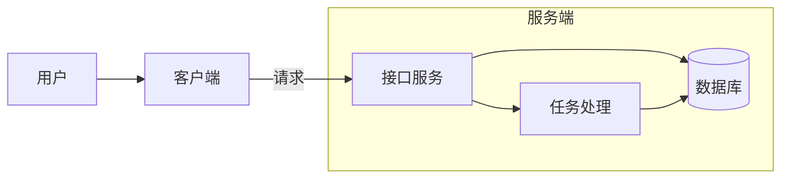
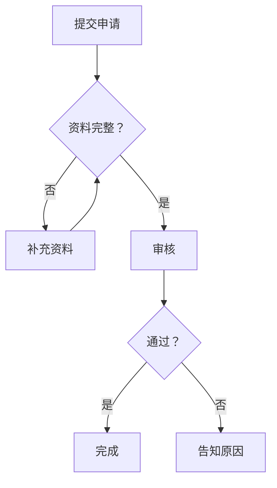
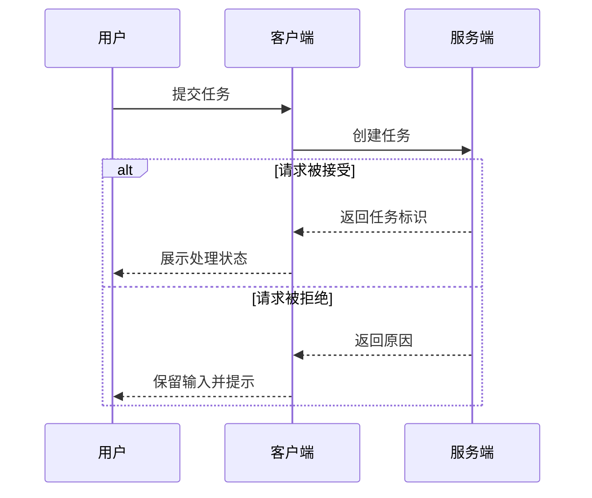

# Mermaid 图表

用结构清楚、可编辑的 Mermaid 图解释关系。FastVibe 会直接渲染回复和 Markdown 文件中的 `mermaid` 围栏，不需要安装工具或生成 HTML 页面。

## 工作方式

1. 先明确图要回答的问题，再从用户提供的信息、代码或文档中确认节点和关系。现有实现、目标方案和假设要标清，不能把推测画成事实。
2. 按关系选择图型。结构和分支用 `flowchart`，交互先后用 `sequenceDiagram`，生命周期用 `stateDiagram-v2`，数据库实体关系用 `erDiagram`，类结构用 `classDiagram`。系统架构默认用稳定的 `flowchart` + `subgraph` 表达边界。
3. 在回复里直接输出闭合的 `mermaid` Markdown 代码块，前后用简短文字解释重点。不要把围栏再包进外层代码块，否则用户看到的是源码而不是图。
4. 一张图只讲一个层次。复杂系统先给总览，再按需要拆成子图；省略不影响问题的实现细节，避免横向过宽、连线交叉和满屏文字。简单事实和一两步操作用文字即可。
5. 用户要求写入文档时，将图放进对应 Markdown 文件；要求单独的 Mermaid 源码时写 `.mmd`。修改既有图时保留仍然正确的语义和命名。

## 图型选择

| 要说明的内容 | 图型 | 重点 |
| --- | --- | --- |
| 系统架构、模块依赖、部署边界 | `flowchart LR` / `flowchart TB` + `subgraph` | 组件职责与连接方向 |
| 业务流程、条件分支、处理步骤 | `flowchart TD` | 分支条件与结束路径 |
| API 调用、跨进程通信、消息交互 | `sequenceDiagram` | 调用顺序、返回与异常分支 |
| 生命周期、任务状态、恢复过程 | `stateDiagram-v2` | 合法状态与转换条件 |
| 表结构、实体关系 | `erDiagram` | 实际基数与已确认的关系 |
| 类与接口的继承、组合 | `classDiagram` | 已确认的结构关系 |

用户指定图型时优先采用；所需图型不适合 Mermaid 时说明原因，并按用户需要选择其他方式。统计分析、精确比例的科研图、UI 原型和插画使用各自合适的工具。

## FastVibe 兼容规则

- 使用标准 Mermaid 语法，优先采用上表中成熟的图型；不要依赖新图型、图标包、外部资源或插件。
- 默认沿用应用主题，不添加 `%%{init: ...}%%`、自定义 CSS 或硬编码颜色；用户确实要求特殊样式时再考虑兼容的局部样式。
- 使用纯文本标签，不放 HTML、` `、脚本、`click` 回调或可点击链接。FastVibe 禁用 HTML 标签与交互回调，图表应靠文字和连线表达完整含义。
- 节点 ID 使用简短稳定的英文标识，显示标签用用户要求的语言。含空格、括号或特殊字符的 flowchart 标签用双引号包裹，例如 `api["接口服务（HTTP）"]`。避免把 `end` 等保留字直接作为 ID；标签需要双引号时可用 `#quot;`。
- 保持标签简短，细节放到图外；不要依赖 HTML 换行。超大图拆成多张，单块源码应明显小于 24,000 字符，否则 FastVibe 会保留源码而不渲染。
- 不要为普通聊天图安装 Mermaid CLI、启动服务、访问在线渲染站点或创建 HTML。直接输出代码块就能显示，也无需调用 `present`。
- 用户另行要求 SVG / PNG / PDF 等导出时，再检查可用导出工具并按相应格式交付；源码渲染能力不等于已生成导出文件。

## 示例

### 架构与模块边界

### 有分支的业务流程

### 调用顺序与失败路径

## 交付前检查

- 代码块已闭合，图型声明、引号、括号和 `subgraph` / `alt` 等结束标记成对。
- 每条箭头方向、分支条件、状态转换及实体基数符合信息来源；重要失败路径没有被省略。
- 图在当前层次能读懂，缩写已解释，事实、方案与假设可区分。
- 修改语法错误时先修最小出错位置，再检查整张图。环境已有 Mermaid 解析或预览工具时可用它验证；没有实际运行解析或渲染时，不声称已经验证通过，也不要为简单图临时安装依赖。
